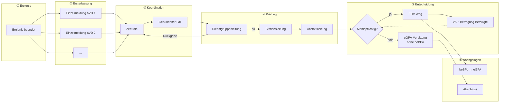
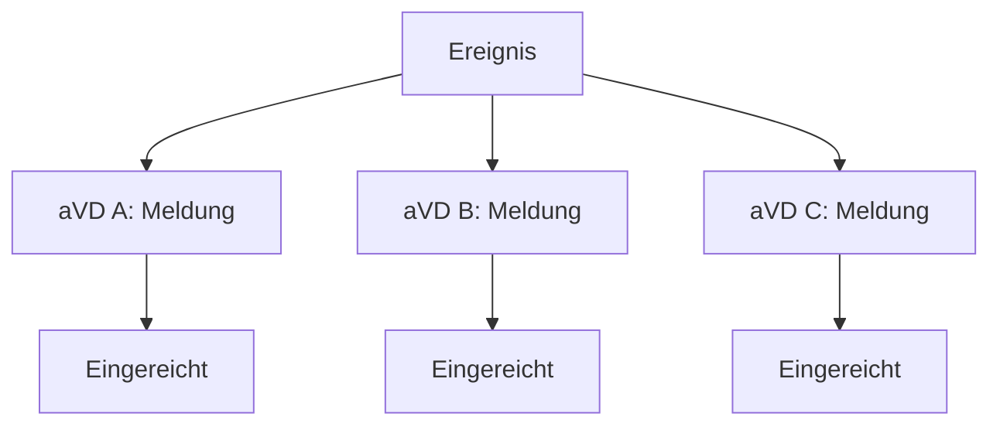
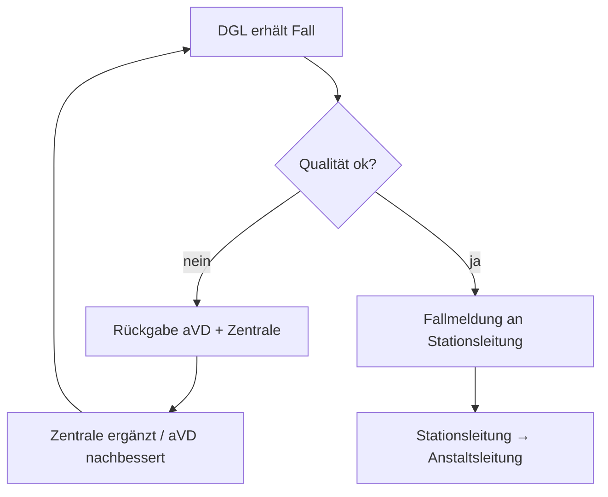
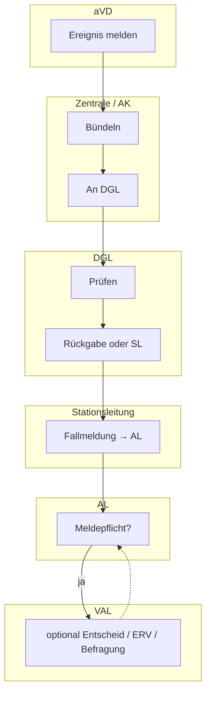

# Gesamtprozess eMeldewesen (A2)

**HEUREKA 2.0 · FHH Hamburg Justiz · Justizvollzug**  
**Version:** 2.0 | **Stand:** 2026-06-02  
**Status:** Soll-Prozess nach Praxisfeedback (Blocks A–P) + Grundsätze BZ JV; Prototyp Fall-Pfad umgesetzt

Dieses Dokument beschreibt den **überarbeiteten End-to-End-Meldeprozess** in Hamburger JVAs: Auslöser, Phasen, Rollen, Entscheidungen, Fristen und Nachgelagertes. Es ist die **fachliche Referenz** für Workshops, Lastenheft und Prototyp-Validierung.

**Ergänzende Dokumente**

| Dokument | Inhalt |
|----------|--------|
| [PROZESS_SOLL_UND_STAND.md](PROZESS_SOLL_UND_STAND.md) | Soll + **Prototyp-Umsetzung** + Backlog |
| [VALIDIERUNG_PROZESS.md](VALIDIERUNG_PROZESS.md) | **Validierungs-Matrix** — sicher / Vorentwurf / zu validieren |
| [Praxisfeedback.md](Praxisfeedback.md) | Roh-Feedback, Einzelblöcke A–H |
| [RUECKFRAGEN_UND_OFFENE_PUNKTE.md](RUECKFRAGEN_UND_OFFENE_PUNKTE.md) | Offene Punkte (OP-*), Chronik |
| [LASTENHEFT/10_PROZESSDIAGRAMM.md](LASTENHEFT/10_PROZESSDIAGRAMM.md) | ARIS-Abgleich (älterer Gesamtentwurf) |

---

## 1. Zweck und Abgrenzung

### 1.1 Zweck

Der Gesamtprozess regelt, wie **vollzugsbedeutsame Ereignisse** in JVAs **erfasst**, **gebündelt**, **geprüft**, **entschieden** und ggf. **extern gemeldet** (ERV) werden.

### 1.2 Abgrenzung

| Gehört **dazu** | Gehört **nicht** dazu |
|-----------------|----------------------|
| Meldungen durch **Bedienstete** (aVD ff.) | Gefangenenportal (A1) |
| Fall-Bündelung paralleler **Einzelmeldungen** — **⚠️ Annahme (OP-FB-01)** | **Basisbeobachtungen** JVP – **Dienstprotokoll aVD** am Schichtende (P1, Workshop-Validierung); **nicht** eMeldewesen |
| Interne Prüfkette Zentrale → DGL → AL | Echte AD-Anbindung, echtes beBPo/eGPA (Zielsystem) |
| ERV bei meldepflichtigem Vorfall | Eigene Polizeiermittlung durch JVA |

**Geltungsbereich (J1):** Der **gleiche Gesamtprozess** gilt für **alle Meldungstypen** (Strafanzeige, interner Vorfall, Gerichtsmeldung usw.).

---

## 2. Auslöser

| Element | Regel |
|---------|--------|
| **Auslöser** | Ein **vollzugsrelevantes Ereignis** ist **beendet** bzw. **aufgelöst** |
| **Meldepflicht** | **Unmittelbar** danach – **nicht** während laufender Akutintervention |
| **Frist Ersterfassung** | **24 Stunden** ab **Ereignisende** (Werktage, siehe Abschnitt 8) |
| **Wer meldet** | **Alle** am Ereignis **beteiligten** aVD – jeweils **eine eigene Meldung** |
| **Schwerwiegende Fälle** | **Telefonische Vorabmeldung** vor der schriftlichen Erfassung; **ggf.** wird die **Polizei** informiert → danach Phase ② (**OP-M-01** für Details) |

---

## 3. Prozess auf einen Blick

### Kernprinzip

> **Ein Vorfall** → **mehrere Einzelmeldungen** (Perspektiven) → **ein gebündelter Fall** → DGL → **Stationsleitung** → AL → **Entscheid Meldepflicht** durch **VAL oder AL** (K2).

---

## 4. Detaillierter Ablauf

### Phase ① – Ereignis

| Schritt | Akteur | Tätigkeit |
|---------|--------|-----------|
| 1.1 | aVD / Team | Ereignis wird wahrgenommen und ggf. unmittelbar eingedämmt |
| 1.2 | Leitung / aVD | Ereignis wird **aufgelöst** / beendet |
| 1.3 | Organisation | Beteiligte aVD können die Meldung **unmittelbar nach dem Ereignis** einreichen. Ob dafür eine **formale Freistellung** existiert (je JVA oder übergreifend), ist **unbekannt** → **OP-ORG-01** |
| 1.4 | aVD / Leitung | In **besonders schwerwiegenden** Fällen: **telefonische Vorabmeldung** vor der schriftlichen Erfassung; **ggf.** wird die **Polizei** informiert. Anschließend Phase ② (schriftliche Einzelmeldung). Details → **OP-M-01** |

**Ergebnis:** Auslöser für parallele Ersterfassung liegt vor (ggf. nach telefonischer Vorabmeldung).

---

### Phase ② – Parallele Ersterfassung (je aVD)

Jeder **beteiligte** aVD erstellt **eine Einzelmeldung** mit **eigener Ich-Perspektive** (eigenes Tun und eigene Wahrnehmung in **einem** Sachverhaltstext).

| Schritt | Inhalt | Pflicht / Regel |
|---------|--------|-----------------|
| 2.1 | **Meldungstyp** wählen (z. B. Strafanzeige, interner Vorfall) | je Anlass; gebündelter **Fall** hat **einen** Typ (L1) |
| 2.2 | **Beteiligte Gefangene** – **ein oder mehrere** am Ereignis; Meldung = **eigene** Handlungen + **eigene** Beobachtungen des/der aVD (L2) | Pflicht Bezug; ggf. `gefangeneId` + weitere Beteiligte |
| 2.3 | **Insassen** (Gefangene) auswählbar — **Filter nach Hafthaus** (alle Stationen des Hauses) | alle Meldungstypen; **sicher** (B5, E-03) |
| 2.4 | **Tatzeit, Tatort**, Sachverhalt | Pflicht |
| 2.5 | **W-Fragen** (Wer·Wann·Was·Wo·Wohin) – **müssen beantwortet** sein (L3); Textbausteine/Vorlage **optional**; Sachverhalt vor Einreichung bearbeitbar (C4) | Pflicht Antworten; Vorlage optional |
| 2.6 | **Sicherstellung** Ja/Nein – keine „Erhebung“ durch JVA | Pflicht Ja/Nein |
| 2.7 | **Keine Zeugen** — nur **Beteiligte** (inhaftierte am Ereignis). Bedienstete dokumentieren sich über **eigene Einzelmeldung** (Ich-Perspektive), nicht als Zeugenliste. **Polizei eingeschaltet:** Ja/Nein (M1) — kein Zeugenmodul | **sicher** (D1, Workshop 2026-06-17); Prototyp: **OP-Z-01** |
| 2.8 | **Einreichen** → Status **Eingereicht** | innerhalb 24 h |

**Ergebnis:** Eine oder mehrere **Einzelmeldungen** im Status *Eingereicht*, noch **ohne** Fall-Zuordnung.

**Parallelität:**

---

### Phase ③ – Fall-Bündelung (Zentrale)

> **⚠️ Annahme (nicht validiert):** Phase ③ ist **Vorentwurf** aus Praxisfeedback (Blocks F, P, D) – **Workshop-Validierung mit JVA-Bediensteten ausstehend** (**OP-FB-01**). Der Prototyp demonstriert diese Annahme; F1–F5 sind **Einzelantworten**, kein beschlossener Gesamtprozess.

| Schritt | Akteur | Tätigkeit |
|---------|--------|-----------|
| 3.1 | **Zentrale** (`arbeitskoordination`) | Eingegangene Einzelmeldungen zum **gleichen Vorfall** identifizieren (fachlich; Assistenz: Tatzeit/Tatort) |
| 3.2 | Zentrale | **Alle** beteiligten aVD-Meldungen zu **einem Fall** bündeln |
| 3.3 | Zentrale | Fall optional benennen (z. B. Ort + Datum) |
| 3.4 | Zentrale | Gebündelten Fall an **Dienstgruppenleitung** weiterleiten |

**Regeln**

- **Nur** die Zentrale darf bündeln (nicht SL, nicht VAL).
- **Vollständigkeit (J2):** In der Praxis melden **alle Beteiligten unmittelbar** nach dem Ereignis. Das System **blockiert nicht hart**, wenn beim Weiterleiten an DGL noch eine Meldung fehlt (**sicher**, Validierung 2026-06-17). Bei der **fachlichen Prüfung** (DGL) kann eine **fehlende Meldung angefordert** werden.
- **Keine** Auto-Bündelung durch das System – Entscheidung liegt bei der Zentrale.

**Fachobjekt „Fall“:** Container für n Einzelmeldungen mit gemeinsamem Status in der Prüfkette. **Ein Fall = ein Meldungstyp** (L1, **sicher** 2026-06-17) – alle gebündelten Einzelmeldungen gehören zum **gleichen Typ**.

---

### Phase ④ – Qualitätsprüfung (Dienstgruppenleitung)

| Schritt | Akteur | Tätigkeit |
|---------|--------|-----------|
| 4.1 | **DGL** | Gebündelten Fall sichten (alle Perspektiven) |
| 4.2 | DGL | **Fachliche Kriterien** je Meldung prüfen |
| 4.3 | DGL | **Inhaltliche Stimmigkeit** der Perspektiven prüfen |
| 4.4a | DGL | **Qualität ausreichend** → **Fallmeldung** an **Stationsleitung** (K1, K4) |
| 4.5 | **Stationsleitung** | Erhält gebündelten Fall von DGL; leitet an **Anstaltsleitung** weiter (K4) |
| 4.4b | DGL | **Qualität nicht ausreichend** → **Rückgabe** an **betroffene aVD** und **Zentrale** mit Begründung |
| 4.4c | DGL | **Fehlende** Beteiligten-Meldung → **anfordern** (Nachforderung, kein harter Systemstopp) | J2 |

**Regeln**

- Rückgabe **ohne Begrenzung** der Wiederholungen (F5) — **sicher** (Validierung 2026-06-17).
- **Nachbesserung (J3):** Betroffene **aVD bearbeiten ihre Einzelmeldung** (Inhalt), nicht nur die Zentrale.
- **DGL entscheidet nicht** über Meldepflicht (K3).
- Konkrete **Prüfcheckliste** noch zu erarbeiten (OP-DGL-01).
- **Rückgabe** an **betroffene aVD und Zentrale** (F4) — **sicher** (Validierung 2026-06-17); Prototyp: **OP-DGL-03**.
- Kette **DGL → Stationsleitung → AL/VAL** (K1, K4) — **zu validieren** (**OP-FB-01**, **OP-JVA-01**).

---

### Phase ⑤ – Entscheidung Meldepflicht (AL / optional VAL)

| Schritt | Akteur | Tätigkeit |
|---------|--------|-----------|
| 5.1 | **AL** (ggf. **VAL** einbezogen) | Gebündelten Fall prüfen (**keine** gesonderten Zusatzunterlagen nötig) |
| 5.2 | **AL oder VAL** | Entscheid **Meldepflichtig ja/nein** – **zu validieren** (K2, **OP-K-03**); **nicht** DGL (K3) |

| Entscheid | Bedeutung | Folge |
|-----------|-----------|--------|
| **Nein** | Vorfall **nicht** meldepflichtig (= **kein ERV**, G1 **sicher**) | **Kein beBPo**; **direkt eGPA-Veraktung** auf Fall-Ebene (O1); **interner Abschluss** **AL oder ggf. VAL** — **zu validieren** (**OP-ABS-01**) |
| **Ja** | Vorfall **meldepflichtig** = **ERV-pflichtig** (G1) | **ERV-Weg** Phase ⑥; **ggf. eine Person** (AL **oder** VAL) ausreichend — **zu validieren** (**OP-ERV-03**) |

**Frist:** Meldepflichtiges Ereignis soll **24 h nach Feststellung** extern gemeldet sein (Werktage, WE-Sammellogik).

---

### Phase ⑥ – Nachgelagerte Schritte

> **⚠️ eGPA noch nicht ausgerollt:** Zielkette **versandfähig → beBPo → eGPA** ist **zu validieren**; **übergangsweise** andere Form der **Veraktung** nötig → **OP-EGPA-01**.

#### 6.0 Abschluss bei „nicht meldepflichtig“ (O1)

| Schritt | Akteur | Tätigkeit |
|---------|--------|-----------|
| 6.0.1 | **AL oder ggf. VAL** | Interner Abschluss des Falls — **zu validieren** (**OP-ABS-01**) |
| 6.0.2 | AL / VAL | **Veraktung** auf **Fall-Ebene** – **ohne** beBPo; Ziel **eGPA**, **übergangsweise** Alternative → **OP-EGPA-01** |

#### 6.1 ERV-Weg bei „meldepflichtig ja“ (Anstaltsleitung + VAL)

| Schritt | Akteur | Tätigkeit |
|---------|--------|-----------|
| 6.1.1 | AL / VAL | Fachliche Bearbeitung des **gebündelten Falls** — **zu validieren** (**OP-ERV-03**) |
| 6.1.2 | **AL oder VAL** | Status **„versandfähig“** setzen (O2) |
| 6.1.3 | AL / VAL | **beBPo**-Versand (xJustiz) auf **Fall-Ebene** (J5) – **nach** versandfähig |
| 6.1.4 | AL / VAL | **Veraktung** nach beBPo — Ziel **eGPA**; **übergangsweise** Alternative → **OP-EGPA-01** |
| 6.1.5 | **AL oder VAL** | Abschluss / Archivierung mit **Vier-Augen** — **zu validieren** (**OP-V-04**) |

#### 6.2 Befragung inhaftierter Beteiligter (VAL)

| Aspekt | Regel |
|--------|--------|
| **Wer** | **VAL** – eigenständig, nicht Zentrale/DGL |
| **Wann** | **Nach** Entscheid „meldepflichtig ja“ — **sicher** (D3, Validierung 2026-06-17) |
| **Was** | **Befragung** der inhaftierten **Beteiligten** – **kein** Zeugenprozess |
| **Dokumentation** | Zuerst **Anordnung**, **Ergebnis** im Nachgang – **am gebündelten Fall** (O4), nicht je Einzelmeldung |

---

## 5. Rollenübersicht (Swimlane)

| Rolle | Kanonischer Code | Hauptaufgaben im Gesamtprozess |
|-------|------------------|--------------------------------|
| Allgemeiner Vollzugsdienst | `avd` | Einzelmeldung, Sicherstellung, Beteiligte (keine Zeugenliste) |
| Zentrale | `arbeitskoordination` | **Bündelung**, Koordination, Weiterleitung DGL |
| Dienstgruppenleitung | `dienstgruppenleitung` | **Qualitätsprüfung**; Weiterleitung **an SL** (K4); **keine** Meldepflicht-Entscheid (K3) |
| Anstaltsleitung | `anstaltsleitung` | **Meldepflicht-Entscheid** (K2, **zu validieren**); interner Abschluss bei „nein“ (**OP-ABS-01**) |
| Vollzugsabteilungsleitung | `val` | **Optional** Meldepflicht-Entscheid (K2, **zu validieren**); ERV (**OP-ERV-03**); Befragung Beteiligte |
| Stationsleitung | `stationsleitung` | **Erhält Fallmeldung von DGL** (K1); **leitet an AL** weiter (K4) – **nicht** Bündelung/DGL |
| Kammer | `kammer` | Sicherstellung nur wenn **betroffen** |

---

## 6. Fachobjekte und Status

### 6.1 Einzelmeldung

| Attribut | Beschreibung |
|----------|--------------|
| `meldungsNr` | z. B. MEL-012 |
| `status` | Entwurf → Eingereicht → … (siehe unten) |
| `gefangeneId` | **Ein** Hauptbeteiligter |
| `fallId` | Zuordnung zum gebündelten Fall (nach Bündelung) |
| `zustaendig` | Erfassende/r aVD |

**Status Einzelmeldung (vereinfacht)**

| Status | Phase |
|--------|--------|
| `DRAFT` | Ersterfassung läuft |
| `SUBMITTED` | Eingereicht, wartet auf Bündelung |
| `FORWARDED` | Im Fall, bei DGL / in Prüfkette |
| `IN_PROGRESS` | Bearbeitung (z. B. nach AL „meldepflichtig“) |
| `ARCHIVED` | Abgeschlossen |

### 6.2 Gebündelter Fall

| Attribut | Beschreibung |
|----------|--------------|
| `fallNr` | z. B. FALL-001 |
| `meldungsTyp` | **Ein** Typ für den gesamten Fall (L1) |
| `meldungen[]` | Alle Einzelmeldungen zum Vorfall (gleicher Typ) |
| `status` | Position in Prüfkette (siehe unten) |
| `meldepflichtig` | Entscheid VAL oder AL (ja/nein) |

**Status Fall**

| Status | Bedeutung |
|--------|-----------|
| `SAMMELN` | Zentrale bündelt / bearbeitet |
| `ZUR_DGL` | Bei Dienstgruppenleitung |
| `ZURUECK_AK` | DGL-Rückgabe an Zentrale |
| `ZUR_SL` | Bei Stationsleitung (Fallmeldung von DGL, K1/K4) |
| `ZUR_AL` | Zur Meldepflicht-Entscheid durch AL/VAL |
| `EGPA_INTERN` | Nicht meldepflichtig – eGPA am Fall (ohne beBPo) |
| `ERV_WEG` | Meldepflichtig – versandfähig → beBPo → eGPA |
| `ABGESCHLOSSEN_INTERN` | Fall vollständig abgeschlossen |

---

## 7. Teilprozesse in der Ersterfassung

### 7.1 Beteiligte (kein Zeugenkonzept)

| Thema | Regel |
|-------|--------|
| **Grundsatz** | Im Meldewesen gibt es **keine Zeugen** — nur **Beteiligte** (inhaftierte am Ereignis) |
| Inhaftierte | **Beteiligte** (`gefangeneId`, ggf. weitere Beteiligte); **nie** Zeugen |
| Bedienstete | Am Ereignis beteiligte aVD erfassen **eigene Einzelmeldung** (Phase ②) — **keine** Zeugenliste anderer Bediensteter |
| Externe / Polizei | **Polizei** nimmt ggf. externe Zeugenaussagen auf; in der Meldung: **Ja/Nein Polizei eingeschaltet** (M1) — **kein** Zeugenfeld |
| VAL-Befragung | Inhaftierte **Beteiligte** durch **VAL** nach AL-Entscheid — **kein** Zeugenprozess (O4) |

> **Hinweis:** Frühere Annahme „Zeugen Bedienstete, 5 WT“ (H5) ist durch **kein Zeugenkonzept** obsolet → **OP-Z-01**, ggf. H5 in Workshop streichen.

### 7.2 Beweismittel / Sicherstellung

| Thema | Regel |
|-------|--------|
| Grundsatz | JVA **sichert**, **erhebt nicht** |
| Pflicht | Ja/Nein bei **jeder** Meldung |
| Physisch | **aVD**; Kammer nur in **bestimmten Fällen** (M2 → Workshop, OP-BM-01) |
| Kammer informieren | **Wie** (System vs. außerhalb) → Workshop (M3, OP-BM-02) |
| Polizei eingeschaltet | **Ja/Nein** in der Meldung (M1) |
| Übergabe Polizei | **Hinweis** in Meldung genügt (E5), wenn übergeben |
| Anlagen | **Keine** Foto-Pflicht; Nachreichung in **5 Werktagen** möglich |

### 7.3 Text und W-Fragen

- **Ein** Fragenkatalog (nicht getrennt Tun/Beobachtung).
- Ziel: **Schilderung aus Sicht des/der Meldenden** – **eigene** Handlungen und **eigene** Beobachtungen (L2).
- **W-Fragen müssen beantwortet sein** (L3) – Vorentwurf Pflicht: **Wer · Wann · Was · Wo · Wohin** (noch fachlich prüfen, C1 / OP-W-01).
- **Vollständiger W-Katalog** laut Bildungszentrum Justizvollzug (BZ JV): **Wer · Was · Wann · Wo · Wie · Warum · Wohin** (siehe Abschnitt 7.4).
- **Textbausteine / generierte Vorlage:** **optional** (L3) – Antworten können auch direkt in den Sachverhalt fließen.
- **Pflege/Freigabe Textbausteine:** **offener Punkt** (L4 → OP-W-02).

### 7.4 Grundsätze für die Abfassung von Meldungen

*Quelle: Bildungszentrum Justizvollzug Hamburg (Schulungsunterlage, übernommen in `docs/20260610_HEUREA_WABE.docx`); fachliche Referenz für Qualitätskriterien in Phase ② und DGL-Prüfung (F3).*

| Nr | Grundsatz | Bedeutung für eMeldewesen |
|----|-----------|---------------------------|
| GZ-A1 | **Nur überprüfbare, belegbare Tatsachen** | Sachverhalt ohne Spekulation; belegbare Angaben (Zeit, Ort, Personen, beobachtetes Verhalten). |
| GZ-A2 | **Frei von jeglicher Wertung** | Keine subjektiven Urteile; sachliche Beschreibung (Abgrenzung zu Emotionen → GZ-B3). |
| GZ-A3 | **Genau und klar für Nicht-Augenzeugen** | Ablauf und Beteiligung so darstellen, dass Dritte den Vorgang **vollständig nachvollziehen** können. |
| GZ-A4 | **W-Fragen beantworten** | Meldung erfüllt ihren Zweck nur, wenn **Wer · Was · Wann · Wo · Wie · Warum · Wohin** beantwortet sind (System: Pflicht-Teilmenge → OP-W-01). |
| GZ-A5 | **Chronologische Reihenfolge** | Geschehnisse in **zeitlicher Abfolge** niederschreiben (Ich-Perspektive, L2). |

### 7.5 Grundsätze zur Abgabe von Meldungen

*Quelle: BZ JV, Schulungsfolie „Zeitpunkt und Fristen zur Abgabe von Meldungen“ (ebenda). Ergänzt die SLA-Tabelle in Abschnitt 8.*

| Nr | Grundsatz | Bezug Prozess / SLA |
|----|-----------|---------------------|
| GZ-B1 | Schriftliche Meldung **so schnell wie möglich** abliefern | Entspricht **24-h-Ersterfassung** (H1) und unmittelbarer Meldepflicht nach Ereignisende (B1). |
| GZ-B2 | Bei **großer Eilbedürftigkeit** geht eine **mündliche Meldung** der schriftlichen voraus | Prozessregel; im Prototyp noch **nicht** als eigener Schritt modelliert (→ OP-M-01). |
| GZ-B3 | Nach eigenem Beteiligungserlebnis **vertretbare Zeit** abwarten, um **objektiv und emotionsfrei** zu schreiben | Qualitätsgrundsatz; Abgrenzung zu GZ-A2; keine pauschale Verzögerung der 24-h-Frist. |
| GZ-B4 | Nach Fertigstellung **Gegenlesen** durch Vertrauensperson (**ohne inhaltliche Korrektur**); danach Abgabe über **Dienstweg** | Qualität vor Einreichung; passt zu **Bearbeitung vor Einreichung** (C4). |
| GZ-B5 | Im **Kriseninterventionsfall** (Gesundheit / seelische Verfassung) Meldung **nachreichen** möglich | Passt zu **Nachreichung 5 Werktage** (H6); Ausnahme von GZ-B1 im Einzelfall. |

---

## 8. Fristen

### 8.1 Operative Fristen (SLA)

| Frist | Dauer | Anmerkung |
|-------|-------|-----------|
| Ersterfassung nach Ereignis | **24 h** | Ab **Ereignisende** (H1, N2) |
| Externe Meldung (meldepflichtig) | **24 h** | Ab **Ereignisende** – **nicht** ab AL-Entscheid (N2); **Werktage** (H2) |
| Wochenende / Feiertage | Sammeln bis **Montag 08:00** | Kein laufender Werktagszähler über WE (N1, H2–H3) |
| Eskalation bei Fristüberschreitung | **Erststufe: SL** (N3) | **Eskalationsschleife** (weitere Stufen) → Workshop (**OP-H-03**) |
| Zeugenaussage Bedienstete | **5 Werktage** | |
| Nachreichung (Ergänzung) | **5 Werktage** | Nach Rückgabe |
| Dringend-Kennzeichen | **Entfällt** | Nicht vorgesehen (H7); Eilbedürftigkeit → **mündliche Vorabmeldung** (GZ-B2) |

### 8.2 Abgabe-Grundsätze (fachlich)

Siehe Abschnitt **7.5** (GZ-B1–B5). Die SLA-Tabelle oben konkretisiert **GZ-B1**; **GZ-B2** (mündlich vor schriftlich) und **GZ-B3** (Emotionsabstand) sind ergänzende Qualitäts- bzw. Verhaltensregeln ohne eigenen System-Timer.

---

## 9. Entscheidungsübersicht

| # | Entscheidung | Entscheider | Optionen |
|---|--------------|-------------|----------|
| E1 | Gleicher Vorfall? | Zentrale (fachlich) | Bündeln / nicht bündeln |
| E2 | Fall vollständig? | Zentrale / DGL (fachlich) | Weiter an DGL (ohne Hartblock) / fehlende Meldung **anfordern** (J2) |
| E3 | Qualität ausreichend? | DGL | SL / Rückgabe |
| E3b | Fall an AL? | Stationsleitung | Weiterleitung AL |
| E4 | Meldepflichtig? | **AL oder VAL** (K2) | Ja (ERV) / Nein (intern) |
| E5 | ERV durchführen? | AL + VAL | **Ja:** versandfähig (O2) → beBPo → eGPA → Vier-Augen (O3); **Nein:** nur eGPA (O1) – **Fall-Ebene** (J5) |
| E6 | **Befragung inhaftierter Beteiligter** dokumentieren? | VAL | Anordnung + Ergebnis **am Fall** (O4); **kein** Zeugenprozess |

---

## 10. Offene Klärungspunkte

### Zurückgestellt (bewusst)

- Pflege **Textbausteine** (L4 / C3 → OP-W-02)
- **Kammer** bei Sicherstellung – welche Fälle? (M2 → OP-BM-01, Workshop)
- **Kammer-Benachrichtigung** – im System oder außerhalb? (M3 → OP-BM-02, Workshop)
- ~~**ERV-Kette** Versandfähig, Vier-Augen, Reihenfolge~~ → **O1–O4** geklärt; Prototyp-Umsetzung **OP-V-02**
- **Basisbeobachtungen** JVP – Vorentwurf **Dienstprotokoll aVD** (P1); **Workshop-Validierung** (OP-JVP-01)
- **JVA-Abweichungen** Rollenkette (P2 → Workshop, OP-JVA-01)
- **Vollständigkeit Prozess** – fehlende Schritte/Rollen (P3 → Workshop, OP-P-01)

### In Klärung / Prototyp-Backlog

- **DGL: fehlende Meldung anfordern** (J2) – kein UI/Workflow
- **aVD bearbeitet Einzelmeldung** bei Rückgabe (J3) – OP-DGL-03
- **DGL-Checkliste** (konkrete Kriterien) – Grundsätze GZ-A1–A5 als Prüfmaßstab
- **Mündliche Vorabmeldung** bei Eilbedürftigkeit (GZ-B2 → OP-M-01)
- **W-Fragen-Assistent** Pflicht (L3) – OP-W-01
- **Polizei Ja/Nein** Feld im Formular (M1)
- **VAL-Befragungs-Workflow** am Fall (O4 → OP-V-02 Rest)
- SLA **Werktage/Wochenende** im System (Montag **08:00**, N1)
- **Eskalationsschleife** nach SL (OP-H-03, Workshop)
- **Mehrere beteiligte Gefangene** je Meldung (L2) – Datenmodell `beteiligte[]`

Vollständige Liste: [RUECKFRAGEN_UND_OFFENE_PUNKTE.md](RUECKFRAGEN_UND_OFFENE_PUNKTE.md)

---

## 11. Abgrenzung zum früheren Einzelmeldungs-Pfad

| Früher (vereinfachter Workshop-Pfad) | Überarbeiteter Gesamtprozess |
|--------------------------------------|------------------------------|
| 1 Meldung → direkt VAL | n Meldungen → 1 Fall |
| VAL als erste Prüfinstanz | **DGL** prüft gebündelt |
| Meldepflicht unklar / pro Meldung | **AL** auf **Fall-Ebene** |
| Keine Zentrale im Kernfluss | **Zentrale** als Bündlerin zwingend |

---

## 12. Chronik

| Datum | Version | Änderung |
|-------|---------|----------|
| 2026-06-02 | 2.0 | Prototyp Fall-Pfad: DGL→SL→AL/VAL, ERV am Fall; Status `ZUR_SL`, `EGPA_INTERN`; PROZESS_SOLL_UND_STAND v2.0 |
| 2026-06-02 | 1.9 | Block P: Basisbeobachtungen = Dienstprotokoll aVD (Workshop); JVA-Abweichungen + Prozesslücken → Workshop |
| 2026-06-02 | 1.8 | Block O2–O4: versandfähig (AL+VAL); Vier-Augen beide; VAL-Befragung Ergebnis am Fall |
| 2026-06-02 | 1.7 | Block O1: nicht meldepflichtig → kein beBPo, direkt eGPA; meldepflichtig ja → beBPo vor eGPA |
| 2026-06-02 | 1.6 | Block N: Montag 08:00 (N1); externe 24 h ab Ereignisende (N2); Eskalation Erststufe SL (N3); Eskalationsschleife → Workshop (OP-H-03) |
| 2026-06-02 | 1.5 | Block M: Polizei Ja/Nein (M1); Kammer-Fälle und Kammer-Kanal → Workshop (M2, M3) |
| 2026-06-02 | 1.4 | Grundsätze Abfassung (GZ-A1–A5) und Abgabe (GZ-B1–B5) aus BZ JV / HEUREKA-WABE-Dokument |
| 2026-06-11 | 1.3 | Block L: Fall ein Typ; aVD Ich-Perspektive; mehrere Gefangene möglich; W-Fragen Pflicht; Textbausteine optional |
| 2026-06-11 | 1.2 | Block K: SL erhält Fall von DGL; DGL→SL→AL; VAL optional Entscheid mit AL; DGL nie Meldepflicht |
| 2026-06-11 | 1.1 | Block J: alle Typen gleich; Vollständigkeit ohne Hartblock; aVD bearbeitet bei Rückgabe; Abschluss nur AL; ERV Fall-Ebene |
| 2026-06-11 | 1.0 | Erstfassung Gesamtprozess nach Praxisfeedback A–H und Fall-Bündelung |
