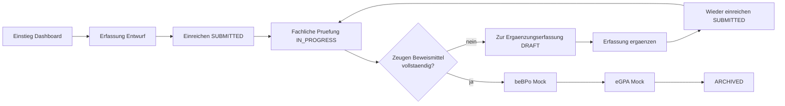
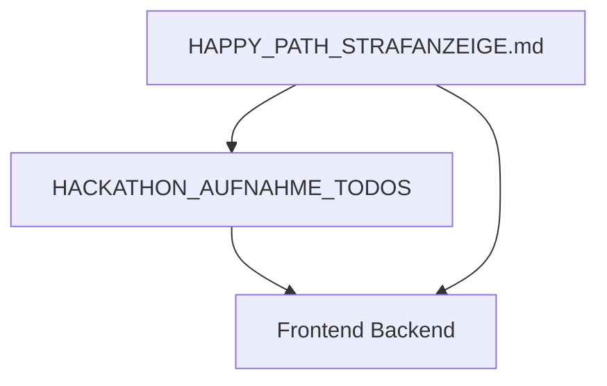

# Happy Path – Strafanzeige (klick für klick)

**Version:** 0.4 | **Stand:** 2026-05-22  
**Zweck:** Leitfaden für **Workshop, Demo und Prototyp-Überarbeitung** – ein durchgängiger **Soll-Pfad** mit Abgleich zum **aktuellen UI (IST)** und **vollständiger Verknüpfung** zu [HACKATHON_A2_AUFNAHME_TODOS.md](HACKATHON_A2_AUFNAHME_TODOS.md) (Abschnitt 7).

**Meldungstyp:** `STRAFANZEIGE` (ERV-pflichtig)  
**Nicht Teil dieses Pfads:** geführte Demo [`/meldungen/demo/strafanzeige`](../frontend/src/App.jsx) → optional, bekannte UX-Probleme [H-P10](HACKATHON_A2_AUFNAHME_TODOS.md), [H-P11](HACKATHON_A2_AUFNAHME_TODOS.md)

---

## 1 Einordnung

| Dokument | Nutzen |
|----------|--------|
| **Diese Datei** | Ein **Happy Path** End-to-End: was klicken, in welcher Rolle, welches Ergebnis |
| [LASTENHEFT/11_PROTOTYP_KLICKPFAD_ERFASSUNG.md](LASTENHEFT/11_PROTOTYP_KLICKPFAD_ERFASSUNG.md) | Technische Referenz (alle Routen, API, Rollenmatrix) |
| [HACKATHON_A2_AUFNAHME_TODOS.md](HACKATHON_A2_AUFNAHME_TODOS.md) | Änderungs-Backlog (H-P*, H-A*) |
| [LASTENHEFT/04_MELDUNGSTYP_STRAFANZEIGE.md](LASTENHEFT/04_MELDUNGSTYP_STRAFANZEIGE.md) | Fachliche Anforderungen Strafanzeige |
| [LASTENHEFT/02_QUERSCHNITT_ROLLEN_STATUS.md](LASTENHEFT/02_QUERSCHNITT_ROLLEN_STATUS.md) | Status und Rechte |
| [LASTENHEFT/03_QUERSCHNITT_SLA_UI.md](LASTENHEFT/03_QUERSCHNITT_SLA_UI.md) | SLA nach Einreichung |

### Referenzrollen (Prototyp-Banner)

| Phase | Rollencode | Demo-Nutzer | JVA |
|-------|------------|-------------|-----|
| Erfassung, Einreichung | `avd` | P. Guerrero (`BD-AVD-1`) | JVA Billwerder |
| Fachliche Prüfung, beBPo, eGPA, Archiv | `val` | M. Petric (`BD-VAL-1`) | JVA Billwerder |

Rollenwechsel: gelbes **Prototyp-Banner** oben (kein Login) → Header `X-Mock-Rolle`, `X-Mock-JVA`, …

### Begriffe Soll vs. IST

| Soll (fachlich) | Status-Code | IST UI (Prototyp) |
|-----------------|-------------|-------------------|
| Erfassung läuft | `DRAFT` | Entwurf |
| Ergänzungserfassung (Rückgabe VAL/AL) | `DRAFT` | Entwurf (Nachreichung Zeugen/Beweismittel) |
| Meldung eingegangen | `SUBMITTED` | Eingereicht |
| **Fachliche Prüfung** | `IN_PROGRESS` | **In Bearbeitung** (missverständlich) |
| Intern weitergegeben | `FORWARDED` | Weitergeleitet (nicht in diesem Happy Path) |
| Abgeschlossen | `ARCHIVED` | Archiviert |

---

## 2 Soll-Ablauf (Übersicht)

**Reihenfolge ERV (Lastenheft):** zuerst **beBPo/xJustiz**, dann **eGPA-Veraktung**, dann **Archiv** (Vier-Augen VAL ↔ AL).

**24-h-SLA:** bedeutet **Bearbeitung aufnehmen** (`IN_PROGRESS`), **nicht** vollständige Zeugen- und Beweismittel-Erfassung. Sind Zeugen/Beweismittel **nicht rechtzeitig** vollständig, gibt **VAL/AL** die Meldung zur **Ergänzungserfassung** zurück (A2-F-QS-004, HP-26b–e) – **umgesetzt**, siehe [UMSETZUNG_BEWEISMITTEL_NACHREICHUNG.md](UMSETZUNG_BEWEISMITTEL_NACHREICHUNG.md).

---

## 3 Soll-Reihenfolge Formularfelder (Strafanzeige)

Reihenfolge in [`MeldungForm.jsx`](../frontend/src/components/meldung/MeldungForm.jsx) ([H-P22](HACKATHON_A2_AUFNAHME_TODOS.md), [H-P23](HACKATHON_A2_AUFNAHME_TODOS.md), [H-P53](HACKATHON_A2_AUFNAHME_TODOS.md) – siehe Status Spalte Hackathon):

| Nr | Feld / Aktion | Pflicht bei Einreichung | Hackathon |
|----|---------------|-------------------------|-----------|
| F1 | Meldungstyp **Strafanzeige** | ja | – |
| F2 | **Tatvorwurf** (BTM / aoV / Diebstahl) – **direkt nach Typwahl** | ja | [H-P22](HACKATHON_A2_AUFNAHME_TODOS.md) `[x]` |
| F3 | **Gefangene/r** (Autocomplete, Dummy-Stammdaten PostgreSQL) | ja | [H-A10](HACKATHON_A2_AUFNAHME_TODOS.md), [H-A11](HACKATHON_A2_AUFNAHME_TODOS.md) `[x]`; Feintuning [H-P25](HACKATHON_A2_AUFNAHME_TODOS.md) |
| F4 | **Tatzeit**, **Tatort** – direkt nach Gefangene/r | ja | Tatzeit [H-P20](HACKATHON_A2_AUFNAHME_TODOS.md) `[x]`; Tatort [H-P21](HACKATHON_A2_AUFNAHME_TODOS.md) `[x]` |
| F5 | **Sachverhalt** | ja | – |
| F6 | **Beweismittel** Ja/Nein; bei Ja Kurztext | ja | – |
| F7 | **Beweismittel-Dateien** (Formate aufgelistet, Kurzbeschreibung je Datei) | optional, Beschreibung Pflicht wenn Datei | [H-P23](HACKATHON_A2_AUFNAHME_TODOS.md), [H-A02](HACKATHON_A2_AUFNAHME_TODOS.md) `[x]` |
| F8 | **Zeugen** (nach Beweismittel-Upload; optional wenn keine Zeugen) | optional | [H-P51](HACKATHON_A2_AUFNAHME_TODOS.md), [H-P52](HACKATHON_A2_AUFNAHME_TODOS.md) |
| F9 | **Als dringend markieren** | optional | [H-P24](HACKATHON_A2_AUFNAHME_TODOS.md), [H-P50](HACKATHON_A2_AUFNAHME_TODOS.md) |
| F10 | **Einreichen** → Dialog „Was passiert als Nächstes?“ | – | [H-P53](HACKATHON_A2_AUFNAHME_TODOS.md) `[x]`, [H-P33](HACKATHON_A2_AUFNAHME_TODOS.md) |
| F11 | **Als Entwurf speichern** oder **Einreichen** (mit Bestätigungsdialog) | – | [H-P26](HACKATHON_A2_AUFNAHME_TODOS.md) `[x]` |

**Kein Formularfeld Empfänger (Strafanzeige):** Bei **Einreichung** wird die Meldung automatisch der **fachlichen Prüfung** (Vollzugsabteilungsleitung / VAL) zugeordnet – nicht der Staatsanwaltschaft. Externer Versand (Staatsanwaltschaft) erfolgt erst nach Prüfung über beBPo ([H-P27](HACKATHON_A2_AUFNAHME_TODOS.md) `[x]`).

---

## 4 Klick für Klick (Haupttabelle)

**Legende Abweichung:** Verweis auf [HACKATHON_A2_AUFNAHME_TODOS.md](HACKATHON_A2_AUFNAHME_TODOS.md) (H-P = Protokoll, H-A = Backlog).

### Phase: Einstieg

| Nr | Phase | Rolle | Route | Soll: Aktion / Eingabe | UI heute (IST) | Ergebnis | API | Abweichung / To-do |
|----|-------|-------|-------|------------------------|----------------|----------|-----|-------------------|
| HP-01 | Einstieg | beliebig | `/dashboard` | App öffnen; Rolle im Banner prüfen | Willkommen, Rolle, JVA | Dashboard mit Kennzahlen | `GET /api/meldungen` (Stats) | [H-P01](HACKATHON_A2_AUFNAHME_TODOS.md)–[H-P03](HACKATHON_A2_AUFNAHME_TODOS.md) KPI/Filter |
| HP-02 | Einstieg | `avd` | `/dashboard` | Im Banner **P. Guerrero** (aVD) wählen | wie Soll | Mock-Header gesetzt | – | – |
| HP-03 | Einstieg | `avd` | `/dashboard` | Kachel **eMeldewesen** anklicken | Fachverfahren-Kachel | Navigation `/meldungen` | – | – |
| HP-04 | Einstieg | `avd` | `/meldungen` | Liste prüfen; Filter/KPIs optional testen | Button „+ Neue Meldung“; KPI-Links | Route `/meldungen/neu` | `GET /api/meldungen` | [H-P01](HACKATHON_A2_AUFNAHME_TODOS.md)–[H-P04](HACKATHON_A2_AUFNAHME_TODOS.md), [H-A20](HACKATHON_A2_AUFNAHME_TODOS.md) |
| HP-05 | Einstieg | `avd` | `/meldungen/neu` | **Nicht** „Demo Strafanzeige“ (Workshop-Kachel) nutzen | Link Workshop auf Dashboard | Formular neue Meldung | – | [H-P10](HACKATHON_A2_AUFNAHME_TODOS.md), [H-P11](HACKATHON_A2_AUFNAHME_TODOS.md) |

### Phase: Erfassung (Entwurf)

| Nr | Phase | Rolle | Route | Soll: Aktion / Eingabe | UI heute (IST) | Ergebnis | API | Abweichung / To-do |
|----|-------|-------|-------|------------------------|----------------|----------|-----|-------------------|
| HP-06 | Erfassung | `avd` | `/meldungen/neu` | Meldungstyp **Strafanzeige** wählen | Radio; ERV-Hinweis | `ervRelevant: true` | – | – |
| HP-07 | Erfassung | `avd` | Formular | **Tatvorwurf** wählen (z. B. BTM) – **sofort unter Typ** | Dropdown direkt nach Strafanzeige | `metadaten.tatvorwurf` | – | [H-P22](HACKATHON_A2_AUFNAHME_TODOS.md) `[x]` |
| HP-08 | Erfassung | `avd` | Formular | **Gefangene/r:** aus Stammdaten-Liste wählen (Fokus oder Suche) | Autocomplete; Dummy-DB JVA | `gefangeneId` gesetzt | `GET /api/gefangene?list=1` / `search=` | [H-P25](HACKATHON_A2_AUFNAHME_TODOS.md) |
| HP-09 | Erfassung | `avd` | Formular | **Tatzeit** und **Tatort** direkt unter Gefangene/r | `TatzeitEingabe` (Datum/Uhrzeit-Panel), `TatortAutocomplete` | `metadaten.tatzeit`, `tatort` | – | Tatzeit [H-P20](HACKATHON_A2_AUFNAHME_TODOS.md) `[x]`; Tatort [H-P21](HACKATHON_A2_AUFNAHME_TODOS.md) `[x]` |
| HP-10 | Erfassung | `avd` | Formular | **Sachverhalt** ausfüllen | Textarea | Text gespeichert | – | – |
| HP-11 | Erfassung | `avd` | Formular | **Beweismittel gesichert?** Ja/Nein (+ Kurztext bei Ja) | Radio + Textarea | `beweismittelGesichert`, `beweismittelAngaben` | – | – |
| HP-12 | Erfassung | `avd` | Formular | Optional: **Dateien** mit **Kurzbeschreibung** je Datei; erlaubte Formate sichtbar | `BeweismittelDateiUpload` | `Anhang.beschreibung` | `POST …/anhaenge` | [H-P23](HACKATHON_A2_AUFNAHME_TODOS.md), [H-A02](HACKATHON_A2_AUFNAHME_TODOS.md) `[x]` |
| HP-13 | Erfassung | `avd` | Formular | **Zeugen** erfassen (nach Datei-Upload) | `ZeugenEditor` | `metadaten.zeugen[]` | – | [H-P51](HACKATHON_A2_AUFNAHME_TODOS.md), [H-P52](HACKATHON_A2_AUFNAHME_TODOS.md); G.7 positiv |
| HP-14 | Erfassung | `avd` | Formular | Optional **Dringend** | Checkbox | `prioritaet: 1` | – | [H-P24](HACKATHON_A2_AUFNAHME_TODOS.md), [H-P50](HACKATHON_A2_AUFNAHME_TODOS.md) |
| HP-15 | Erfassung | `avd` | Formular | **Einreichen** klicken → Bestätigungsdialog lesen → **Jetzt einreichen** | `EinreichungFolgeaktionenDialog` (Hinweis fachliche Prüfung/VAL) | Vorschau Folgeprozess | – | [H-P53](HACKATHON_A2_AUFNAHME_TODOS.md) `[x]` |
| HP-16 | Erfassung | `avd` | Formular | Nach Bestätigung: **Eingereicht**; Zuständigkeit **fachliche Prüfung** (VAL), kein Empfänger-Feld | Feld Empfänger entfernt; `empfaenger`/`empfaengerTyp` automatisch (interne Leitung) | `SUBMITTED` + `zeugenFolgeaktionen` | `POST`/`PATCH` Status | [H-P27](HACKATHON_A2_AUFNAHME_TODOS.md) `[x]`, [H-P26](HACKATHON_A2_AUFNAHME_TODOS.md) `[x]`, [H-P33](HACKATHON_A2_AUFNAHME_TODOS.md) |
| HP-16a | Erfassung | `avd` | Formular | Optional: **Als Entwurf speichern** (ohne Dialog) | Button „Als Entwurf speichern“ | Status `DRAFT` | `POST` `alsEntwurf: true` | – |

### Phase: Einreichung (Detail)
| HP-19 | Einreichung | `avd` | `/meldungen/:id` | Detail: **Prozesslandkarte** – Schritt „Eingereicht“ aktiv | Landkarte: Entwurf → Eingereicht → Bearbeitung → … | Anzeige | – | [H-P30](HACKATHON_A2_AUFNAHME_TODOS.md), [H-P32](HACKATHON_A2_AUFNAHME_TODOS.md); G.7 positiv |
| HP-20 | Einreichung | `avd` | Detail | **ERV-Badge**, Stammdaten, ggf. **Zeugen-Folgeaktionen** (Mock) | Abschnitt Folgeaktionen, Frist 5 Tage | `metadaten.zeugenFolgeaktionen` | Backend bei `SUBMITTED` | [H-P33](HACKATHON_A2_AUFNAHME_TODOS.md) |
| HP-20a | Zeugenaussage | `avd` | **Arbeitskorb** → Task `zeugenaussage_bestaetigen` (z. B. MEL-115, Jana Fischer) | Zeugenaussage erfassen/abschließen | Inline-Formular in Aufgabenansicht | Task erledigt | `PATCH /arbeitskorb/…/abschliessen` | [UMSETZUNG_ARBEITSKORB_NAVIGATION.md](UMSETZUNG_ARBEITSKORB_NAVIGATION.md) |
| HP-20b | Zeugenaussage | `avd` | `/arbeitskorb` | Nach Abschluss: Rückkehr zum **Arbeitskorb** (nicht Meldungsdetail); **kein** „Fachliche Prüfung aufnehmen“ | Erfolgs-Banner; Meldungsdetail zeigt nur Hinweis auf VAL | – | – | [UMSETZUNG_ARBEITSKORB_NAVIGATION.md](UMSETZUNG_ARBEITSKORB_NAVIGATION.md) |
| HP-21 | Einreichung | `avd` | Detail | SLA-Hinweis: Bearbeitung innerhalb **24 h** | Text/Badge in Detail/Liste | – | – | [H-A24](HACKATHON_A2_AUFNAHME_TODOS.md) |

### Phase: Fachliche Prüfung

| Nr | Phase | Rolle | Route | Soll: Aktion / Eingabe | UI heute (IST) | Ergebnis | API | Abweichung / To-do |
|----|-------|-------|-------|------------------------|----------------|----------|-----|-------------------|
| HP-22 | Prüfung | `val` | Banner | Rolle **M. Petric (VAL)** wählen | Prototyp-Banner | Header `val` | – | – |
| HP-23 | Prüfung | `val` | `/meldungen/:id` | Meldung öffnen (Status **Eingereicht**) | Liste → Zeile | Detail | `GET /api/meldungen/:id` | – |
| HP-24 | Prüfung | `val` | Detail | Ggf. Pop-up **„Meldungen zur fachlichen Prüfung“** bestätigen (**nur VAL/AL**, nicht AVD) | Modal bei offenen Arbeitskorb-Tasks `fachliche_pruefung` | – | – | [H-A25](HACKATHON_A2_AUFNAHME_TODOS.md), [UMSETZUNG_ARBEITSKORB_NAVIGATION.md](UMSETZUNG_ARBEITSKORB_NAVIGATION.md) |
| HP-25 | Prüfung | `val` | Detail | **Fachlich prüfen** (Prüfung aufnehmen) | Button **„Fachlich prüfen“** | Status `IN_PROGRESS` | `PATCH …/status` | [H-P31](HACKATHON_A2_AUFNAHME_TODOS.md) `[x]` |
| HP-26 | Prüfung | `val` | Detail | Inhalt prüfen (Sachverhalt, Zeugen, Anlagen); ggf. Kommentar | Statusverlauf | Eintrag Verlauf | `PATCH …/status` + `kommentar` | [H-B08](HACKATHON_A2_AUFNAHME_TODOS.md), [09_WORKSHOP_CHECKLISTE](LASTENHEFT/09_WORKSHOP_CHECKLISTE_INTERN_BEARBEITUNG.md) |

### Phase: Ergänzungserfassung (optional – wenn Zeugen/Beweismittel nicht in 24 h vollständig)

| Nr | Phase | Rolle | Route | Soll: Aktion / Eingabe | UI heute (IST) | Ergebnis | API | Abweichung / To-do |
|----|-------|-------|-------|------------------------|----------------|----------|-----|-------------------|
| HP-26b | Prüfung | `val` / `al` | Detail | Feststellung: **Zeugenaussagen** und/oder **Beweismittel** können **nicht innerhalb 24 h** vollständig aufgenommen werden (24 h = nur **Übernahme**, nicht Nachweis-Vollständigkeit) | keine gesonderte SLA-Ansicht | fachliche Entscheidung dokumentiert | – | [A2-F-QS-004](LASTENHEFT/02_QUERSCHNITT_ROLLEN_STATUS.md) |
| HP-26c | Rückgabe | `val` / `al` | Detail **oder** Arbeitskorb „Fachliche Prüfung“ | **Zur Ergänzungserfassung zurückgeben** – Grund (`zeugen` / `beweismittel` / `beides`), Kommentar, Frist; auch wenn Ersterfassung `beweismittelGesichert: nein` | `RueckgabeDialog`, „Beweismittel nachfordern“; aus `SUBMITTED`/`FORWARDED`/`IN_PROGRESS` und Arbeitskorb-Prüfaufgabe | `DRAFT`, `rueckgabeErgaenzung`, `beweismittelNachreichung`, Task `beweismittel_nachreichen` | `PATCH …/status` → `DRAFT` | [UMSETZUNG_BEWEISMITTEL_NACHREICHUNG.md](UMSETZUNG_BEWEISMITTEL_NACHREICHUNG.md) |
| HP-26d | Ergänzung | `avd` | **Arbeitskorb** → Task `beweismittel_nachreichen` (alternativ `/meldungen/:id/bearbeiten`) | **Ja:** Kurztext + Anhänge; **Nein:** Begründung `beweismittelKeineBegruendung` | Inline-`BeweismittelErfassung` in linker Spalte; hervorgehobene Aufgaben-Karte | `ergebnis` `nachgereicht` oder `keine` | `PATCH /arbeitskorb/…/abschliessen`, `POST …/anhaenge` | [UMSETZUNG_BEWEISMITTEL_NACHREICHUNG.md](UMSETZUNG_BEWEISMITTEL_NACHREICHUNG.md) |
| HP-26e | Wiedereinreichung | `avd` | Arbeitskorb-Task (Button „Beweismittel speichern und Meldung einreichen“) | **Erneut einreichen** → `SUBMITTED`; bei Nein automatische **AVD-Notiz** | Rückkehr zum **Arbeitskorb** mit Erfolgsmeldung | `SUBMITTED`, Notiz bei `ergebnis: keine` | `PATCH /arbeitskorb/…/abschliessen` | [UMSETZUNG_BEWEISMITTEL_NACHREICHUNG.md](UMSETZUNG_BEWEISMITTEL_NACHREICHUNG.md), [UMSETZUNG_ARBEITSKORB_NAVIGATION.md](UMSETZUNG_ARBEITSKORB_NAVIGATION.md) |
| HP-26f | Prüfung | `val` | Detail | Erneut **Fachlich prüfen**, Prüfung abschließen → weiter **HP-27** (beBPo) | wie HP-25/26 | `IN_PROGRESS` | `PATCH …/status` | – |

*Ohne Rückgabe:* direkt von **HP-26** zu **HP-27**, wenn Zeugen/Beweismittel aus Sicht VAL vollständig sind oder Fristen anderweitig geregelt.*

### Phase: ERV-Abschluss (beBPo → eGPA → Archiv)

| Nr | Phase | Rolle | Route | Soll: Aktion / Eingabe | UI heute (IST) | Ergebnis | API | Abweichung / To-do |
|----|-------|-------|-------|------------------------|----------------|----------|-----|-------------------|
| HP-27 | ERV | `val` | Detail | Optional: **Als versandfähig markieren** (vor beBPo) | noch nicht umgesetzt | Start 3-Werktage-SLA | – | [H-A01](HACKATHON_A2_AUFNAHME_TODOS.md), [H-B05](HACKATHON_A2_AUFNAHME_TODOS.md) |
| HP-28 | ERV | `val` | Detail | **Per beBPo versenden** bestätigen | Button „Per beBPo versenden“ | Versandverlauf, Badge | `POST …/xjustiz-versand` | [H-A30](HACKATHON_A2_AUFNAHME_TODOS.md), [H-Z45](HACKATHON_A2_AUFNAHME_TODOS.md) |
| HP-29 | ERV | `val` | Detail | **In eGPA verakten (Mock)** | Button nach beBPo | Veraktungsliste | `POST …/verakten` | [H-A30](HACKATHON_A2_AUFNAHME_TODOS.md), [H-Z45](HACKATHON_A2_AUFNAHME_TODOS.md) |
| HP-30 | ERV | `val` / `al` | Detail | **Abschließen** (Vier-Augen: andere Leitungsrolle) | Button „Abschließen“; disabled ohne beBPo+eGPA | Status `ARCHIVED` | `PATCH …/status` | [H-A07](HACKATHON_A2_AUFNAHME_TODOS.md), [H-A31](HACKATHON_A2_AUFNAHME_TODOS.md), [H-Z44](HACKATHON_A2_AUFNAHME_TODOS.md) |

### Phase: Parallel zum Happy Path (gleicher Prototyp, anderer Pfad)

| Hackathon | Prio | Status | Bezug | Kurzbeschreibung |
|-----------|------|--------|-------|------------------|
| [H-P10](HACKATHON_A2_AUFNAHME_TODOS.md) | P2 | `[ ]` | HP-05 | Demo **Weiter** = nächster Schritt, nicht erneut Einleitung |
| [H-P11](HACKATHON_A2_AUFNAHME_TODOS.md) | P2 | `[ ]` | HP-05 | Demo ohne Rücksprung auf gleiche Maske |
| [H-P12](HACKATHON_A2_AUFNAHME_TODOS.md) | P3 | `[ ]` | – | Demo-Rollen-Hinweis aVD vs. SL |
| [H-P13](HACKATHON_A2_AUFNAHME_TODOS.md) | P3 | `[ ]` | – | Zweiter Workshop-Durchklick getrennt von Live-Demo |
| [H-P40](HACKATHON_A2_AUFNAHME_TODOS.md) | P2 | `[ ]` | unten | Dynamische PDF (Appian-Vergleich) |
| [H-P41](HACKATHON_A2_AUFNAHME_TODOS.md) | P3 | `[ ]` | unten | „meldepflichtig“ ≠ ERV |

### Bewusst nicht im Happy Path (Zielsystem / Pop-up)

| Thema | Hackathon | Verweis |
|-------|-----------|---------|
| QS Erst-/Zweitinstanz | H-Z10–Z12, H-A05 | [12_PROTOTYP_POPUP_ZIELOPTIONEN.md](LASTENHEFT/12_PROTOTYP_POPUP_ZIELOPTIONEN.md) |
| Meldepflicht prüfen | H-Z13 | Pop-up |
| Eilmeldung | H-Z30, H-A06 | Pop-up |
| Inhalt nach Einreichung bearbeiten | H-Z02, H-A03 | Pop-up |
| Parallele QS-Zweiterfassung, 4W-Nummer, Gutachten, … | H-Z03, H-Z10–Z43 | Pop-up |
| **Rückgabe Ergänzungserfassung** (Zeugen/Beweismittel) | **H-P54** `[x]`, A2-F-QS-004 | **im Happy Path** HP-26b–f – [UMSETZUNG_BEWEISMITTEL_NACHREICHUNG.md](UMSETZUNG_BEWEISMITTEL_NACHREICHUNG.md) |
| Dynamische PDF | H-P40 | Workshop |
| „meldepflichtig“ (≠ ERV) | H-P41 | Workshop |
| Intern **Weiterleiten** (`FORWARDED`) | – | [11_PROTOTYP_KLICKPFAD](LASTENHEFT/11_PROTOTYP_KLICKPFAD_ERFASSUNG.md) Kap. 4 |
| Pop-up Zieloptionen (umgesetzt) | H-A21 `[x]`, H-A22 | `MeldungZieloptionenModal` auf Detail |

---

## 5 Abnahme-Checkliste (nach Überarbeitung)

Manuell den Happy Path einmal durchspielen (Hackathon-IDs in Klammern):

**Sprint 1 – offen**

- [x] **HP-01–04:** Dashboard-KPIs und Filter ([H-P01](HACKATHON_A2_AUFNAHME_TODOS.md)–[H-P04](HACKATHON_A2_AUFNAHME_TODOS.md))
- [ ] **HP-19–21, HP-25:** Status/Landkarte ([H-P30](HACKATHON_A2_AUFNAHME_TODOS.md)–[H-P32](HACKATHON_A2_AUFNAHME_TODOS.md))
- [ ] **HP-21:** SLA 24 h sichtbar ([H-A24](HACKATHON_A2_AUFNAHME_TODOS.md))
- [ ] **HP-24:** Prüf-Pop-up ([H-A25](HACKATHON_A2_AUFNAHME_TODOS.md))
- [x] **HP-26b–f:** Rückgabe Ergänzungserfassung, Nachreichung, Wiedereinreichung ([H-P54](HACKATHON_A2_AUFNAHME_TODOS.md) `[x]`, [UMSETZUNG_BEWEISMITTEL_NACHREICHUNG.md](UMSETZUNG_BEWEISMITTEL_NACHREICHUNG.md))
- [ ] **HP-27–30:** versandfähig, beBPo→eGPA→Archiv ([H-A01](HACKATHON_A2_AUFNAHME_TODOS.md), [H-A30](HACKATHON_A2_AUFNAHME_TODOS.md), [H-A31](HACKATHON_A2_AUFNAHME_TODOS.md), [H-A07](HACKATHON_A2_AUFNAHME_TODOS.md))

**Sprint 2 – offen**

- [ ] **HP-05:** Demo-Route optional ([H-P10](HACKATHON_A2_AUFNAHME_TODOS.md), [H-P11](HACKATHON_A2_AUFNAHME_TODOS.md))
- [x] **HP-09:** Tatort-Dropdown ([H-P21](HACKATHON_A2_AUFNAHME_TODOS.md) `[x]` – `TatortAutocomplete`, alphabetische Stammliste)
- [ ] **HP-14:** Dringend ([H-P24](HACKATHON_A2_AUFNAHME_TODOS.md), [H-P50](HACKATHON_A2_AUFNAHME_TODOS.md))

**Erledigt / bestätigt**

- [x] **HP-04:** ERV-Badge in Liste ([H-A20](HACKATHON_A2_AUFNAHME_TODOS.md) `[x]`)

- [x] **HP-07–08:** Feldreihenfolge Typ→Tatvorwurf→Gefangene ([H-P22](HACKATHON_A2_AUFNAHME_TODOS.md) `[x]`, [H-A10](HACKATHON_A2_AUFNAHME_TODOS.md)/[H-A11](HACKATHON_A2_AUFNAHME_TODOS.md) `[x]`)
- [x] **HP-09:** Tatzeit korrekt ([H-P20](HACKATHON_A2_AUFNAHME_TODOS.md) `[x]` – `TatzeitEingabe`, Wandzeit ohne UTC-Verschiebung)
- [x] **HP-25:** Button „Fachlich prüfen“ ([H-P31](HACKATHON_A2_AUFNAHME_TODOS.md) `[x]`)
- [x] **HP-12:** Beweismittel-Upload ([H-P23](HACKATHON_A2_AUFNAHME_TODOS.md), [H-A02](HACKATHON_A2_AUFNAHME_TODOS.md) `[x]`)
- [x] **HP-13, HP-15–16:** Zeugen, Einreichungs-Dialog, Pflichtvalidierung, **kein Empfänger-Feld** / Routing zur fachlichen Prüfung ([H-P53](HACKATHON_A2_AUFNAHME_TODOS.md), [H-P26](HACKATHON_A2_AUFNAHME_TODOS.md), [H-P27](HACKATHON_A2_AUFNAHME_TODOS.md) `[x]`)
- [x] **HP-20:** Zeugen-Folgeaktionen Detail ([H-P33](HACKATHON_A2_AUFNAHME_TODOS.md))
- [x] Rollenwechsel aVD → VAL (G.7)

---

## 6 Verwandte Dokumente und Überarbeitungskette

| Dokument | Inhalt |
|----------|--------|
| [10_PROZESSDIAGRAMM.md](LASTENHEFT/10_PROZESSDIAGRAMM.md) | Mermaid Gesamtprozess |
| [ANHANG_B_FELDER.md](LASTENHEFT/ANHANG_B_FELDER.md) | Pflichtfelder Strafanzeige |
| [HACKATHON_A2_AUFNAHME_TODOS.md](HACKATHON_A2_AUFNAHME_TODOS.md) | Alle Änderungsanforderungen |

**Empfohlene Implementierungsreihenfolge:** identisch mit [HACKATHON_A2_AUFNAHME_TODOS.md](HACKATHON_A2_AUFNAHME_TODOS.md) Abschnitt E – **Sprint 1:** H-P01–03, H-P30, H-A01, H-A07, H-A30–31 *(H-P20, H-P31 erledigt)*; **Sprint 2:** H-P10–11, H-P21–24, H-P40, H-A03–04, H-A24.

---

## 7 Hackathon-Anforderungen – vollständiger Abgleich

Maßgeblich: [HACKATHON_A2_AUFNAHME_TODOS.md](HACKATHON_A2_AUFNAHME_TODOS.md). Status `[x]` = im Prototyp für den Strafanzeige-Pfad umgesetzt bzw. Workshop bestätigt.

### 7.1 Workshop-Protokoll (Abschnitt G – H-P*)

| ID | Prio | Status | Happy-Path-Bezug |
|----|------|--------|------------------|
| H-P01 | P1 | `[x]` | HP-01, HP-04 |
| H-P02 | P1 | `[x]` | HP-04 (Filter überfällig) |
| H-P03 | P1 | `[x]` | HP-01, HP-04 |
| H-P04 | P2 | `[x]` | HP-04 |
| H-P10 | P2 | `[ ]` | HP-05 (Demo, nicht Hauptpfad) |
| H-P11 | P2 | `[ ]` | HP-05 |
| H-P12 | P3 | `[ ]` | – |
| H-P13 | P3 | `[ ]` | – |
| H-P20 | P1 | `[x]` | HP-09 (Tatzeit) – [`TatzeitEingabe.jsx`](../frontend/src/components/meldung/TatzeitEingabe.jsx) |
| H-P21 | P2 | `[x]` | HP-09 (Tatort) – [`TatortAutocomplete.jsx`](../frontend/src/components/meldung/TatortAutocomplete.jsx) |
| H-P22 | P2 | `[x]` | HP-07–16, F2–F11 |
| H-P23 | P2 | `[x]` | HP-12, F7 |
| H-P24 | P2 | `[ ]` | HP-14, F9 |
| H-P25 | P3 | `[ ]` | HP-08 |
| H-P26 | P2 | `[x]` | HP-16, F11 |
| H-P27 | P2 | `[x]` | HP-16 – **kein Empfänger-Feld**; bei Einreichung Zuständigkeit **fachliche Prüfung (VAL)** |
| H-P30 | P1 | `[ ]` | HP-19, §1 Begriffe |
| H-P31 | P1 | `[x]` | HP-25 – [`MeldungAktionen.jsx`](../frontend/src/components/meldung/MeldungAktionen.jsx) |
| H-P32 | P2 | `[ ]` | HP-19 |
| H-P33 | P2 | `[ ]` | HP-16, HP-20; Dialog-Vorschau `[x]` |
| H-P40 | P2 | `[ ]` | Parallel-Tabelle |
| H-P41 | P3 | `[ ]` | Parallel-Tabelle |
| H-P50 | P3 | `[ ]` | HP-14, F9 |
| H-P51 | P3 | `[ ]` | HP-13 (Fachfrage Zeugen-Typ) |
| H-P52 | P3 | `[ ]` | HP-13 (Routing Station/Haus) |
| **H-P53** | P2 | `[x]` | HP-15 – **Einreichungs-Bestätigung** mit Folgeprozess (neu in Hackathon 0.6) |
| **H-P54** | P1 | `[x]` | HP-26b–f – **Rückgabe Ergänzungserfassung** durch VAL/AL (Zeugen/Beweismittel nicht in 24 h); A2-F-QS-004 → [UMSETZUNG_BEWEISMITTEL_NACHREICHUNG.md](UMSETZUNG_BEWEISMITTEL_NACHREICHUNG.md) |

### 7.2 Prototyp-Backlog (Abschnitt A – H-A*)

| ID | Prio | Status | Happy-Path-Bezug |
|----|------|--------|------------------|
| H-A01 | P1 | `[ ]` | HP-27 |
| H-A02 | P2 | `[x]` | HP-12, F7 |
| H-A03 | P2 | `[ ]` | Zielsystem (Pop-up) |
| H-A04 | P2 | `[ ]` | – (Liste/Warteschlange) |
| H-A05 | P3 | `[ ]` | Zielsystem |
| H-A06 | P3 | `[ ]` | Zielsystem |
| H-A07 | P1 | `[ ]` | HP-30 |
| H-A10 | P1 | `[x]` | HP-08, F3 |
| H-A11 | P1 | `[x]` | HP-08 |
| H-A12 | P2 | `[ ]` | Infrastruktur |
| H-A13 | P2 | `[ ]` | Infrastruktur |
| H-A20 | P2 | `[x]` | HP-04 |
| H-A21 | P2 | `[x]` | Detail Pop-up Zieloptionen |
| H-A22 | P3 | `[ ]` | Detail Pop-up Filter Phase 1 |
| H-A23 | P2 | `[ ]` | HP-06 (inaktive Typen) |
| H-A24 | P2 | `[ ]` | HP-21 |
| H-A25 | P2 | `[ ]` | HP-24 |
| H-A26 | P3 | `[ ]` | – |
| H-A30 | P1 | `[ ]` | HP-28–30 |
| H-A31 | P1 | `[ ]` | HP-30 |
| H-A32 | P1 | `[ ]` | HP-26c – Rückgabe Ergänzungserfassung (Zielsystem, gekoppelt A2-F-QS-004) |

### 7.3 Fachliche Klärung (H-B*) – Lastenheft, nicht Klickpfad

| ID | Bezug Happy Path |
|----|------------------|
| H-B01 | Vier-Augen – HP-30 |
| H-B02 | Werktagslogik SLA – HP-21 |
| H-B05 | „Versandfähig“ – HP-27 |
| H-B06 | 24-h-Messung – HP-25 (nur Übernahme, nicht Zeugen/Beweismittel vollständig) |
| H-B10 | Frist Nachreichung nach Rückgabe – HP-26c |
| H-B07 | Kammer Beweismittel – nach HP-11 |
| H-B08 | Workshop-Checkliste Prüfung – HP-26 |
| H-B03, H-B04, H-B09 | Lastenheft allgemein |

### 7.4 Zielsystem (H-Z*) – Kurzverweis

Relevant für ERV-Abschluss im Happy Path: **H-Z21** (versandfähig), **H-Z44** (Vier-Augen), **H-Z45** (beBPo vor eGPA), **H-Z51** (Zeugen echte Kanäle). Vollständige Liste: Hackathon Abschnitt C.

### 7.5 Workshop positiv (kein offenes To-do)

Rollenwechsel-Banner; Tatvorwurf nur Strafanzeige; Zeugen Typen; Upload/Download; Landkarte; Hinweis Rolle→VAL nach Einreichung (Hackathon G.7).

---

## Änderungshistorie

| Datum | Version | Änderung |
|-------|---------|----------|
| 2026-05-20 | 0.3 | **Kein Empfänger-Feld** bei Strafanzeige; Einreichung → fachliche Prüfung (VAL); [H-P27](HACKATHON_A2_AUFNAHME_TODOS.md) `[x]` |
| 2026-05-20 | 0.2 | Abschnitt **7** Hackathon-Vollabgleich; HP-16/17 Einreichungsdialog; Checkliste Sprint 1/2; Hackathon-Spalte §3 |
| 2026-05-22 | 0.4 | **Rückgabe Ergänzungserfassung** HP-26b–f, A2-F-QS-004; SLA-Abgrenzung 24 h |
| 2026-05-20 | 0.1 | Erstfassung Happy Path Strafanzeige (Soll + IST, Workshop-Protokoll, Hackathon-To-dos) |
