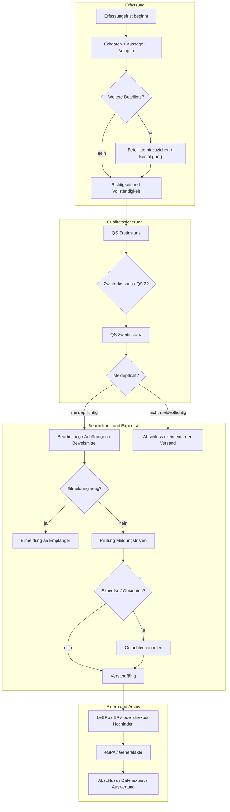
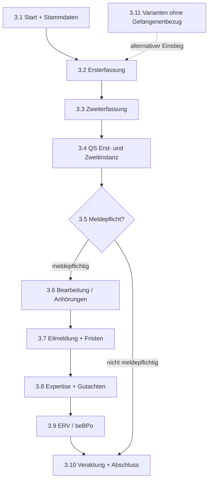
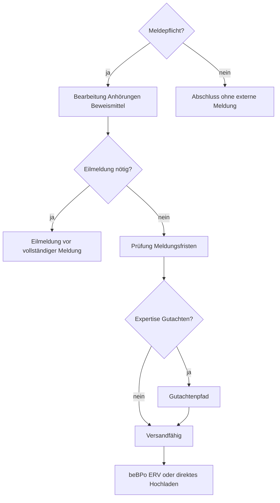
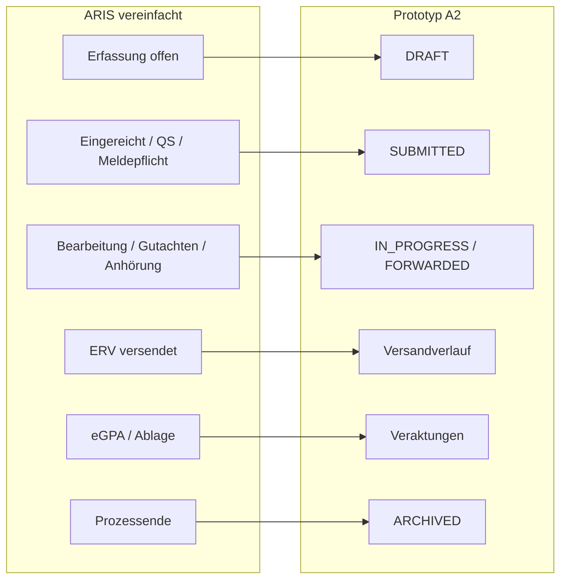
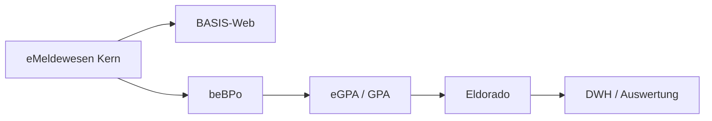
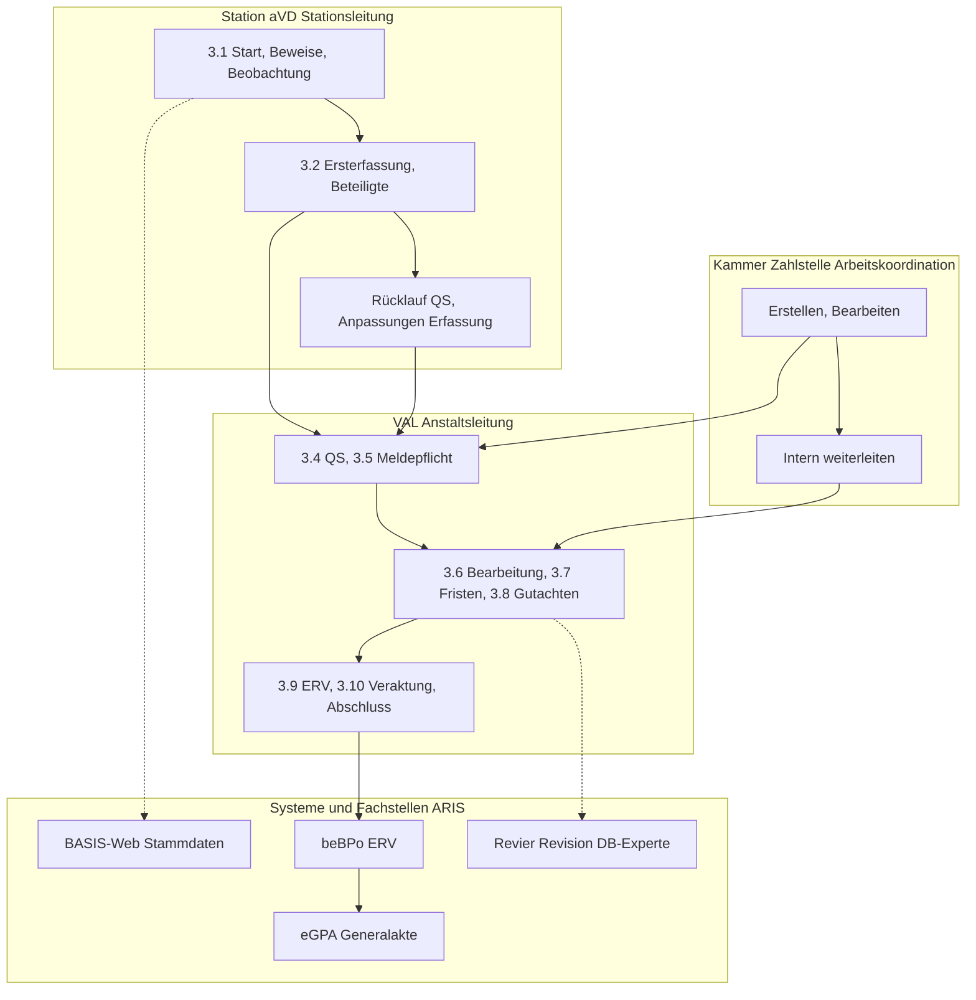

# Gesamtprozess eMeldewesen (strukturiert aus ARIS)

**Version:** 0.5 | **Status:** Entwurf aus ARIS-BPMN (13.03.2026); Quartalsauswertung A2-F-QS-002 inkl. KPI-Katalog und 15-Werktage-Frist  
**Quelle:** `eMeldewesen Prozess ARIS.pdf` → Textbasis [../eMeldewesen_Prozess_ARIS.txt](../eMeldewesen_Prozess_ARIS.txt)  
**Abgleich:** Prototyp HEUREKA A2, Kapitel [02_QUERSCHNITT_ROLLEN_STATUS.md](02_QUERSCHNITT_ROLLEN_STATUS.md), [03_QUERSCHNITT_SLA_UI.md](03_QUERSCHNITT_SLA_UI.md)

---

## 1 Einordnung

Das ARIS-Modell **„eMeldewesen (BPMN FHH – Operativer Prozess+)“** beschreibt den **vollständigen operativen Soll-Prozess** inklusive Ersterfassung, paralleler Zweiterfassung, zweistufiger Qualitätssicherung (QS), Meldepflichtprüfung, Expertise/Gutachten, Eilmeldung, ERV-Versand und Ablage in eGPA/Generalakte.

Der **HEUREKA-2.0-Prototyp A2** bildet bewusst nur einen **Teilpfad** ab (Meldung anlegen → Status → optional beBPo/eGPA → Archiv). Dieses Kapitel strukturiert den **ARIS-Gesamtprozess** und markiert den **Prototyp-Abgleich**.

| Kennzeichen | ARIS-Soll | Prototyp A2 |
|-------------|-----------|-------------|
| Ersterfassung / Zweiterfassung / QS | ja, ausführlich | nein (vereinfachte „Bearbeitung“) |
| Meldepflichtprüfung, Eilmeldung | ja | nein |
| Expertise / Gutachten (Revier, Revision, Experte) | ja | nein |
| Zeugen-Folgeaktionen (Strafanzeige) | nicht explizit im ARIS-Text | ja (Mock bei Einreichung) |
| Statusmodell | fachlich feiner | `DRAFT` → `SUBMITTED` → `IN_PROGRESS` / `FORWARDED` → `ARCHIVED` |
| beBPo / eGPA / Vier-Augen | ja | Mock, VAL/AL |

---

## 2 Prozess auf einen Blick

**Ausführliche Diagramme:** [10_PROZESSDIAGRAMM.md](10_PROZESSDIAGRAMM.md) (Gesamtprozess Abschnitt 1, Prototyp Abschnitt 2, Meldungstypen, Status, SLA, Zeugen). **Rollen entlang des Kernpfads (vereinfacht):** dort Abschnitt 5. **ARIS-erweiterte Swimlane:** unten Abschnitt 2.5.

**Hinweis:** Die Grafik ist eine **Lesehilfe**; Verzweigungen und Parallelität folgen dem ARIS-Diagramm, nicht dieser Vereinfachung.

### 2.1 Schema: Phasenfolge Kapitel 3 (linearer Lesepfad)

Lesepfad der Unterkapitel – **kein** striktes BPMN; Meldepflicht (3.5) verzweigt fachlich zu „mit externer Meldung“ vs. „ohne“.

### 2.2 Schema: Zentrale Weichen (Auszug aus Kapitel 4)

Die vollständige **Entscheidungsübersicht** bleibt die **Tabelle in Abschnitt 4**. Hier nur die zentralen Weichen als Leseschema:

Weitere Gateways (Beteiligte, Bestätigung, Aufgabenübernahme, Rückfragen an Erfassende): **Abschnitt 4** Tabelle.

### 2.3 Schema: ARIS ↔ Prototyp-Status (Mapping)

Entspricht Kapitel **7 Abgleich**; für LC-Umsetzung und Workshop.

### 2.4 Schema: Systemlandschaft (Kapitel 6)

**Prototyp:** nur Mock für beBPo und eGPA; keine Live-Schnittstellen.

### 2.5 Schema: Rollen-Swimlanes (ARIS-Soll, Abgleich Prototyp)

Leseschema zur **Verteilung von Aufgaben** auf Akteure und Systeme. Es ist **kein** BPMN mit strikter Reihenfolge aller parallelen Pfade; die Phasennummern verweisen auf **Abschnitt 3** dieses Dokuments.

**Abgleich:** Vereinfachte Darstellung der Rollenblöcke wie in [10_PROZESSDIAGRAMM.md](10_PROZESSDIAGRAMM.md) Abschnitt **5 Rollen entlang des Kernpfads**; hier zusätzlich **QS**, **Gutachten/Expertise** und **Systeme** aus ARIS (Kapitel 5 und 6).

| Bereich | Prototyp A2 (Mindestbild) |
|---------|---------------------------|
| Station | Meldung anlegen, Entwurf, Einreichung; Zeugen-Folgeaktionen bei Strafanzeige nach [10_PROZESSDIAGRAMM.md](10_PROZESSDIAGRAMM.md) Abschnitt 7 |
| Kammer / Zahlstelle / Arbeitskoordination | Wie Station: Erstellen und Bearbeiten; Weiterleiten ohne beBPo ([02_QUERSCHNITT_ROLLEN_STATUS.md](02_QUERSCHNITT_ROLLEN_STATUS.md)) |
| VAL / AL | Bearbeitung, Weiterleiten, beBPo, eGPA, Archiv; **keine** getrennten QS-/Gutachten-Status |
| BASIS-Web, Revier, Revision, Experte | nicht angebunden bzw. nicht als Rolle modelliert |

---

## 3 Phasen und Hauptschritte

### 3.1 Start und Stammdaten

| Schritt | Beschreibung | Typische Akteure / Systeme |
|---------|--------------|----------------------------|
| Erfassungsfrist hat begonnen | Zeitliche Einordnung des Vorgangs; Fristen laufen | Planer, JVA |
| Gefangenen-Stammdaten abrufen | Wer ist betroffen? | **BASIS-Web** (Analog eMeldewesen) |
| Geschäftsvorgangsnummer generieren | Pro 4-Augen-Prinzip (4W) eine Nummer; verbundene Sachverhalte ggf. mit `.x` | eMeldewesen |
| Beobachtungsbogen (Freitext) | Dokumentation des Beobachteten | aVD / Erfassende |
| Beweismittel sichern / digitalisieren | Vor formaler Meldung | Station, aVD |

**ARIS-Hinweis:** Während der Erfassung soll die Geschäftsvorgangsnummer pro 4W generiert werden; bei mehreren Gefangenen im selben Sachverhalt Kennzeichnung mit `.x`.

**Prototyp:** Meldungs-ID im System; keine separate GV-Nummer-Logik; kein BASIS-Web-Anbindung (Seed-Daten).

---

### 3.2 Ersterfassung

| Schritt | Beschreibung |
|---------|--------------|
| Eckdaten erfassen | Wer, Wann, Wo, Was |
| Aussage erstellen | Inhaltliche Darstellung |
| Beweismittel und Dokumente hochladen | Anlagen |
| Weitere Beteiligte nötig? | Gateway |
| Beteiligte hinzuziehen | Bei Bedarf weitere Personen einbinden |
| Bestätigung der Beteiligung liegt vor? | Gateway |
| Die Richtigkeit und Vollständigkeit prüfen | Vor Übergabe an QS |
| Eine Beschreibung des Ereignisses erstellen | Zusammenfassung für nachgelagerte Stufen |
| Erfassung ist abgeschlossen | Übergabe |

**Prototyp:** Entspricht grob **Meldung anlegen** (`MeldungForm`, Status `DRAFT`) und **Einreichung** (`SUBMITTED`). Zeugen, Tatvorwurf (Strafanzeige) sind prototypspezifisch erweitert.

---

### 3.3 Zweiterfassung (parallel, wiederholbar)

| Schritt | Beschreibung |
|---------|--------------|
| Zweiterfassung | Unabhängige zweite inhaltliche Erfassung |
| 2. Aussage anpassen | Korrektur/Ergänzung der Aussage |
| Aussagen anpassen | Bei Rückfragen |
| Der Prozess wird für weitere Zweiterfassende unabhängig vom ursprünglichen Zweiterfassenden wiederholt | ARIS-Anmerkung |
| **Rückgabe Ergänzungserfassung (Lastenheft)** | **VAL/AL** geben Meldung an Erfassung zurück, wenn **Zeugen/Beweismittel** nicht innerhalb 24 h vollständig – Nachreichung, dann **erneute Einreichung** (**A2-F-QS-004**, Happy Path HP-26b–e) |

**Prototyp:** nicht abgebildet (weder parallele QS-Zweiterfassung noch Rückgabe-Nachreichung).

---

### 3.4 Qualitätssicherung (Erst- und Zweitinstanz)

| Schritt | Beschreibung |
|---------|--------------|
| Qualitätssicherung Erstinstanz | 1. QS-Instanz |
| Fragen hinsichtlich der Ersterfassung | Rückfragen an Erfassende |
| Zurück an der 1. QS-Instanz mit Fragen | Schleife |
| Qualitätssicherung Zweitinstanz | 2. QS-Instanz |
| Fragen hinsichtlich der Zweiterfassung | Rückfragen |
| 2. Prüfung der Richtigkeit und Vollständigkeit | Nach Zweiterfassung |
| QS ist abgeschlossen und eine Meldepflicht besteht | Gateway-Ergebnis |
| QS wird gestoppt | Bei laufenden Anpassungen der Erfassung |
| Anpassungen der Erfassung wurden angefragt / sind eingegangen | Rückkopplung zur Erfassung |
| An Meldende zur Bearbeitung weiterleiten | Bei offenen Punkten |

**Prototyp:** keine getrennten QS-Instanzen; fachliche Prüfung als **„In Bearbeitung“** ohne QS-Status.

---

### 3.5 Meldepflicht und Beschreibung

| Entscheidung | Folge |
|--------------|-------|
| Besteht eine Meldepflicht? | zentrale Weiche |
| Meldepflichtig | weiter in Bearbeitung / Versandpfad |
| Nicht meldepflichtig | Abschluss ohne externe Meldung (siehe 3.9) |
| Den Meldepflicht prüfen | Aufgabe |
| Bestätigung der Meldepflicht | dokumentiert |
| Meldungspflichtmitteilung | Mitteilung über Ergebnis der Prüfung |
| Die Beschreibung anpassen | bei inhaltlichen Korrekturen |
| Anpassungen oder Ergänzungen nötig | Rückkopplung |
| Keine weitere Informationen nötig | QS/Bearbeitung kann fortgesetzt werden |

**Prototyp:** Meldepflicht nicht als eigener Prozessschritt; ERV-Relevanz über **Meldungstyp** / `ervRelevant`.

---

### 3.6 Bearbeitung (nach Meldepflicht)

| Schritt | Beschreibung |
|---------|--------------|
| Bearbeitungsanfrage | formale Bearbeitung starten |
| Bestätigung der Bearbeitung | Übernahme |
| Bearbeitung abgeschlossen / Bearbeitung ist abgeschlossen | interner Abschluss der Bearbeitungsphase |
| **Anhörung der beschuldigten Hauptbeteiligten** (Gefangene/r) | Befragung/Anhörung der als **Hauptbeteiligte/r** erfassten Person; Ergebnis dokumentieren (A2-F-QS-003); **nicht** identisch mit Zeugenaufnahme |
| Anhörungen weiterer Beteiligter, falls nötig | inkl. Dokumentation und Ablage (ARIS: „Anpassungen“) |
| Stellungnahmen zu Anhörungen und Zeugenaussagen | Nach Anhörung |
| Fragen / Anmerkungen an Erfassende schicken | Rückfragen |
| Aufgabe Übernahme? / Aufgabe wurde übernommen / nicht übernommen | Zuweisung an Bearbeitende (z. B. Kammer, Revier) |
| Übernahme Aufgabe | Organisatorische Zuweisung |

**Prototyp:** Status **In Bearbeitung** / **Weitergeleitet**; Zeugen-Folgeaktionen bei Strafanzeige **nur bei Einreichung** (Benachrichtigung aVD/SL, Frist Bedienstete). **Anhörung Beschuldigte/r:** nicht im Prototyp (A2-F-QS-003).

---

### 3.7 Eilmeldung und Fristen

| Schritt / Entscheidung | Beschreibung |
|------------------------|--------------|
| Prüfung der Meldungsfristen | Fristenkontrolle |
| Meldungsfrist &lt; 48 Stunden | Kriterium für Eilmeldung |
| Meldung nötig? | Gateway |
| Eilmeldung nötig / nicht nötig | Verzweigung |
| Erstellung Eilmeldung | Dringliche Vorabinformation |
| Übermittlung an relevanten Empfänger | vor vollständiger Meldung |
| Prüfung Richtigkeit und Vollständigkeit | vor Versand |

**Prototyp:** SLA **24 h** Bearbeitung aufnehmen, **5 Tage** Überfällig-Anzeige; keine Eilmeldung als eigener Vorgangstyp.

**Lastenheft-SLA:** siehe [03_QUERSCHNITT_SLA_UI.md](03_QUERSCHNITT_SLA_UI.md) (24 h / 3 Werktage beBPo).

---

### 3.8 Expertise und Gutachten

| Schritt | Beschreibung | Akteure |
|---------|--------------|---------|
| Anforderung Expertise | Bedarf feststellen | VAL, AL |
| Experte Gutachten einholen (Standard-Abfrage) | an DB Experte | eMeldewesen |
| Anfrage Gutachten | formal | |
| Revision für Gutachten anfragen / Revier für Gutachten anfragen | je nach Thema | Revision, Revier |
| bezüglich Gesundheitszustand Beteiligter / Sachgegenstand | Spezialisierung | |
| Expertengutachten wurde angefragt | Status | |
| Rückmeldung Gutachter ist eingegangen | | |
| Erfassung Gutachten | im System | |
| Gutachten ist erstellt und versendet | Abschluss Gutachten | |
| Stellungnahme zu Gutachten | Verarbeitung | |
| Beweismittelbegutachtung | fachlich | Begutachtung |
| Ende der Gutachtenanfrage | | |
| Von wem kam die Aufforderung zu Stellungnahme? | Aufforderung kam von AL / VL·VAL | |

**Prototyp:** nicht abgebildet.

---

### 3.9 Erstellung Meldung und externer Versand (ERV)

| Schritt | Artefakt / System |
|---------|-------------------|
| Erstellung Meldung | fachlicher Kern |
| XJustiz-Strukturdatei | ERV |
| Mitteilung (PDF) | ERV |
| ERV-Nachricht | ERV |
| Versand an ERV oder direktes Hochladen | beBPo oder manuell |
| Übermittlung an relevanten Empfänger | extern |
| Anlagen, Beweismittel und Dokumente hochladen | |

**Prototyp:** Mock **POST** `/api/meldungen/:id/xjustiz-versand` (VAL/AL); ERV-Badge in UI.

**Lastenheft:** beBPo **vor** eGPA; internes Weiterleiten ≠ externer Versand ([02_QUERSCHNITT_ROLLEN_STATUS.md](02_QUERSCHNITT_ROLLEN_STATUS.md)).

---

### 3.10 Veraktung, Abschluss, Nachgelagertes

| Schritt | System / Ziel |
|---------|---------------|
| Verfügung an die eGPA / Generalakte | Ablage |
| (e)GPA | elektronische Personalakte |
| Eldorado | (Schnittstelle im ARIS-Modell) |
| Abschluss des Prozesses | Endzustand fachlich |
| Datenauszug / Datenexport | Export |
| Auswertung / Fachaufsicht | DWH, Auswertung (inkl. **quartalsweiser Statistik**, A2-F-QS-002) |
| Endereignis | BPMN-Ende |

**Prototyp:** Mock **Verakten** (`POST …/verakten`), Status **Archiviert**; Vier-Augen VAL↔AL dokumentiert, **nicht durchgesetzt**. **Quartalsauswertung:** nicht im Prototyp; siehe Abschnitt 8.2.

**Lastenheft (Zielsystem):** Nach Abschluss bzw. Archivierung fließen Meldungsdaten in die **nachgelagerte Auswertung** (DWH). Dort ist eine **quartalsweise statistische Auswertung** aller Ermittlungsverfahren und Vorfälle verbindlich vorgesehen (Details: A2-F-QS-002).

---

### 3.11 Varianten ohne Gefangenenbezug

| Entscheidung | Bedeutung (ARIS) |
|--------------|------------------|
| Ereignis mit Gefangenenbezug | Standardpfad mit Stammdaten aus BASIS-Web |
| Ereignis mit keinen / keinem Gefangenenbezug | abweichender Pfad (weniger Stammdatenbezug) |

**Prototyp:** Gefangenen-Autocomplete optional je Typ; keine getrennte Prozessvariante.

---

## 4 Entscheidungsübersicht (Gateways)

| Frage im Modell | Ja → typische Folge | Nein → typische Folge |
|-----------------|---------------------|------------------------|
| Weitere Beteiligte nötig für die Erfassung? | Beteiligte hinzuziehen | Richtigkeit/Vollständigkeit |
| Bestätigung der Beteiligung liegt vor? | weiter | ggf. warten / nachfassen |
| Weitere Beteiligung nötig? | Schleife Beteiligung | Erfassung abschließen |
| Besteht eine Meldepflicht? | Bearbeitung / Versandpfad | Abschluss ohne Meldung |
| Meldungsfrist &lt; 48 h / Eilmeldung nötig? | Eilmeldung | regulärer Pfad |
| Meldung nötig? | Erstellung / Versand | interner Abschluss |
| Anpassungen oder Ergänzungen nötig? | zurück an Erfassung/QS | weiter |
| Aufgabe wurde übernommen? | Bearbeitung durch Übernehmer | andere Zuweisung |
| Weitere Informationen von der Erfassenden nötig? | Rückfrage | QS/Bearbeitung fortsetzen |

---

## 5 Rollen und Organisation (ARIS → Prototyp)

Schematische Swimlane: **Abschnitt 2.5**; vereinfachtes Rollendiagramm Prototyp: [10_PROZESSDIAGRAMM.md](10_PROZESSDIAGRAMM.md) Abschnitt 5.

| ARIS / Fachlich | Rolle im Prototyp (kanonisch) | Anmerkung |
|-----------------|-------------------------------|-----------|
| Allgemeiner Vollzugsdienst (AVD) | `avd` | Ersterfassung, Station |
| Stationsleitung | `stationsleitung` | Sichtbereich Station |
| Vollzugsabteilungsleitung (VAL) | `val` | QS, beBPo, eGPA, Abschluss |
| Anstaltsleitung (AL) | `anstaltsleitung` | wie VAL + gesamte Anstalt |
| Kammer | `kammer` | Weiterleiten |
| Planer | – | nicht als Rolle im Prototyp |
| Revier / Revision | – | Gutachtenpfad |
| DB Experte / Expertise | – | Gutachten |
| JVAen (organisatorisch) | JVA-Filter Mock-Nutzer | |
| Fachaufsicht / Auswertung | – | nachgelagert (DWH); Empfänger u. a. Quartalsberichte (A2-F-QS-002) |

---

## 6 Systemlandschaft (aus ARIS)

| System | Funktion im Prozess |
|--------|---------------------|
| **eMeldewesen** | Kernanwendung Erfassung, QS, Bearbeitung, Versandsteuerung |
| **BASIS-Web** | Gefangenen-Stammdaten (Analog-Anbindung im Modell) |
| **beBPo** | ERV-Versand (xJustiz) |
| **(e)GPA / eGPA** | Veraktung, Generalakte |
| **Eldorado** | im Modell am Abschlusspfad |
| **DWH** | Auswertung / Fachaufsicht; quartalsweise Statistik Ermittlungsverfahren und Vorfälle (A2-F-QS-002) |
| **DB eMeldewesen / DB Bedienstete / DB Experte** | Datenhaltung / Fachdaten im Modell |

**Prototyp:** nur Mock für beBPo und eGPA; keine echten Schnittstellen (.cursorrules Kap. 8).

---

## 7 Abgleich: ARIS-Hauptpfad ↔ Prototyp-Status

| ARIS (vereinfacht) | Prototyp-Status / UI |
|--------------------|----------------------|
| Erfassung (offen) | `DRAFT` (Entwurf) |
| Erfassung abgeschlossen / QS / Meldepflicht | `SUBMITTED` (Eingereicht) |
| Bearbeitung, Weiterleitung, Gutachten, Anhörung | `IN_PROGRESS`, `FORWARDED` |
| beBPo / ERV versendet | Versandverlauf, Badge |
| eGPA-Veraktung | Veraktungsliste |
| Abschluss des Prozesses | `ARCHIVED` (Archiviert) |

**Prozesslandkarte UI:** `getProzessSchritte()` – Entwurf → Eingereicht → Bearbeitung → [beBPo] → [eGPA] → Archiviert.

---

## 8 Quartalsweise statistische Auswertung (Lastenheft)

### 8.1 Einordnung

Die ARIS-Prozesskette endet mit **Datenexport** und **Auswertung / Fachaufsicht** (DWH). Für die Behörden- und JVA-Steuerung ist zusätzlich eine **verbindliche, quartalsweise Statistik** über alle im eMeldewesen erfassten **Ermittlungsverfahren** und **Vorfälle** erforderlich – unabhängig vom operativen Prototyp.

| Begriff | Abgrenzung im eMeldewesen (Auswertungsumfang) |
|---------|-----------------------------------------------|
| **Ermittlungsverfahren** | Alle Meldungen mit **ERV-Relevanz** bzw. vergleichbarem externen Verfahren: aktuell `STRAFANZEIGE`, `MELDUNG_GERICHT`; bei Aktivierung auch `VORFALL_EXTERN`, sofern ERV-pflichtig geführt |
| **Vorfälle** | Vorfallmeldungen **ohne** ERV-Kernprozess im Meldewesen: `VORFALL_INTERN`; künftig weitere Vorfall-Typen nach Fachbeschluss (z. B. `VORFALL_EXTERN`, wenn nicht der Ermittlungsverfahren-Statistik zugeordnet) |

**Zeitraum:** Kalenderquartale (Q1–Q4, 01.01.–31.03. / 01.04.–30.06. / 01.07.–30.09. / 01.10.–31.12.); Auswertung bezieht alle im Quartal **eingereichten, bearbeiteten und abgeschlossenen** Vorgänge ein.

**Berichtsfrist (Beschluss):** Der Quartalsbericht ist **spätestens 15 Werktage** nach Quartalsende **freigegeben und abrufbar** (Werktagsdefinition wie SLA: [03_QUERSCHNITT_SLA_UI.md](03_QUERSCHNITT_SLA_UI.md), Abweichungen je JVA → [ANHANG_A_JVA_MATRIX.md](ANHANG_A_JVA_MATRIX.md)).

**Prototyp:** keine Umsetzung; Kennzeichnung **Zielsystem (Muss)**.

### 8.2 A2-F-QS-002 – Quartalsweise statistische Auswertung Ermittlungsverfahren und Vorfälle

| Feld | Inhalt |
|------|--------|
| **ID** | A2-F-QS-002 |
| **HEUREKA-Referenz** | HEUREKA-2.0-A2-QS-002 |
| **Titel** | Quartalsweise statistische Auswertung aller Ermittlungsverfahren und Vorfälle |
| **Priorität** | Zielsystem (Muss) |
| **Beschreibung** | Sie erhalten **je Kalenderquartal** eine **statistische Auswertung** über **alle** im eMeldewesen dokumentierten **Ermittlungsverfahren** und **Vorfälle** (siehe Abschnitt 8.1). Die Auswertung dient der **Fachaufsicht**, der **Anstalts- und Behördenleitung** sowie der **Qualitätssicherung** (Trends, Volumina, Bearbeitungsstände). Die Bereitstellung erfolgt über die **nachgelagerte Auswertungsumgebung (DWH)** bzw. einen daran angebundenen **Bericht**; sie ersetzt keine Einzelfallbearbeitung in eMeldewesen. |
| **Vorbedingung** | Meldungen sind im eMeldewesen erfasst; für abgeschlossene Fälle liegt mindestens Status **Archiviert** (`ARCHIVED`) oder gleichwertiger Abschluss vor; Datenexport/DWH-Anbindung ist betriebsbereit. |
| **Auslöser** | **Kalenderende** des Quartals (automatischer DWH-Lauf am Folgetag); manueller Nachzug nur bei technischer Störung durch berechtigte IT/Fachaufsicht. |
| **Ergebnis** | Ein **Quartalsbericht** (PDF und maschinenlesbarer Export, z. B. CSV/XLSX) mit **allen Pflicht-KPIs** (Abschnitt 8.3), getrennt und vergleichbar für **Ermittlungsverfahren** und **Vorfälle**, filterbar nach **JVA** und Vollzugsabteilung. |
| **Akzeptanzkriterium** | Pro Quartal **genau eine** freigegebene Auswertung, **spätestens 15 Werktage** nach Quartalsende (Abschnitt 8.4). |
| | Umfasst **alle** Ermittlungsverfahren und **alle** Vorfälle des Quartals (keine stille Teilmenge). |
| | Enthält **vollständig** die KPI-IDs **KP-EV-01 bis KP-EV-12**, **KP-VF-01 bis KP-VF-09** und **KP-Ü-01 bis KP-Ü-03** (Abschnitt 8.3). |
| | Metadaten im Bericht: Quartal, **Erstellungszeitpunkt**, **Freigabezeitpunkt**, **Datenstand** (letzter Export), Version des Berichtsschemas. |
| | **Keine** personenbezogene Einzelliste im Standardbericht (nur Aggregation); Einzelfallabruf nur über eMeldewesen-Berechtigungen. |
| **Rolle(n)** | Fachaufsicht; `anstaltsleitung`; `val` (Sichtbereich eigene JVA/Abteilung); zentrale Behördenauswertung nach Freigabe (konkrete Rollen im Zielsystem festzulegen). |
| **Meldungstyp** | Querschnitt – alle aktiven und künftig aktivierten Typen gemäß Abschnitt 8.1 |
| **Statusbezug** | Alle Status; Schwerpunkt `SUBMITTED`, `IN_PROGRESS`, `FORWARDED`, `ARCHIVED` |
| **Quelle** | Fachauftrag / Lastenheft-Ergänzung 2026-05-22 |
| **Prototyp** | **nicht umgesetzt** – Anforderung nur Zielsystem/DWH dokumentieren |

**Abhängigkeiten:** SLA ([03_QUERSCHNITT_SLA_UI.md](03_QUERSCHNITT_SLA_UI.md)), Datenexport nach Archiv (Abschnitt 3.10), DWH (Abschnitt 6), KPI-Katalog und Frist (Abschnitte 8.3–8.4).

### 8.3 KPI-Katalog (Pflichtinhalt Quartalsbericht)

Alle Kennzahlen sind **aggregiert** (Anzahl, Prozent, Mittelwert/Median wo angegeben). „Im Quartal“ = Ereigniszeitpunkt liegt im Kalenderquartal (Einreichung, Statuswechsel oder Abschluss je KPI).

#### Ermittlungsverfahren (`KP-EV-*`)

| KPI-ID | Kennzahl | Definition / Messung |
|--------|----------|----------------------|
| **KP-EV-01** | Neu eingereicht | Anzahl mit erstem `SUBMITTED` im Quartal |
| **KP-EV-02** | In Bearbeitung (Stichtag) | Anzahl mit Status `IN_PROGRESS` oder `FORWARDED` am **letzten Kalendertag** des Quartals |
| **KP-EV-03** | Abgeschlossen | Anzahl mit `ARCHIVED` im Quartal |
| **KP-EV-04** | Verteilung Meldungstyp | Anzahl und % je Typ (`STRAFANZEIGE`, `MELDUNG_GERICHT`, …) |
| **KP-EV-05** | Verteilung Status (Stichtag) | Anzahl je Status am Quartalsende |
| **KP-EV-06** | Verteilung Tatvorwurf | Anzahl und % je `metadaten.tatvorwurf` (nur `STRAFANZEIGE`: BTM, aoV, Diebstahl, sonstige) |
| **KP-EV-07** | Dringend markiert | Anzahl mit Priorität „dringend“ / `prioritaet: 1` (eingereicht oder abgeschlossen im Quartal) |
| **KP-EV-08** | SLA 24 h – Überfällig | Anzahl und %: `SUBMITTED` → erster `IN_PROGRESS` **> 24 Werktage**; optional Ø Bearbeitungsdauer in Werktagen |
| **KP-EV-09** | SLA ERV 3 WT – Überfällig | Anzahl und %: „versandfähig“ → beBPo-Versand **> 3 Werktage** (nur Fälle mit Versand im Quartal oder offen am Quartalsende) |
| **KP-EV-10** | beBPo-Versand | Anzahl mit dokumentiertem beBPo/xJustiz-Versand im Quartal |
| **KP-EV-11** | eGPA-Veraktung | Anzahl mit dokumentierter Veraktung im Quartal |
| **KP-EV-12** | Vorquartalsvergleich | Delta (absolut und %) zu **KP-EV-01, -03, -08, -09** gegenüber dem unmittelbar vorherigen Quartal |

#### Vorfälle (`KP-VF-*`)

| KPI-ID | Kennzahl | Definition / Messung |
|--------|----------|----------------------|
| **KP-VF-01** | Neu eingereicht | wie KP-EV-01, Umfang Vorfälle (Abschnitt 8.1) |
| **KP-VF-02** | In Bearbeitung (Stichtag) | wie KP-EV-02 |
| **KP-VF-03** | Abgeschlossen | wie KP-EV-03 |
| **KP-VF-04** | Verteilung Meldungstyp | z. B. `VORFALL_INTERN`, künftige Typen |
| **KP-VF-05** | Verteilung Status (Stichtag) | wie KP-EV-05 |
| **KP-VF-06** | Verteilung Tatort / Empfänger | Anzahl je `tatort` bzw. `empfaengerTyp`/`empfaenger` (soweit erfasst) |
| **KP-VF-07** | Dringend markiert | wie KP-EV-07 |
| **KP-VF-08** | SLA 24 h – Überfällig | wie KP-EV-08 (ohne ERV-Kennzahlen) |
| **KP-VF-09** | Vorquartalsvergleich | Delta zu **KP-VF-01, -03, -08** gegenüber Vorquartal |

#### Übergreifend (`KP-Ü-*`)

| KPI-ID | Kennzahl | Definition / Messung |
|--------|----------|----------------------|
| **KP-Ü-01** | Gesamtvolumen | Summe aller Meldungen (Ermittlungsverfahren + Vorfälle) mit Aktivität im Quartal |
| **KP-Ü-02** | Aufschlüsselung JVA | KP-EV-01/03 und KP-VF-01/03 **je teilnehmender JVA** |
| **KP-Ü-03** | Aufschlüsselung Abteilung | dieselben Kern-KPIs je Vollzugsabteilung, soweit Stammdaten im DWH |

**Optionale Erweiterung (Kann, Zielsystem):** Median Bearbeitungsdauer bis Archiv; Anzahl mit Zeugen; Anzahl mit Anhängen – nur nach Fachfreigabe, nicht Abnahme-blockierend.

### 8.4 Berichtsfrist und Freigabe

| Regel | Inhalt |
|-------|--------|
| **Frist** | **15 Werktage** nach dem letzten Kalendertag des Quartals |
| **Beispiel** | Q1 (Ende 31.03.) → Bericht spätestens freigegeben am 15. Werktag nach dem 31.03. |
| **Werktag** | Wie SLA-Bearbeitungsfrist ([03_QUERSCHNITT_SLA_UI.md](03_QUERSCHNITT_SLA_UI.md)); Feiertage/JVA-Sonderregeln in [ANHANG_A_JVA_MATRIX.md](ANHANG_A_JVA_MATRIX.md) |
| **Automatik** | DWH erzeugt Entwurf **Tag 1** nach Quartalsende; Fachaufsicht/behördenweite Auswertung **prüft und gibt frei** bis spätestens Tag 15 (Werktage) |
| **Verspätung** | System protokolliert Verspätung; sichtbar für `anstaltsleitung` und zentrale Fachaufsicht (Zielsystem) |
| **Abnahme-Test** | [A2-F-TST-016](07_ABNAHME_UND_ANHANG.md): Bericht Q-1 liegt innerhalb Frist vor und enthält alle Pflicht-KPIs |

---

## 9 Offene Punkte und Workshop-Themen

Aus ARIS und Prototyp-Gap abgeleitet; ergänzend [RUECKFRAGEN_UND_OFFENE_PUNKTE.md](../RUECKFRAGEN_UND_OFFENE_PUNKTE.md):

1. **Inhaltliche Prüfcheckliste** in der Bearbeitungsphase → Workshop-Vorlage [09_WORKSHOP_CHECKLISTE_INTERN_BEARBEITUNG.md](09_WORKSHOP_CHECKLISTE_INTERN_BEARBEITUNG.md) (Beschlüsse nach Termin eintragen).
2. **Definition „versandfähig“** vor beBPo (SLA 3 Werktage).
3. **Werktage / Wochenenden** bei Erfassungs- und Meldungsfristen (ARIS: 48 h Eilmeldung; Lastenheft: 24 h SLA).
4. **Zweiterfassung und QS** – verpflichtend für alle Typen oder nur ERV?
5. **Geschäftsvorgangsnummer (4W)** – führende Nummer vs. System-ID.
6. **Gutachtenpfad** – wann Revision vs. Revier vs. externer Experte?
7. **Direktes Hochladen** vs. beBPo – zulässige Ausnahmen?
8. ~~**Anhörungsergebnisse**~~ → **beschuldigte Hauptbeteiligte:** dokumentiert in **A2-F-QS-003** / Anhang B `anhoerungBeschuldigte`; weitere Beteiligte weiterhin workshop-offen.

---

## 10 Änderungshistorie

| Datum | Version | Änderung |
|-------|---------|----------|
| 2026-05-22 | 0.7 | **A2-F-QS-004** Rückgabe Ergänzungserfassung (Zeugen/Beweismittel) in Abschnitt 3.3 |
| 2026-05-22 | 0.6 | Anhörung beschuldigte Hauptbeteiligte: **A2-F-QS-003** (Verweis Abschnitt 3.6) |
| 2026-05-22 | 0.5 | Abschnitt 8.3–8.4: **KPI-Katalog** (KP-EV/VF/Ü) und Berichtsfrist **15 Werktage** |
| 2026-05-22 | 0.4 | Abschnitt 8: **A2-F-QS-002** quartalsweise statistische Auswertung Ermittlungsverfahren und Vorfälle |
| 2026-05-20 | 0.3 | Abschnitt 2.5 Rollen-Swimlanes; Verweise auf [10_PROZESSDIAGRAMM.md](10_PROZESSDIAGRAMM.md) Abschnitte 1, 5 und 7 |
| 2026-05-20 | 0.2 | Schema-Darstellung ergänzt (Abschnitt 2.1–2.4: Phasen, Gateways, Status-Mapping, Systeme) |
| 2026-05-19 | 0.1 | Erstfassung aus ARIS-PDF-Textextraktion, Abgleich Lastenheft/Prototyp |
