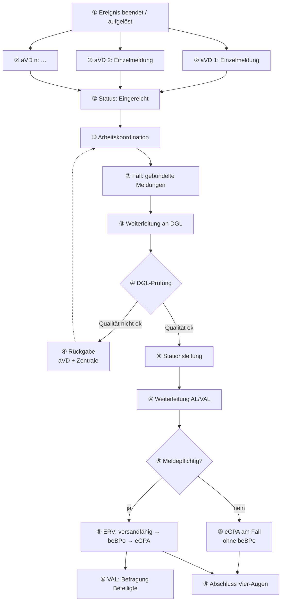

# Überarbeiteter Meldeprozess – Soll, Prototyp-Stand, offene Punkte

**A2 eMeldewesen** | HEUREKA 2.0 | FHH Hamburg Justiz  
**Version:** 2.0 | **Stand:** 2026-06-02  
**Status:** Soll + **Prototyp-Stand** nach Fall-Pfad (DGL→SL→AL/VAL, ERV am Fall)

Dieses Dokument beschreibt den **feedbacketen Soll-Prozess** (Praxis, Stand Workshop-Rückfragen A–H), was **im Prozess geschehen soll**, wie der **Prototyp** ihn abbildet und was **noch offen** ist.

**Quellen:** [GESAMTPROZESS.md](GESAMTPROZESS.md) (fachliche Referenz) · [Praxisfeedback.md](Praxisfeedback.md) · [RUECKFRAGEN_UND_OFFENE_PUNKTE.md](RUECKFRAGEN_UND_OFFENE_PUNKTE.md) · Prototyp `meldewesen-a2-main`

---

## 1. Kurzfassung

Nach einem **beendeten Ereignis** erfassen **alle beteiligten aVD** jeweils eine **eigene Einzelmeldung**. Die **Zentrale** bündelt zu **einem Fall**. **DGL** prüft → **Stationsleitung** → **AL/VAL** entscheidet Meldepflicht. **Nein** → eGPA am Fall ohne beBPo. **Ja** → versandfähig → beBPo → eGPA am Fall (AL/VAL). VAL-Befragung Beteiligte nach AL „ja“ (Workflow noch offen).

---

## 2. Gesamtprozess (Soll)

### Phasenübersicht

| Phase | Wer | Was soll passieren |
|-------|-----|-------------------|
| **① Ereignis** | – | Meldepflicht **unmittelbar nach Ereignis**, ggf. **nach Auflösung** (nicht während Akutintervention). aVD: **unmittelbare** Meldung möglich (**OP-ORG-01**). **Schwerwiegend:** **telefonische Vorabmeldung**, ggf. **Polizei** informiert → danach schriftlich (**OP-M-01**). |
| **② Ersterfassung** | **aVD** (alle Beteiligten) | Je Person **eine Einzelmeldung**; **ein** Hauptbeteiligter (`gefangeneId`); **Insassen nach Hafthaus** filterbar (alle Meldungstypen); W-Fragen → Textvorlage → **vor Einreichung** bearbeitbar; Sicherstellung Ja/Nein; **keine Zeugen**, nur **Beteiligte**; Polizei Ja/Nein (M1). |
| **③ Bündelung** | **Zentrale** nur | Alle Einzelmeldungen zum **gleichen Fall** zusammenfassen; **kein** Weiterleiten an DGL ohne vollständiges Bündel (fachlich). — **⚠️ Annahme (OP-FB-01)** |
| **④ DGL-Prüfung** | **Dienstgruppenleitung** | Fachliche Kriterien + **inhaltliche Stimmigkeit** der Perspektiven; Rückgabe an **aVD und Zentrale** bei Mängeln; **beliebig oft** wiederholbar. |
| **⑤ Entscheid** | **AL oder VAL** | Meldepflicht ja/nein auf **Fall-Ebene** (K2, **zu validieren**); **meldepflichtig = ERV** (G1, **sicher**) |
| **⑥ Abschluss** | **AL / ggf. VAL** | **Nein:** Veraktung ohne beBPo (**OP-EGPA-01** Übergang). **Ja:** ERV-Kette — **zu validieren**; **ggf. eine Person** (**OP-ERV-03**); Vier-Augen **OP-V-04** |
| **⑦ Nachgelagert** | **VAL** | Befragung Beteiligter **nur nach „Ja“** — **sicher** (D3); Anordnung/Ergebnis am Fall — **OP-V-02** |

---

## 3. Rollen und Verantwortlichkeiten

| Rollencode | UI-Label | Im überarbeiteten Prozess |
|------------|----------|---------------------------|
| `avd` | Allgemeiner Vollzugsdienst | **Ersterfassung** – eigene Einzelmeldung nach Ereignis; **unmittelbare** Meldung ermöglichen (Freistellung **OP-ORG-01**); physische **Sicherstellung** (aVD). |
| `arbeitskoordination` | Arbeitskoordination (**Zentrale**) | **Einzige** Rolle mit **Fall-Bündelung**; Weiterleitung gebündelt an DGL; Koordination bei DGL-Rückgabe. |
| `dienstgruppenleitung` | Dienstgruppenleitung | **Qualitätsprüfung** gebündelter Fälle; Freigabe AL oder Rückgabe. |
| `anstaltsleitung` | Anstaltsleitung | **Entscheid meldepflichtig** ja/nein auf **Fall-Ebene**; bei ja: ERV mit VAL. |
| `val` | Vollzugsabteilungsleitung | **Nach** AL „ja“: ERV (beBPo/eGPA), **Befragung** inhaftierter Beteiligter (eigenständig). |
| `stationsleitung` | Stationsleitung | **Fallmeldung** von DGL → Weiterleitung AL/VAL (K1, K4) |
| `kammer` | Kammer | Nur bei **Betroffenheit** (Sicherstellung); physisch nur in **bestimmten Fällen** (offen). |

**Demo-Nutzer im Prototyp:** AK-01 (Zentrale), DGL-01, AL-01, AVD-01 ff.

---

## 4. Phase ② – Ersterfassung im Detail

### 4.1 Inhalt der Einzelmeldung

| Thema | Soll (beschlossen) | Hinweis |
|-------|-------------------|---------|
| **Timing** | Unmittelbar nach Ereignis / nach Auflösung | Frist **24 h** (H1) |
| **Perspektive** | **Ein** Text aus Ich-Sicht (Tun + Beobachtung gemeinsam) | C2 – kein getrennter Tun-/Beobachtungs-Katalog |
| **W-Fragen** | Wer · Wann · Was · Wo · Wohin (Vorentwurf, **noch prüfen**) | C1, OP-W-01 |
| **Textvorlage** | Generiert, **vor Einreichung** bearbeitbar | C4 |
| **Hauptbeteiligte/r** | **Eine** `gefangeneId` pro Meldung | B4 |
| **Gefangene-Auswahl** | **Insassen nach Hafthaus** filterbar (alle Stationen des Hauses, alle Meldungstypen) | B5, E-03 ✅ Prototyp |
| **Gefangene vs. Zeugen** | **Kein Zeugenkonzept** — nur **Beteiligte** (inhaftiert); Bedienstete über **eigene Meldung** | D1, Workshop 2026-06-17 |
| **Externe / Polizei** | **Polizei** ggf. vor Ort; Meldung: **Ja/Nein Polizei eingeschaltet** (M1) | D2, M1 |
| **Sicherstellung** | Ja/Nein **Pflicht**; keine Erhebung; aVD sichert | E1–E2 |
| **Foto/Anlagen** | **Keine** Pflicht; Nachreichung möglich | E4, H6 (5 WT) |
| **Dringend-Flag** | **Entfällt** | H7 |

### 4.2 Beteiligte und Polizei (keine Zeugen)

- **Kein Zeugenmodul** im Meldewesen — nur **Beteiligte** (inhaftierte am Ereignis).
- Am Ereignis beteiligte **Bedienstete** erfassen jeweils **eigene Einzelmeldungen** (Phase ②), keine Zeugenliste.
- **Polizei eingeschaltet:** Ja/Nein in der Meldung (M1) — **OP-Z-02** (UI).
- ~~Zeugen Bedienstete, 5 Werktage (H5)~~ → **entfällt** mit Zeugenkonzept (**OP-Z-01**).

### 4.3 Nach Einreichung (Einzelmeldung)

- Status **Eingereicht** (`SUBMITTED`).
- Meldung wartet auf **Fall-Bündelung** durch Zentrale (kein direkter Weg mehr „sofort zur VAL-Prüfung“ als Hauptprozess).

---

## 5. Phase ③–⑤ – Fall, Prüfung, Entscheid

### 5.1 Fall-Bündelung (fachlich)

> **⚠️ Annahme (nicht validiert):** Der gesamte Prozessschritt **Fall-Bündelung** (Phase ③) basiert auf Praxisfeedback F1–F5 / P-01–P-02 als **Vorentwurf**. **Workshop-Validierung** mit mehreren JVAs steht aus (**OP-FB-01**, **OP-JVA-01**). Der Prototyp modelliert diese Annahme.

| Regel | Inhalt |
|-------|--------|
| **Kriterium** | Alle Meldungen zum **gleichen Vorfall** – verschiedene **aVD-Perspektiven** (F1) |
| **Ein Typ pro Fall** | **Ein Fall = ein Meldungstyp** (L1) — **sicher** (Validierung 2026-06-17) |
| **Vollständigkeit** | **Alle** beteiligten aVD müssen gemeldet haben, bevor fachlich vollständig gebündelt wird (F2) |
| **Weiterleitung ohne Hartblock** | Zentrale darf an DGL weiterleiten **ohne** dass alle aVD-Meldungen vorliegen — **sicher** (J2, Validierung 2026-06-17); fehlende Meldung bei **DGL** anfordern |
| **Erkennung** | Fachlich durch Beteiligung am Ereignis; Assistenz: gleiche **Tatzeit/Tatort** (B2) |
| **Wer bündelt** | **Nur** Zentrale (A3) |
| **aVD bei Verzug** | Meldung **sofort** nach Ereignis; **unmittelbare** Einreichung ermöglichen — **Freistellung** offen (**OP-ORG-01**); keine Zentrale-Wartefrist (H4) |

### 5.2 Fall-Status (Prototyp / Datenmodell)

| Status | Bedeutung | Nächster Schritt |
|--------|-----------|------------------|
| `SAMMELN` | Zentrale sammelt/bündelt | AK: an DGL weiterleiten |
| `ZURUECK_AK` | DGL-Rückgabe | AK: ergänzen, erneut an DGL |
| `ZUR_DGL` | Bei DGL zur Prüfung | DGL: Freigabe oder Rückgabe |
| `ZUR_AL` | Bei AL zur Entscheid | AL: meldepflichtig ja/nein |
| `ABGESCHLOSSEN_INTERN` | AL: **nicht** meldepflichtig | Meldungen archiviert |
| `ERV_WEG` | AL: **meldepflichtig** | ERV über Einzelmeldungen (AL/VAL) |

### 5.3 DGL-Prüfung

- Prüft **fachliche Kriterien** je Meldung und **inhaltliche Stimmigkeit** im Bündel (F3).
- **Konkrete Checkliste:** noch zu erarbeiten (OP-DGL-01).
- Rückgabe an **aVD und Zentrale** (F4) — **sicher** (2026-06-17); **unbegrenzt** wiederholbar (F5, **sicher** 2026-06-17).
- Freigabe → **Stationsleitung** → AL/VAL (K1, K4) — **zu validieren** (**OP-FB-01**).

### 5.4 AL-Entscheid

| Entscheid | Folge |
|-----------|--------|
| **Entscheider** | **AL oder VAL** (K2) — **zu validieren** (**OP-K-03**) |
| **Meldepflichtig nein** | **Kein beBPo**; **direkt eGPA** (O1); interner Abschluss — **AL oder ggf. VAL** (**OP-ABS-01**) |
| **Meldepflichtig ja** | = **ERV-pflichtig** (G1, **sicher**); **beBPo → eGPA** (O1); **ggf. eine Person** — **OP-ERV-03** |

### 5.5 VAL – Befragung Beteiligte (nur nach „Ja“)

| Aspekt | Soll |
|--------|------|
| **Wer** | VAL **selbst** (D5) |
| **Wann** | **Nur nach** Entscheid **meldepflichtig ja** (D3) — **sicher** (2026-06-17) |
| **Dokumentation** | Zuerst **Anordnung**, **Ergebnis** im Nachgang (D4) |
| **Nicht** | Zeugenprozess Station/aVD; Inhaftierte als Zeugen (D1) |

---

## 6. Fristen und SLA (beschlossen)

| Thema | Regel |
|-------|--------|
| **Ersterfassung** | **24 h** ab **Ereignisende** (H1, N2) |
| **Fachliche Prüfung / extern** | **24 h** ab **Ereignisende** (nicht ab AL-Entscheid); **Werktage** (H2, N2) |
| **Wochenende/Feiertage** | Sammeln bis **Montag 08:00** – kein Werktagszähler über WE (N1, H2–H3) |
| **Eskalation Frist** | **Erststufe: Stationsleitung** (N3); **Eskalationsschleife** → Workshop (OP-H-03) |
| **Zeugen Bedienstete** | **5 Werktage** (H5) |
| **Nachreichung** (Rückgabe Ergänzung) | **5 Werktage** (H6) |
| **Dringend** | **Nicht** vorgesehen (H7) |

---

## 7. Prototyp-Stand (Umsetzung)

### 7.1 Umgesetzt ✅

| Bereich | Umsetzung |
|---------|-----------|
| **Rollen** | `arbeitskoordination`, `dienstgruppenleitung`, `stationsleitung`, `anstaltsleitung`, `val`, `avd` … |
| **Fall-Modell** | `MeldungsFall` inkl. `ZUR_SL`, `EGPA_INTERN`, ERV-Felder (`versandfaehigAm`, beBPo, eGPA) |
| **Prozesskette** | Zentrale → DGL → **SL** → AL/VAL → ERV **am Fall** |
| **Meldepflicht** | **AL oder VAL** (`entscheid-meldepflicht`) |
| **ERV am Fall** | versandfähig → beBPo → eGPA → abschließen (Vier-Augen) |
| **API** | `/api/faelle` inkl. `weiterleiten-sl`, `weiterleiten-al`, Fall-ERV-Endpunkte |
| **UI** | Hub je Rolle, `FallDetail`, `FallErvPanel`, Bündelungsvorschläge |
| **Bündelung** | Mehrere aVD-Meldungen, gleicher Meldungstyp, Tatzeit/Tatort-Vorschläge — **⚠️ Annahme (OP-FB-01)** |
| **Seed** | FALL-001 (`ZUR_SL`), FALL-002 (`ZUR_AL`), MEL-019/020 |
| **Einzelmeldung** | Erfassung, Zeugen, Beweismittel, Arbeitskorb (paralleler Pfad ohne Fall) |

### 7.2 Demo-Klickpfad

1. **aVD**: Meldung einreichen (gleicher Tatort/Tatzeit für Bündelung) **oder** Seed nutzen.
2. **AK-01**: Fall bündeln → **an DGL**.
3. **DGL-01**: Qualität ok → **Stationsleitung** (FALL-001: bereits `ZUR_SL`).
4. **SL-01**: Fallmeldung → **AL/VAL**.
5. **AL-01** / **VAL-01**: Meldepflicht (FALL-002: bereits `ZUR_AL`) → ERV-Panel am Fall-Detail.

### 7.3 Abweichungen / Lücken im Prototyp ⚠️

| Lücke | Soll | Prototyp heute |
|-------|------|----------------|
| DGL-Rückgabe an **aVD** | aVD + Zentrale (F4) | Nur `ZURUECK_AK` (Zentrale) |
| DGL-**Checkliste** | Konkrete Kriterien (F3) | Freitext-Rückgabe |
| **W-Fragen-Assistent** | Pflichtfragen → Text (L3) | Freitext-Sachverhalt |
| **Polizei Ja/Nein** (M1) | Feld in Meldung | Fachlich geklärt, **UI fehlt** |
| **Zeugen `inhaftierter`** | Entfernen (D1) | Noch im `ZeugenEditor` |
| **VAL-Befragung** | Anordnung/Ergebnis **am Fall** (O4) | Nicht als Workflow |
| **SLA Werktage / WE** | Montag 08:00 (N1) | Vereinfachte Hinweise |
| **Dringend** | Entfällt (H7) | Feld noch vorhanden |
| **Benachrichtigungen** | Bei Fall-Übergängen | Keine Fall-Tasks |
| **DGL: fehlende Meldung anfordern** | J2 | Nicht modelliert |

---

## 8. Offene Punkte (Übersicht)

### 8.1 Bewusst zurückgestellt (Workshop später)

| ID | Thema |
|----|--------|
| **OP-W-02 / C3** | Wer pflegt/freigibt **Textbausteine**? |
| **OP-BM-01 / M2** | **Kammer** bei Sicherstellung – welche „bestimmten Fälle“? (Workshop) |
| **OP-BM-02 / M3** | Kammer-Benachrichtigung **im System** oder **außerhalb**? (Workshop) |
| **OP-Z-02 / M1** | ~~Externe Zeugen dokumentieren~~ → **Polizei Ja/Nein** (Prototyp noch offen) |
| **OP-V-02** | **O1–O4** fachlich geklärt; Prototyp: versandfähig, Vier-Augen, Befragung am Fall |
| **OP-JVP-01 / P1** | Basisbeobachtungen = **Dienstprotokoll aVD** (Schichtende) – **Workshop-Validierung** |
| **OP-JVA-01 / P2** | **JVA-Abweichungen** Rollenkette – Workshop |
| **OP-P-01 / P3** | **Fehlende Schritte/Rollen** im Gesamtprozess – Workshop |

### 8.2 Fachlich offen / zu präzisieren

| ID | Thema |
|----|--------|
| **OP-DGL-01** | Ausformulierte **DGL-Kriterienliste** (Workshop/Lastenheft) |
| **OP-W-01 / C1** | W-Fragen-Liste **fachlich/rechtlich prüfen** |
| **OP-Z-02 / D2** | Externe Zeugen – **Dokumentation** in Meldung wenn Polizei aufnimmt |
| **B2** | Technische **Verknüpfungshilfe** (Ereignis-ID o. ä.) über Tatzeit/Tatort hinaus |

### 8.3 Prototyp-Backlog (Soll bekannt, Umsetzung offen)

| ID | Thema |
|----|--------|
| **OP-DGL-03** | DGL-Rückgabe erreicht **aVD** (Aufgaben/Benachrichtigung) |
| **OP-Z-01** | Zeugen-UI bereinigen; VAL-Befragungs-Workflow |
| **OP-H-01** | Dringend entfernen; SLA Werktage/WE; Zeugen 5 WT im Mock |

### 8.4 Lastenheft / Zielsystem (nicht Prototyp-Scope)

- Echte AD-Auth, eGPA, beBPo, BASIS-Web
- **OP-H-03:** Eskalationsschleife nach SL (Workshop)
- Feiertagskalender je JVA (Anhang A)
- Gefangenenportal (A1, nicht A2)

---

## 9. Abgrenzung zum früheren Prototyp-Pfad

| Früher (vereinfacht) | Überarbeitet (Soll) |
|---------------------|---------------------|
| Eine Meldung → direkt VAL-Prüfung | **Mehrere Einzelmeldungen** → **Fall** → DGL → AL |
| VAL als erste „fachliche Prüfung“ nach Einreichung | **DGL** prüft gebündelt; **AL** entscheidet Meldepflicht; VAL für ERV/Befragung |
| `stationsleitung` / `val` als DGL-Ersatz | **Eigene Rolle** `dienstgruppenleitung` |
| Bündelung undurchgängig | **`MeldungsFall`** + Hub + API |

Der **Einreichungsdialog** und die **Fall-Leiste** im Prototyp kommunizieren diesen überarbeiteten Pfad.

---

## 10. Verweise

| Dokument | Inhalt |
|----------|--------|
| [Praxisfeedback.md](Praxisfeedback.md) | Roh-Feedback, Blocks A–H, Schaubilder |
| [RUECKFRAGEN_UND_OFFENE_PUNKTE.md](RUECKFRAGEN_UND_OFFENE_PUNKTE.md) | OP-*-IDs, Chronik |
| [HAPPY_PATH_STRAFANZEIGE.md](HAPPY_PATH_STRAFANZEIGE.md) | Demo-Pfad Strafanzeige (teilw. vor Bündelungs-Update) |
| [LASTENHEFT/11_PROTOTYP_KLICKPFAD_ERFASSUNG.md](LASTENHEFT/11_PROTOTYP_KLICKPFAD_ERFASSUNG.md) | Technischer Klickpfad |
| Hub `/emeldewesen?bereich=faelle` | Fall-Bündelung im laufenden System |

---

## Chronik

| Datum | Änderung |
|-------|----------|
| 2026-06-11 | Dokument 1.0 – konsolidierter Soll-Prozess nach Praxisfeedback A–H + Prototyp Fall-Bündelung inkl. AL-Entscheid |
