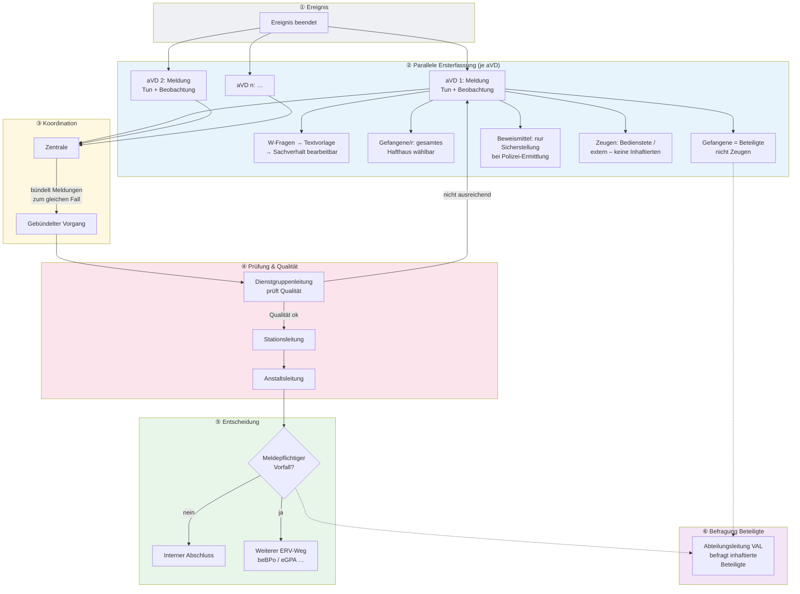
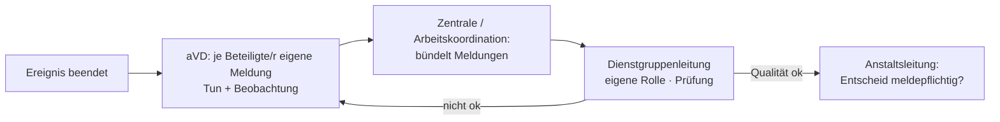
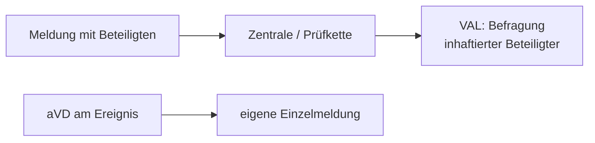

# Praxisfeedback – A2 eMeldewesen

Dieses Dokument sammelt **Feedback von Praxisexpert:innen** (aVD, SL, VAL, AL, ggf. Kammer) zu Meldeprozessen und zum **Prototypen**. Es ergänzt – ersetzt nicht – den **[Gesamtprozess](GESAMTPROZESS.md)**, [RUECKFRAGEN_UND_OFFENE_PUNKTE.md](RUECKFRAGEN_UND_OFFENE_PUNKTE.md) und das [Lastenheft](LASTENHEFT/README.md).

**Version:** 0.18 | **Stand:** 2026-06-02

---

## Gesamtschaubild – feedbacketer Prozess (Praxis)

*Alle bisherigen Praxisfeedback-Punkte in einem Ablauf. Gestrichelte Kästen = parallele bzw. optionale Schritte.*

### Legende

| Phase | Inhalt | Feedback-IDs |
|-------|--------|--------------|
| ② Ersterfassung | Unmittelbar nach Ereignisende; W-Fragen; Haus-weite Gefangenenauswahl; Beteiligte ≠ Zeugen; Sicherstellung | E-01–E-04, T-01, S-01, Z-01, BM-01 |
| ③ Zentrale | Bündelung gleicher Fälle, Koordination | D-01, P-01 |
| ④ DGL | Prüfung, Rückgabe, Qualitätskriterien | P-02 |
| ⑤ AL / VAL | Entscheid **meldepflichtig** ja/nein (K2: VAL oder AL) | V-01 |
| ⑥ VAL | Befragung inhaftierter **Beteiligter** (nicht Zeugenprozess) | S-01, Z-02 |

**Offen (nicht im Schaubild verbindlich):** JVA-Abweichungen bei Rollenkette (A4).

**Rollenzuordnung (beantwortet 2026-06-09):** Zentrale = **`arbeitskoordination`**; Dienstgruppenleitung = **eigene Rolle** (nicht `stationsleitung` / nicht `val`); Bündeln nur Zentrale.

---

## Ist-Prozess laut Praxis (Kernablauf)

*Quelle: Praxisfeedback, 2026-06-08 · Rollenzuordnung ergänzt 2026-06-09.*

| Schritt | Praxis (Soll) | Prototyp (Stand 2026-06-11) |
|---------|---------------|------------------------------|
| 1 | Nach Ende des Ereignisses schreiben **alle beteiligten aVD unmittelbar** eine Meldung (eigenes Tun + Beobachtung). | ✅ Parallele Einzelmeldungen (`SUBMITTED`); je aVD eigene Meldung. |
| 2 | **Zentrale** (`arbeitskoordination`) bündelt zum **gleichen Fall** – **nur** Zentrale. | ✅ `/api/faelle`, Hub Fall-Bündelung, Vorschläge Tatzeit/Tatort. |
| 3 | **Dienstgruppenleitung** prüft, gibt bei Bedarf **zurück**; bei Qualität → **AL**. | ✅ Rolle `dienstgruppenleitung`; Freigabe/Rückgabe. **Offen:** Rückgabe an aVD (OP-DGL-03). |
| 4 | **AL** entscheidet **meldepflichtig** (= ERV): **nein** → Archiv; **ja** → ERV AL/VAL. | ✅ `entscheid-al` → `ABGESCHLOSSEN_INTERN` / `ERV_WEG`. |

→ Gesamtdoku: [PROZESS_SOLL_UND_STAND.md](PROZESS_SOLL_UND_STAND.md)

### Rollenzuordnung (beschlossen / beantwortet)

| Rückfrage | Antwort | Prototyp-Impuls |
|-----------|---------|-----------------|
| **A1** – Wer ist die „Zentrale“? | **`arbeitskoordination`** | Bündel-UI + Aufgaben für Rolle `arbeitskoordination` |
| **A2** – Wer ist die Dienstgruppenleitung? | **Eigene Rolle** (nicht `stationsleitung`, nicht `val`) | ✅ Rolle `dienstgruppenleitung` (DGL) im Prototyp; Workflow Block B offen |
| **A3** – Wer bündelt? | **Nur die Zentrale** | Berechtigung Bündeln ausschließlich `arbeitskoordination` |
| **A4** – JVA-Abweichungen? | **Im Workshop klären** (P2) | OP-JVA-01; Anhang A JVA-Matrix |

### Parallele Ersterfassung (Block B – beantwortet / offen)

| Rückfrage | Antwort | Prototyp-Impuls |
|-----------|---------|-----------------|
| **B1** – Wann Pflicht zur Meldung? | **Unmittelbar nach dem Ereignis** – ggf. **nachdem es aufgelöst** wurde (nicht während der laufenden Intervention). In **besonders schwerwiegenden** Fällen zuvor **telefonische Vorabmeldung** (ggf. Polizei) → **OP-M-01** | Erfassungsmaske/Timing-Hinweis; kein Melden mitten in der Akutsituation; Verknüpfung Telefonat ↔ schriftliche Meldung offen |
| **B2** – Wie erkennen aVD den gleichen Fall? | **Alle Beteiligten** melden **direkt nach dem Ereignis**; **alle** Meldungen werden **gebündelt** und **weitergeleitet** (Zentrale). Zuordnung zum Ereignis fachlich durch Beteiligung am selben Vorfall, nicht durch System-Fall-ID. | Erfassung unmittelbar nach Ereignis; Bündelung/Weiterleitung Zentrale (F1/F2); **offen:** techn. Verknüpfungshilfe (Tatzeit/Tatort/Ereignis-ID) |
| **B3** – Müssen alle aVD melden? | **Ja** – alle am Ereignis Beteiligten (siehe **F2**) | E-01 |
| **B4** – Ein oder mehrere Hauptbeteiligte? | **Ein** Hauptbezug pro Meldung (`gefangeneId`); **ein oder mehrere** beteiligte Gefangene am Ereignis möglich (L2) | `gefangeneId` + `metadaten.beteiligte[]` (Z-03) |
| **B5** – Hafthaus-Auswahl Meldungstypen? | **Insassen nach Hafthaus filterbar** (alle Stationen des Hauses) – **für alle Meldungstypen** — **sicher** (Workshop 2026-06-17) | E-03: `?haus=`-Filter im Formular |

### Fall-Bündelung (Block F – Vorentwurf / **Annahme, nicht validiert**)

> **⚠️ OP-FB-01:** Die Antworten F1–F5 stammen aus **Praxisfeedback (eine Perspektive)** und bilden den **modellierten Vorentwurf** – der **Gesamtprozess Fall-Bündelung** ist **noch nicht workshop-validiert** (mehrere JVAs, OP-JVA-01).

| Rückfrage | Antwort | Prototyp-Impuls |
|-----------|---------|-----------------|
| **F1** – Nach welchen Kriterien bündelt die Zentrale? | **Alle Meldungen zum gleichen Fall** werden gebündelt – es sind **verschiedene Perspektiven** (je aVD: eigenes Tun + Beobachtung) auf **denselben Vorfall**, nicht verschiedene Vorfälle. | Bündel-UI: Hinweis „Perspektiven zum gleichen Fall“; ggf. Vorschläge nach Tatzeit/Tatort (Assistenz, keine Auto-Bündelung) |
| **F2** – Ungebündelte Einzelmeldungen / Vollständigkeit? | **Alle** beteiligten aVDs melden **unmittelbar**; fachlich **alle** zu **einem** Fall. **Kein Hartblock** beim Weiterleiten; fehlende Meldung bei **fachlicher Prüfung anfordern** (J2). | Nachforderung DGL; kein System-Stop |
| **F3** – Qualitätskriterien DGL? | **Fachliche Kriterien** an eine Meldung + **inhaltliche Stimmigkeit** (gebündelte Perspektiven). **Konkrete Kriterienliste** noch zu erarbeiten → offene Punkte. | DGL-Prüf-Checkliste im Prototyp; Inhalte Workshop/Lastenheft |
| **F4** – Rückgabe an wen? | **Beides** – an die **betroffenen aVD** (Nachbesserung) **und** an die **Zentrale** (Koordination/Vollständigkeit). | Workflow: DGL-Rückgabe → aVD + AK; Prototyp derzeit nur `ZURUECK_AK` |
| **F5** – Häufigkeit Rückgabe? | **Keine Grenze** – solange die Qualität nicht ausreicht, darf **immer wieder** zurückgegeben werden. | Kein Max.-Zähler; Schleife DGL ↔ Zentrale/aVD bis Qualität ok |

### Beteiligte, Zeugen, VAL-Befragung (Block D – beantwortet)

| Rückfrage | Antwort | Prototyp-Impuls |
|-----------|---------|-----------------|
| **D1** – Zeugen im Meldewesen? | **Kein Zeugenkonzept** — nur **Beteiligte** (inhaftiert). Bedienstete am Ereignis → **eigene Einzelmeldung**, keine Zeugenliste. **Sicher** (Workshop 2026-06-17). | `ZeugenEditor` **entfernen** (OP-Z-01); nur Beteiligtenfelder |
| **D2** – Externe Zeugen im Meldewesen? | **Zeugenaussagen** externer Personen nimmt die **Polizei** auf; in der Meldung: **Ja/Nein Polizei eingeschaltet** (M1). | Pflichtfeld Polizei Ja/Nein; kein Zeugenfeld Externe |
| **D3** – Wann VAL-Befragung? | **Danach** – nur nach Entscheid **meldepflichtig ja** — **sicher** (Validierung 2026-06-17) | VAL-Aufgabe erst nach Entscheid „ja“ |
| **D4** – Anordnung vs. Ergebnis? | **Anordnung** zur Befragung; **Ergebnis** **im Nachgang** – beides **am Fall** (O4). | `anordnungBefragung` / `ergebnisBefragung` am `MeldungsFall` |
| **D5** – Wer löst VAL-Aufgabe aus? | **VAL selbst** (nicht Zentrale/DGL/automatisch). | Kein Auto-Task; VAL startet Befragung eigenständig |

### Beweismittel / Sicherstellung (Block E – beantwortet)

| Rückfrage | Antwort | Prototyp-Impuls |
|-----------|---------|-----------------|
| **E1** – Erhebung vs. Sicherstellung? | **Ja bestätigt:** JVA **erhebt nicht**, **sichert** nur bei möglichen **Polizeiermittlungen**. | UI/Lastenheft: „Sicherstellung“, nicht „Erhebung“ |
| **E2** – Pflicht Ja/Nein? | **Ja** – bei **jeder** Meldung Pflichtangabe, auch ohne physische Spuren (nur **Beteiligte**). | Validierung Einreichung `beweismittelGesichert`; Begründung bei „Nein“ |
| **E3** – Wer sichert physisch? | **aVD**; **Kammer** nur in **bestimmten Fällen** (M2 → Workshop, OP-BM-01). | Rolle aVD; Kammer-Fälle Workshop |
| **E4** – Foto/Upload Pflicht? | **Keine Pflicht** – Kurzbezeichnung reicht; **Nachreichung** möglich (z. B. Rückgabe Ergänzungserfassung). | Upload optional; Nachreichungsworkflow |
| **E5** – Übergabe Polizei/Kammer? | In der **Meldung genügt der Hinweis**, **wenn** übergeben wurde – kein eigener Übergabe-Prozessschritt im Meldewesen. | Freitext/Hinweisfeld; kein Tracking-Modul Übergabe |
| **E6** – Rolle Kammer? | Kammer **nur informieren**, wenn sie **betroffen** ist (nicht pauschal bei jeder Sicherstellung). | Kein Auto-Hinweis Kammer; ggf. manueller Hinweis |

### Fristen und Eskalation (Block H – beantwortet)

| Rückfrage | Antwort | Prototyp-Impuls |
|-----------|---------|-----------------|
| **H1** – Frist Ersterfassung? | **24 Stunden** nach dem Ereignis (Feststellung/Auflösung). | SLA-Hinweis Erfassung; Anbindung B1 |
| **H2** – 24-h-Regel Prüfung / extern? | Gilt auch für **fachliche Prüfung**. **Externe Meldung** (meldepflichtig): **24 h ab Ereignisende** (N2), **nicht** ab AL-Entscheid. **Werktage**; WE: Sammeln bis **Montag 08:00** (N1). | SLA ab Ereignisende; WE → Montag 08:00 |
| **H3** – Fristbeginn Wochenende? | Frist startet **ab Ereignisende**; über **Wochenende/Feiertage** wird **gesammelt** (kein laufender Werktagszähler); Fortsetzung **Montag 08:00** (N1). | `getSlaHinweise`: Pause WE/FT → Montag 08:00 |
| **H4** – Fehlende aVD-Meldungen? | Meldungen **direkt nach dem Ereignis**; Mitarbeitende sollen **unmittelbar** melden können. **Offen (OP-ORG-01):** Ob es eine **formale Freistellung** gibt (je JVA oder übergreifend) — **Regelung unbekannt**, Workshop. Keine separate Wartefrist der Zentrale. | Kein Eskalations-Timer „fehlende aVD“; organisatorische Ermöglichung im Prozess klären |
| **H5** – Zeugen-Frist Bedienstete? | **5 Werktage** für Zeugenaussage. | Mock-Frist Zeugen-Benachrichtigung auf Werktage umstellen |
| **H6** – Nachreichung? | **5 Werktage** nach Rückgabe zur Ergänzungserfassung. | A2-F-QS-004 / Rückgabe-Workflow |
| **H7** – „Dringend“-Flag? | **Nicht nötig** – kann **entfernt** werden. | `dringend`-Feld/UI aus `MeldungForm` streichen (H-P24, H-P50) |

### W-Fragen und Textvorlagen (Block C – teilweise beantwortet)

| Rückfrage | Antwort | Prototyp-Impuls |
|-----------|---------|-----------------|
| **C1** – Pflicht-W-Fragen? | **Vorentwurf Pflicht:** Wer · Wann · Was · Wo · Wohin. **BZ JV (vollständig):** + **Wie · Warum** → OP-W-01 | Assistent mit 5 Fragen als Start; 7 Fragen als Zielkatalog |
| **C2** – Tun vs. Beobachtung getrennt? | **Ein gemeinsamer Katalog** – Inhalt: **Schilderung des Vorfalls aus der Sicht des/der Meldenden mit eigener Beteiligung** (Tun + Wahrnehmung in einem Text). | Ein Fragenkatalog je aVD-Meldung; Vorlage als Ereignisdarstellung aus Ich-Perspektive |
| **C3** – Pflege/Freigabe Bausteine? | **Offener Punkt** (L4) → OP-W-02 | Workshop |
| **C4** – Bearbeitung vor Einreichung? | **Ja – vor der Einreichung**; W-Fragen **Pflicht** (L3), Textbausteine **optional** (L3) | Assistent mit Pflichtvalidierung |

### Fristen – Präzisierung (Block N – teilweise beantwortet)

| Rückfrage | Antwort | Prototyp-Impuls |
|-----------|---------|-----------------|
| **N1** – „Montag früh“ – Uhrzeit? | **08:00 Uhr** | WE/FT-Sammellogik: Fristfortsetzung Montag **08:00** |
| **N2** – 24-h extern ab wann? | Ab **Ereignisende** – **nicht** ab AL-Entscheid „meldepflichtig ja“ | SLA-Timer Ereignisende; unabhängig von AL-Entscheid-Zeitpunkt |
| **N3** – Eskalation bei Überschreitung? | **Erste Anlaufstelle: Stationsleitung**; **Eskalationsschleife** (weitere Stufen, Fristen, Rollen) → **Workshop** | Erststufe SL; vollständige Kette → **OP-H-03** |

### Zeugen, Sicherstellung, Kammer (Block M – teilweise beantwortet)

| Rückfrage | Antwort | Prototyp-Impuls |
|-----------|---------|-----------------|
| **M1** – Externe Zeugen / Polizei in Meldung? | Es genügt **Ja/Nein**, ob die **Polizei eingeschaltet** wurde | Pflichtfeld `polizeiEingeschaltet` (o. ä.); kein Zeugenfeld für Externe |
| **M2** – Kammer bei Sicherstellung – welche Fälle? | **Workshop** klären | OP-BM-01 |
| **M3** – Kammer im System informieren? | **Workshop** klären | OP-BM-02 |

### Gesamtprozess – Ersterfassung & Inhalt (Block L – beantwortet)

| Rückfrage | Antwort | Prototyp-Impuls |
|-----------|---------|-----------------|
| **L1** – Typ im Fall? | Gebündelte Meldungen = **ein Fall** mit **einem** Meldungstyp (immer gleicher Typ) | Validierung bei Bündelung: gleicher `meldungsTyp` |
| **L2** – Bezug aVD / Gefangene? | Meldung = **eigene** Handlungen + **eigene** Beobachtungen des aVD; **ein oder mehrere** beteiligte Gefangene möglich | `gefangeneId` + ggf. `metadaten.beteiligte[]` (Z-03) |
| **L3** – W-Fragen / Textbausteine? | **W-Fragen müssen beantwortet** sein; **Textbausteine optional** | Assistent Pflichtvalidierung; Vorlage nicht zwingend |
| **L4** – Pflege Textbausteine? | **Offener Punkt** (Workshop) | OP-W-02 |

### Gesamtprozess – Rollen & Weiterleitung (Block K – beantwortet)

| Rückfrage | Antwort | Prototyp-Impuls |
|-----------|---------|-----------------|
| **K1** – Rolle Stationsleitung? | **Erhält Fallmeldung** vom **DGL** | Status `ZUR_SL`; SL-Arbeitskorb |
| **K2** – VAL vor AL? | **Zu validieren (2026-06-17):** **AL oder VAL** kann Meldepflicht entscheiden? | Entscheid-UI für `val` + `anstaltsleitung`; **OP-K-03** |
| **K3** – DGL Meldepflicht? | **Nein** | Keine Entscheid-Buttons für DGL |
| **K4** – Weiterleitung nach DGL? | **DGL → Stationsleitung → AL** (nicht DGL direkt an AL) | `weiterleiten-sl` + `weiterleiten-al` (OP-K-02) |

### Gesamtprozess – Validierung (Block J – beantwortet)

| Rückfrage | Antwort | Prototyp-Impuls |
|-----------|---------|-----------------|
| **J1** – Geltung Meldungstypen? | **Alle gleich** – gleicher Gesamtprozess für alle Meldungstypen | Kein typ-spezifischer Abzweig vor DGL |
| **J2** – Vollständigkeit vor DGL? | **Nicht hart blockieren**; Praxis: alle melden unmittelbar; bei Prüfung **fehlende Meldung anfordern** | Kein System-Stop; DGL/Nachforderung-UI |
| **J3** – Wer bearbeitet bei Rückgabe? | **Einzelmeldung bearbeiten** (betroffene **aVD**) | Rückgabe → aVD-Bearbeitung, nicht nur Zentrale |
| **J4** – Interner Abschluss? | **AL oder ggf. auch VAL** — **OP-ABS-01** (2026-06-17; vorher: nur AL) | Abschluss-Aktion Rollen klären |
| **J5** – ERV-Ebene? | **Fall-Ebene** (ein ERV-Vorgang pro Fall) | beBPo/eGPA am Fall, nicht je Einzelmeldung (OP-ERV-02) |

### Abgrenzung & Vollständigkeit (Block P – teilweise beantwortet)

| Rückfrage | Antwort | Prototyp-Impuls |
|-----------|---------|-----------------|
| **P1** – Basisbeobachtungen JVP? | **Dienstprotokoll der aVD**, das **am Schichtende** ausgefüllt wird – **Vorentwurf; Workshop-Validierung** | JVP-Modul (nicht A2); OP-JVP-01 |
| **P2** – JVA-Abweichungen Rollenkette? | **Im Workshop definieren/klären** | OP-JVA-01; Anhang A |
| **P3** – Fehlende Schritte/Rollen? | **Im Workshop definieren/klären** | OP-P-01; GESAMTPROZESS-Review |

### ERV & Nachgelagert (Block O – beantwortet)

| Rückfrage | Antwort | Prototyp-Impuls |
|-----------|---------|-----------------|
| **O1** – Reihenfolge beBPo / eGPA? | **Ziel:** **Nicht meldepflichtig** → kein beBPo, **Veraktung** (eGPA). **Meldepflichtig ja** → beBPo vor eGPA. **Zu validieren (2026-06-17):** eGPA **nicht ausgerollt** — **übergangsweise andere Veraktung** → **OP-EGPA-01** | Prototyp Mock; Ist-Prozess klären |
| **O2** – Schritt „versandfähig“? | **Ja** – vor beBPo; setzen dürfen **AL und VAL** (**beide**) | Fall-Status `versandfaehig`; Button für `anstaltsleitung` + `val` |
| **O3** – Vier-Augen ERV-Abschluss? | **AL und VAL** dürfen abschließen (**beide**) | Vier-Augen-Prüfung VAL↔AL am Fall; OP-V-02 |
| **O4** – VAL-Befragung Ergebnis wo? | **Am gebündelten Fall** (nicht je Einzelmeldung) | Metadaten/Felder am `MeldungsFall`; Z-02 |

### Anstaltsleitung / Meldepflicht (Block G – beantwortet)

| Rückfrage | Antwort | Prototyp-Impuls |
|-----------|---------|-----------------|
| **G1** – „Meldepflichtig“ = ERV? | **Gleichbedeutend** – meldepflichtiger Vorfall = **ERV-pflichtig** — **sicher** (Validierung 2026-06-17) | Entscheid **VAL oder AL** (K2, **OP-K-03**) |
| **G2** – Zusätzliche Unterlagen für AL? | **Nein** – **keine gesonderten Zusatzunterlagen**; Entscheidung auf Basis des **gebündelten Falls**, der der AL vorliegt (Inhalte inkl. Sicherstellung bereits darin). | Fall-Detail `ZUR_AL` reicht; kein Extra-Paket |
| **G3** – „Meldepflichtig nein“? | **Interner Abschluss**; **kein beBPo**; **direkt eGPA** (O1). Abschluss: **AL oder ggf. VAL** — **OP-ABS-01** | eGPA-Button; kein beBPo bei „nein“ |
| **G4** – Wer ERV-Weg (beBPo/eGPA)? | **Zu validieren:** **ggf. eine Person** (AL **oder** VAL) — **OP-ERV-03**. **Ja:** beBPo → eGPA. **Nein:** nur eGPA (O1). | Verakten/eGPA und beBPo je nach Entscheid |

---

## Arbeitsregel

| Inhalt | Vorgehen |
|--------|----------|
| Neues Gespräch / Workshop | Abschnitt **Sitzungsprotokoll** anlegen (Datum, JVA, Teilnehmer) |
| Konkrete fachliche Aussage | In passende **Prozessphase** oder **Meldungstyp** eintragen |
| Umsetzung im Prototyp | Spalte **Prototyp-Impuls** + ggf. Verweis auf [HACKATHON_A2_AUFNAHME_TODOS.md](HACKATHON_A2_AUFNAHME_TODOS.md) (H-P / H-A) |
| Offene Klärung ohne Antwort | Kurz hier notieren **und** in [RUECKFRAGEN_UND_OFFENE_PUNKTE.md](RUECKFRAGEN_UND_OFFENE_PUNKTE.md) (Chronik) übernehmen |
| Beschluss / Abweichung je JVA | Spalte **JVA** + ggf. [LASTENHEFT/ANHANG_A_JVA_MATRIX.md](LASTENHEFT/ANHANG_A_JVA_MATRIX.md) |

**Legende Priorität:** P1 = Prototyp-Workshop kritisch · P2 = Lastenheft wichtig · P3 = später / Zielsystem

---

## Sitzungsprotokolle

### Sitzung ___ – ___________ (JVA: ___________)

| Feld | Inhalt |
|------|--------|
| **Datum** | |
| **Ort / Format** | vor Ort · Teams · Telefon |
| **Teilnehmer** | Rolle, Name, JVA |
| **Moderation / Protokoll** | |
| **Prototyp-Version** | Branch / Ordner / Commit (z. B. `meldewesen-a2-main`) |
| **Durchgeklickter Pfad** | z. B. Strafanzeige Erfassung → Einreichung → VAL-Prüfung |

**Kernaussagen (3–5 Sätze):**

1.
2.
3.

**Top-3 für Prototyp als Nächstes:**

1.
2.
3.

---

## 1 Dashboard und Übersicht

| Nr | Feedback (Zitat / Paraphrase) | JVA | Prototyp-Impuls | Prio | Status |
|----|------------------------------|-----|-----------------|------|--------|
| D-01 | **Zentrale** (= **`arbeitskoordination`**) koordiniert Meldewesen und **bündelt allein** Meldungen zum **gleichen Fall** (verschiedene aVD-Perspektiven auf einen Vorfall). | F1 | ✅ Hub „Fall-Bündelung“; Kriterium: gleicher Fall / Perspektiven | P1 | prototyp |
| D-02 | | | | | offen |

**Leitfragen:** Was muss auf dem Dashboard sofort sichtbar sein? Was bedeutet „in Bearbeitung“ / „überfällig“?

---

## 2 Ersterfassung (Entwurf)

| Nr | Feedback | JVA | Prototyp-Impuls | Prio | Status |
|----|----------|-----|-----------------|------|--------|
| E-01 | **Unmittelbar nach dem Ereignis** (ggf. nach Auflösung) schreiben **alle beteiligten aVD** eine Meldung (Tun + Beobachtung); **alle** Beteiligten-Meldungen **müssen** zu **einem** Fall gebündelt werden (B1, F1, F2). | B1, F1, F2 | Parallele Erfassung; Zentrale bündelt wenn vollständig; Vollständigkeitsprüfung im Prototyp offen | P1 | teilweise |
| E-02 | **W-Fragen** (gemeinsamer Katalog, C2) → **Vorfall-Schilderung** aus Ich-Sicht mit Beteiligung → **vor Einreichung** bearbeitbar (C4). Pflichtfragen-Vorentwurf: **Wer, Wann, Was, Wo, Wohin** (C1, prüfen). | C1, C2, C4 | Assistent „Fragen → Text“; C3 (Pflege) offen | P1 | teilweise |
| E-03 | Bei Auswahl **Gefangene/r** müssen alle Inhaftierten des **gesamten Hafthauses** auswählbar sein (alle Stationen) – **alle Meldungstypen** (B5). | B5 | ✅ `MeldungForm` + `?haus=` aus Nutzer-`abteilung`; Backend-Validierung | P1 | prototyp |
| E-04 | **Sicherstellung** (nicht Erhebung) bei möglichen **Polizeiermittlungen**; **Pflicht Ja/Nein** je Meldung (E2); **aVD** sichert physisch; Hinweis in Meldung bei Übergabe (E5); Foto **optional**, Nachreichung (E4). | E1–E6 | Abschnitt **12**; UI `BeweismittelErfassung.jsx` | P1 | beantwortet |

**Leitfragen:** Pflichtfelder, Entwurf vs. Einreichung, Gefangenenbezug (**Haus vs. Station**), **Beweismittel = Sicherstellung** (nicht Erhebung), Dringend-Flag, **W-Fragen-Assistent** für Sachverhalt.

**Abgleich Prototyp (E-03):** Hauptbeteiligten-Auswahl in `MeldungForm` filtert nach **Hafthaus** (`abteilung` des Nutzers, z. B. „Abteilung 1“). Nutzer ohne Hafthaus (Leitung, Zentrale) sehen weiterhin die **gesamte JVA** (Prototyp-Ausnahme).

---

## 3 Strafanzeige

| Nr | Feedback | JVA | Prototyp-Impuls | Prio | Status |
|----|----------|-----|-----------------|------|--------|
| S-01 | **Gefangene = Beteiligte**, nicht Zeugen (D1). **Befragung** durch **VAL selbst** (D5), **nach** AL-Entscheid meldepflichtig (D3); Anordnung vorher, Ergebnis nachher (D4). | D1, D3–D5 | Abschnitt **13**; VAL-Workflow + Zeugen-UI anpassen | P1 | teilweise |
| S-02 | | | | | offen |

**Leitfragen:** Tatvorwurf (BTM/aoV/Diebstahl), **Beteiligte vs. Zeugen**, Anlagen, Einreichung → Zentrale/DGL/AL.

---

## 4 Interner Vorfall

| Nr | Feedback | JVA | Prototyp-Impuls | Prio | Status |
|----|----------|-----|-----------------|------|--------|
| I-01 | | | | | offen |
| I-02 | | | | | offen |

**Leitfragen:** Empfänger Abteilung/Leitung, Gefangenenbezug, Abschluss ohne ERV.

---

## 5 Meldung an Gericht

| Nr | Feedback | JVA | Prototyp-Impuls | Prio | Status |
|----|----------|-----|-----------------|------|--------|
| G-01 | | | | | offen |
| G-02 | | | | | offen |

**Leitfragen:** Aktenzeichen, Gericht als Empfänger, Anlagen, ERV-Kette wie Strafanzeige.

---

## 6 Nach Einreichung – Prüfung und Bearbeitung

| Nr | Feedback | JVA | Prototyp-Impuls | Prio | Status |
|----|----------|-----|-----------------|------|--------|
| P-01 | **Zentrale** (`arbeitskoordination`) bündelt Einzelmeldungen und leitet **gebündelt** an **Dienstgruppenleitung** (eigene Rolle) weiter. | (offen) | ✅ Prototyp: `/api/faelle`, Hub „Fall-Bündelung“, Status `ZUR_DGL` | P1 | prototyp |
| P-02 | **Dienstgruppenleitung** prüft **fachliche Kriterien** + **inhaltliche Stimmigkeit**; bei Erfüllung → **AL**; sonst Rückgabe an **aVD und Zentrale**, **ohne Begrenzung** der Wiederholungen. | F3–F5 | ✅ Freigabe/Rückgabe; **offen:** Kriterienliste (OP-DGL-01), Rückgabe an aVD im Prototyp | P1 | teilweise |
| P-03 | | | | | offen |

**Leitfragen:** Was bedeutet „fachliche Prüfung“? Wer übernimmt? Rückgabe an Station? Anhörung vor Versand?

---

## 7 ERV, beBPo, eGPA, Abschluss

| Nr | Feedback | JVA | Prototyp-Impuls | Prio | Status |
|----|----------|-----|-----------------|------|--------|
| V-01 | **Meldepflichtig ja/nein** (G1). **Nein** → **eGPA** ohne beBPo (O1, G3). **Ja** → **beBPo → eGPA** (O1, G4). **AL und VAL**. | G1–G4, O1 | beBPo nur bei „ja“; eGPA beide Pfade | P1 | teilweise |
| V-02 | **O1–O4** geklärt: versandfähig (AL+VAL), Vier-Augen (beide), Befragung am Fall | O1–O4 | OP-V-02 (Prototyp) | P1 | beantwortet |

**Leitfragen:** Prototyp-Umsetzung ERV-Kette → **OP-V-02** (O1–O4 fachlich geklärt).

---

## 8 Fristen und Eskalation

| Nr | Feedback | JVA | Prototyp-Impuls | Prio | Status |
|----|----------|-----|-----------------|------|--------|
| F-01 | **24 h** Erfassung (H1) und **24 h** fachliche Prüfung / **externe Meldung** bei meldepflichtigem Ereignis nach **Feststellung** (H2). **Werktage**; WE/FT: **Sammeln bis Montag früh** (H2–H3). | H1–H3 | SLA-Engine Werktage + Wochenend-Pause; ERV-Countdown nach Feststellung | P1 | beantwortet |
| F-02 | **aVD:** Meldung **sofort** nach Ereignis, **Freistellung** (H4). **Zeugen:** 5 **Werktage** (H5). **Nachreichung:** 5 **Werktage** (H6). **Dringend** entfällt (H7). | H4–H7 | Zeugen-Frist; Rückgabe-Frist; Dringend-UI entfernen | P1 | beantwortet |

**Leitfragen:** Erinnerungen/Eskalationskette SL → VAL → AL im Detail (Zielsystem); Feiertagskalender je JVA (Anhang A).

---

## 9 Medienbrüche und Schmerzpunkte (Ist heute)

| Nr | Was läuft heute außerhalb des (geplanten) Meldewesens? | JVA | Wunsch fürs Zielsystem | Prio |
|----|--------------------------------------------------------|-----|------------------------|------|
| M-01 | | | | |
| M-02 | | | | |

---

## 14 Offene Punkte – Justizvollzugsplattform (JVP)

*Abgrenzung zu **eMeldewesen (A2)** – eigene Fachverfahren-Kachel / Modul auf der JVP, nicht Teil des Meldeprozesses.*

| Nr | Offener Punkt | JVA | Scope | Prio | Status |
|----|---------------|-----|-------|------|--------|
| JVP-01 | **Basisbeobachtungen** = **Dienstprotokoll aVD** am **Schichtende** (P1, Vorentwurf). Eigenes JVP-Modul, **nicht** eMeldewesen. | P1 | JVP-Dashboard; Abgrenzung A2; **Workshop-Validierung** OP-JVP-01 | P2 | teilweise |

**Offene Klärung (Workshop, OP-JVP-01):**

- **P1 validieren:** Inhalt/Pflicht des **Dienstprotokolls**; Bezug zu **Ereignis-Meldungen** (eMeldewesen) und BASIS-Web.
- Soll die JVP-Kachel **„Demnächst“** bleiben oder ins Lastenheft **Plattform** (nicht A2)?

---

## 13 Keine Zeugen – nur Beteiligte

### Anforderung (Praxis, **sicher** ab 2026-06-17)

Im Meldewesen gibt es **keine Zeugen** — ausschließlich **Beteiligte** (inhaftierte am Ereignis). Am Ereignis beteiligte **Bedienstete** dokumentieren sich über **eigene parallele Einzelmeldungen** (Phase ②), nicht über ein Zeugenmodul.

Die **Befragung** inhaftierter Beteiligter erfolgt durch die **VAL** – **nicht** als Zeugenprozess. **Zeitpunkt:** **nach** AL-Entscheid meldepflichtig (D3). **Dokumentation:** **Anordnung** und **Ergebnis** **am gebündelten Fall** (D4, O4). **Auslösung:** **VAL selbst** (D5).

| Rolle im System | Praxis (Soll) | Nicht Soll |
|-----------------|---------------|------------|
| **Hauptbeteiligte/r** (Gefangene/r) | Bezug zur Meldung (ein `gefangeneId`, B4); ggf. weitere Beteiligte | Zeugenmodul |
| **Bedienstete am Ereignis** | **Eigene Einzelmeldung** (Ich-Perspektive) | Als „Zeuge“ erfassen |
| **Externe / Polizei** | **Polizei** ggf. vor Ort; Meldung: **Ja/Nein Polizei eingeschaltet** (M1) | Zeugenfeld für Externe |
| **Befragung Beteiligte/r** | **VAL**, nach AL-Entscheid, selbst ausgelöst | Zeugenprozess Station/aVD |

### Abweichung Prototyp heute

| Aspekt | Heute | Soll |
|--------|--------|------|
| `ZeugenEditor` | Bedienstete + `inhaftierter` mit Zeugenworkflow | **Komplett entfernen** (OP-Z-01) |
| Folgeaktionen | Mock: Zeugen-Benachrichtigung, 5 WT (H5) | **Entfällt** |
| Hauptfeld Gefangene/r | `gefangeneId` als Hauptbeteiligte/r | Passt; ggf. **weitere Beteiligte** (inhaftiert) |
| Polizei | Feld fehlt | **Ja/Nein** (M1, OP-Z-02) |

### Feedback-Tabelle

| Nr | Feedback | JVA | Prototyp-Impuls | Prio | Status |
|----|----------|-----|-----------------|------|--------|
| Z-01 | **Kein Zeugenkonzept** — nur **Beteiligte**; Bedienstete über **eigene Meldung** (D1, 2026-06-17) | D1 | `ZeugenEditor` **entfernen** | P1 | sicher / Prototyp offen |
| Z-02 | **VAL** befragt Beteiligte **nach** AL-Entscheid; **selbst** ausgelöst; Anordnung/Ergebnis **am Fall** (O4), zweiphasig (D3–D5) | D3–D5, O4 | Felder am `MeldungsFall` | P1 | teilweise |
| Z-03 | **Ein oder mehrere** beteiligte Gefangene je Meldung (L2); `gefangeneId` = Hauptbezug | L2 | `metadaten.beteiligte[]` | P2 | teilweise |

---

## 12 Beweismittel – Sicherstellung (nicht Erhebung)

### Anforderung (Praxis)

**Beweismittel werden in der Regel nicht erhoben**, sondern lediglich **sichergestellt** – und zwar in Vorbereitung auf bzw. für den Fall von **Polizeiermittlungen**.

| Begriff | Praxis (Soll) | Nicht gemeint |
|---------|---------------|---------------|
| **Sicherstellung** | Spuren/Gegenstände **bewahren**, dokumentieren, ggf. an Polizei/Kammer übergeben | Eigene „Ermittlung“ durch JVA |
| **Erhebung** | obliegt **Polizei** / externen Ermittlungsbehörden | Kein JVA-Standardprozess im Meldewesen |

**Konsequenz für Meldungen:** Das Feld dokumentiert, **ob** und **was** die JVA **gesichert** hat – nicht, ob die JVA Beweise „erhoben“ hat.

### Abweichung Prototyp heute

| Aspekt | Heute | Anpassung Soll |
|--------|--------|----------------|
| Feld `beweismittelGesichert` | Label „Beweismittel“, Hinweis „gesichert“ | Passt grob; Begriff **Sicherstellung** in UI/Lastenheft vereinheitlichen |
| Datei-Upload | „Beweismittel als Datei“ | Klarstellen: Dokumentation der **Sicherstellung** (Foto/Liste), keine „Erhebung“ |
| Nachforderung VAL | „Beweismittel nachfordern“ | Fachlich: Nachweis/Angaben zur **Sicherstellung** oder Begründung „nichts zu sichern“ |
| Kammer | E6 | Nur bei **Betroffenheit** informieren; physisch nur in **bestimmten Fällen** (E3, OP-BM-01) |

### Feedback-Tabelle

| Nr | Feedback | JVA | Prototyp-Impuls | Prio | Status |
|----|----------|-----|-----------------|------|--------|
| BM-01 | Keine **Erhebung**; nur **Sicherstellung** bei **Polizeiermittlungen** (E1) | E1 | UI: „Sicherstellung“; Hilfetext Polizei-Kontext | P1 | beantwortet |
| BM-02 | **Ja/Nein Pflicht** bei **jeder** Meldung – auch ohne materielle Spuren (nur **Beteiligte**, E2) | E2 | Einreichungs-Validierung; „Nein“ mit Kurzbegründung | P1 | beantwortet |
| BM-03 | **Übergabe:** In Meldung **Hinweis** genügt, wenn übergeben (E5); kein Meldewesen-Tracking | E5 | Hinweisfeld; Zielsystem außerhalb A2 | P2 | beantwortet |
| BM-04 | **Physische Sicherstellung:** **aVD**; Kammer **nur in bestimmten Fällen** (E3) | E3 | Rollenhinweis aVD; Kammer-Fälle → OP-BM-01 | P1 | teilweise |
| BM-05 | **Kammer:** nur informieren, wenn **betroffen** (E6) | E6 | Kein pauschaler Kammer-Workflow | P2 | beantwortet |
| BM-06 | **Foto/Upload:** keine Pflicht; **Nachreichung** möglich (E4) | E4 | Optionaler Upload; Anbindung Rückgabe/Nachreichung | P1 | beantwortet |

### Offene Klärung (Workshop)

- **M2 / OP-BM-01:** In welchen **bestimmten Fällen** ist die **Kammer** bei physischer Sicherstellung beteiligt (E3)?
- **M3 / OP-BM-02:** Muss die Kammer bei Sicherstellung **im System** informiert werden – oder reicht **telefonisch/außerhalb**?
- Formulierung UI: „Wurden Beweismittel **gesichert**?“ vs. Bezug **Polizeiermittlung** – Präferenz?

---

## 11 Textvorlagen und W-Fragen (Sachverhalt)

### Anforderung (Praxis)

Meldetexte sollen **präzise und rechtsicher** formuliert sein, ohne dass jede:r Bedienstete:r einen Freitext von Null schreiben muss.

**Idee (Soll):**

1. Das System stellt **W-Fragen** (z. B. Wer? Was? Wann? Wo? Warum? Wie?).
2. Antworten sind **kurz** (Stichwort oder ein Satz) – keine langen Fließtexte in den Fragen.
3. Aus den Antworten wird eine **Textvorlage** für den Meldetext (Sachverhalt / Ereignisdarstellung) **zusammengesetzt**.
4. Die Vorlage wird im **Rich-Text-Feld angezeigt** und kann **manuell bearbeitet** werden, bevor gespeichert/eingereicht wird.

### Bezug zum Ist-Prozess (E-01 / C2)

**Ein gemeinsamer Fragenkatalog** (nicht getrennt Tun/Beobachtung): Ziel ist eine **Schilderung des Vorfalls aus der Sicht des/der Meldenden** **mit eigener Beteiligung** (Handeln und Wahrnehmung in einem Text).

| Pflicht-W-Fragen (Vorentwurf C1, prüfen) | Vollständiger Katalog BZ JV (GZ-A4) |
|-------------------------------------------|-------------------------------------|
| Wer? · Wann? · Was? · Wo? · Wohin? | + **Wie? · Warum?** |

*Quelle W-Katalog: Bildungszentrum Justizvollzug Hamburg (`docs/20260610_HEUREA_WABE.docx`). Pflicht-Teilmenge: OP-W-01.*

### Grundsätze Abfassung und Abgabe (BZ JV)

Übernommen aus Schulungsunterlage HEUREKA/WABE; ausführlich in [GESAMTPROZESS.md](GESAMTPROZESS.md) Abschnitt **7.4 / 7.5**.

**Abfassung (GZ-A1–A5):** nur belegbare Tatsachen · wertungsfrei · für Nicht-Augenzeugen nachvollziehbar · W-Fragen · chronologisch.

**Abgabe (GZ-B1–B5):** so schnell wie möglich (→ 24 h, H1) · bei Eilbedürftigkeit **mündlich vor schriftlich** (→ OP-M-01) · Emotionsabstand vor Verfassen · Gegenlesen Vertrauensperson · Nachreichung im Kriseninterventionsfall (→ H6).

### Abweichung Prototyp heute

| Aspekt | Heute | Soll laut Praxisfeedback |
|--------|--------|---------------------------|
| Sachverhalt | Freies Rich-Text-Feld | Optional: **Fragen-Assistent** → generierte Vorlage |
| Vorlagen | keine | je **Meldungstyp** / ggf. Tatvorwurf |
| Rechtssicherheit | Nutzer:in allein verantwortlich | Leitfragen + einheitliche Textbausteine |

### Feedback-Tabelle

| Nr | Feedback | JVA | Prototyp-Impuls | Prio | Status |
|----|----------|-----|-----------------|------|--------|
| T-01 | W-Fragen mit Kurzantworten → **Textvorlage** → **bearbeitbarer** Meldetext | (offen) | UI-Wizard oder Seitenleiste; Template-Engine; Mapping Antwort → Satzbausteine | P1 | offen |
| T-02 | Vorlagen **rechtsicher** und **einheitlich** über JVAs | (offen) | Fachliche Pflege der Fragen/Textbausteine (Lastenheft/Anhang); Versionierung | P2 | offen |
| T-03 | Fragenkatalog ggf. je **Meldungstyp**; **kein** getrennter Tun-/Beobachtungs-Katalog (C2: gemeinsam) | C2 | Konfiguration JSON je `meldungsTyp`; ein Katalog je aVD-Schilderung | P2 | teilweise |

### Offene Klärung (Workshop)

- **C1 (Vorentwurf):** Wer · Wann · Was · Wo · Wohin – **nochmals fachlich/rechtlich prüfen** (OP-W-01).
- **C3** offen (Pflege/Freigabe Textbausteine).
- Reicht **ein** generierter Absatz oder **strukturierte Abschnitte** (Tatzeit, Beteiligte, Verlauf, Maßnahmen)?
- Soll die Vorlage auch für **PDF/beBPo** maßgeblich sein? (Verknüpfung [H-P40](HACKATHON_A2_AUFNAHME_TODOS.md) dynamische PDF)

---

## 15 Grundsätze zur Meldungsgestaltung (BZ JV)

*Quelle: `docs/20260610_HEUREA_WABE.docx` (Folien Bildungszentrum Justizvollzug Hamburg). Fachliche Referenz – nicht Workshop-Rückfrage, sondern übernommene Standards.*

### Abfassung

| ID | Grundsatz | Prototyp-Impuls |
|----|-----------|-----------------|
| GZ-A1 | Nur **überprüfbare, belegbare** Tatsachen | Validierungshinweise im Sachverhalt; DGL-Checkliste (F3) |
| GZ-A2 | **Frei von jeglicher Wertung** | Schulungstext / Beispiel negativ im Assistenten |
| GZ-A3 | **Genau und klar** – Nicht-Augenzeuge kann Ablauf und Beteiligte nachvollziehen | Qualitätsprüfung DGL; Volltext-Lesbarkeit |
| GZ-A4 | **W-Fragen:** Wer · Was · Wann · Wo · Wie · Warum · Wohin | W-Fragen-Assistent (L3, C1, OP-W-01) |
| GZ-A5 | **Chronologische** Reihenfolge | Strukturvorlage Sachverhalt; Ich-Perspektive (L2) |

### Abgabe

| ID | Grundsatz | Prototyp-Impuls |
|----|-----------|-----------------|
| GZ-B1 | Schriftlich **so schnell wie möglich** | SLA 24 h (H1); Freistellung aVD (H4) |
| GZ-B2 | **Besonders schwerwiegend:** **telefonische Vorabmeldung** vor schriftlicher Meldung; **ggf.** Polizei informiert | Grundsatz dokumentiert; Details → **OP-M-01** |
| GZ-B3 | Nach eigenem Beteiligungserlebnis **Zeit** für objektive, emotionsfreie Formulierung | Hinweistext im Formular (kein Frist-Stop) |
| GZ-B4 | **Gegenlesen** durch Vertrauensperson (ohne inhaltliche Korrektur); dann **Dienstweg** | Passt zu Bearbeitung vor Einreichung (C4) |
| GZ-B5 | **Kriseninterventionsfall:** Meldung **nachreichen** | Nachreichung 5 WT (H6) |

---

## 10 Abgleich Prototyp (Live-Test)

*Nach Durchklick im Prototyp ausfüllen.*

| Schritt (Happy Path) | Stimmt fachlich? | Abweichung / Kommentar | To-do (H-P / H-A) |
|----------------------|------------------|------------------------|-------------------|
| Dashboard / Filter | J · N · teils | | |
| W-Fragen → Textvorlage (Sachverhalt) | | | |
| Neue Meldung – Strafanzeige | | | |
| Einreichung + Dialog | | | |
| Detail / Landkarte | | | |
| VAL – Prüfung | | | |
| beBPo / eGPA / Archiv | | | |

Referenz: [HAPPY_PATH_STRAFANZEIGE.md](HAPPY_PATH_STRAFANZEIGE.md)

---

## Chronik

| Datum | Kurzinhalt | Verknüpfung |
|-------|------------|-------------|
| 2026-06-02 | **P1–P3:** Basisbeobachtungen = Dienstprotokoll aVD (Workshop); JVA-Abweichungen + Prozesslücken → Workshop | Block P; OP-JVP-01, OP-JVA-01, OP-P-01 |
| 2026-06-02 | **O2–O4:** versandfähig (AL+VAL); Vier-Augen beide; VAL-Befragung Ergebnis am Fall | Block O; GESAMTPROZESS v1.8; OP-V-02 |
| 2026-06-02 | **O1:** nicht meldepflichtig → kein beBPo, direkt eGPA; meldepflichtig ja → beBPo vor eGPA | Block O; GESAMTPROZESS v1.7 |
| 2026-06-02 | **N3 ergänzt:** Eskalationsschleife → Workshop (OP-H-03); Erststufe bleibt SL | Block N |
| 2026-06-02 | **N1–N3:** Montag 08:00; 24 h extern ab Ereignisende; Eskalation → SL | Block N; GESAMTPROZESS v1.6 |
| 2026-06-02 | **M1–M3:** Polizei Ja/Nein; Kammer-Fälle + Kammer-Kanal → Workshop (OP-BM-01, OP-BM-02) | Block M; GESAMTPROZESS v1.5 |
| 2026-06-02 | **Grundsätze BZ JV:** Abfassung GZ-A1–A5, Abgabe GZ-B1–B5 aus HEUREKA-WABE-Dokument; W-Katalog 7 Fragen | Abschnitt **15**; GESAMTPROZESS v1.4; OP-M-01 (mündliche Vorabmeldung) |
| 2026-06-11 | **Zurückgestellt:** C3, JVP-01, OP-BM-01, V-02 – bewusst offen für spätere Workshop-Runde | OP-W-02, JVP-01, OP-BM-01, V-02 |
| 2026-06-11 | **L1–L4:** Fall ein Typ; aVD Ich-Sicht; mehrere Gefangene; W-Fragen Pflicht; Bausteine optional/offen | Block L; GESAMTPROZESS v1.3 |
| 2026-06-11 | **K1–K4:** SL Fallmeldung DGL; DGL→SL→AL; VAL/AL Entscheid; DGL nie Meldepflicht | Block K; GESAMTPROZESS v1.2 |
| 2026-06-11 | **J1–J5:** alle Typen; kein Hartblock Vollständigkeit; aVD bearbeitet; Abschluss nur AL; ERV Fall-Ebene | Block J; GESAMTPROZESS v1.1 |
| 2026-06-11 | **H1–H7:** 24 h Erfassung/Prüfung/extern (Werktage, WE sammeln); aVD Freistellung; Zeugen 5 WT; Nachreichung 5 WT; Dringend entfällt | Block H; F-01, F-02 |
| 2026-06-11 | **E1–E6:** Sicherstellung nicht Erhebung; Ja/Nein Pflicht; aVD sichert; Foto optional/Nachreichung; Hinweis bei Übergabe; Kammer nur wenn betroffen | Block E; Abschnitt 12 |
| 2026-06-09 | **D1–D5:** Beteiligte ≠ Zeugen; extern → Polizei; VAL nach AL; Anordnung/Ergebnis; VAL selbst | Block D; Abschnitt 13 |
| 2026-06-09 | **C2/C4:** **Ein** Fragenkatalog; Vorfall-Schilderung Ich-Sicht; Bearbeitung **vor Einreichung**; C3 offen | Block C; E-02 |
| 2026-06-09 | **C1 (Vorläufig):** Pflicht-W-Fragen Wer/Wann/Was/Wo/Wohin – **noch prüfen** | Block C; OP-W-01 |
| 2026-06-09 | **G1–G4:** meldepflichtig = ERV; keine Extra-Unterlagen; nein → Abschluss/Archiv; ja → AL+VAL ERV | Block G; V-01 |
| 2026-06-09 | **F4/F5:** Rückgabe an **aVD + Zentrale**; **keine** Begrenzung der Rückgabewiederholungen | Block F; P-02 |
| 2026-06-09 | **F3:** DGL prüft fachliche Kriterien + inhaltliche Stimmigkeit; **Kriterienliste** noch offen | Block F; P-02 |
| 2026-06-09 | **B5:** Gefangene/r-Auswahl aus **gesamtem Hafthaus** (alle Meldungstypen) | Block B; E-03 |
| 2026-06-09 | **B4:** **Ein** Hauptbeteiligter pro Meldung | Block B |
| 2026-06-09 | **B1:** Meldepflicht **unmittelbar nach Ereignis**, ggf. **nach Auflösung** (nicht während Akutsituation) | Block B; E-01 |
| 2026-06-09 | **B2:** Beteiligte aVDs melden **direkt nach Ereignis**; **alle** Meldungen werden gebündelt und weitergeleitet | Block B; F1/F2 |
| 2026-06-09 | **F2:** Alle beteiligten aVDs melden; **alle** Beteiligten-Meldungen **müssen** zu **einem** Fall gebündelt werden | Block F; E-01 |
| 2026-06-09 | **F1:** Bündeln = alle Meldungen zum **gleichen Fall**, **verschiedene Perspektiven** (aVD) | Block F Fall-Bündelung |
| 2026-06-09 | **Rollen:** Zentrale = `arbeitskoordination`; DGL = **eigene Rolle**; Bündeln nur Zentrale; JVA-Abweichungen unbekannt (A1–A4) | Ist-Prozess Rollenzuordnung |
| 2026-06-09 | **Offen:** **Basisbeobachtungen** zu allen Gefangenen als **eigene JVP-Option** (nicht eMeldewesen) | Abschnitt **14**; JVP-01 |
| 2026-06-08 | **Gesamtschaubild** feedbacketer Prozess (alle Punkte) | Abschnitt **Gesamtschaubild** oben |
| 2026-06-08 | **Gefangene ≠ Zeugen:** nur **Beteiligte**; **Befragung** durch **VAL** (Abteilungsleitung) | Abschnitt **13**; S-01, Z-01–Z-02 |
| 2026-06-08 | **Beweismittel:** keine **Erhebung** durch JVA, nur **Sicherstellung** bei Polizeiermittlungen | Abschnitt **12**; E-04, BM-01 |
| 2026-06-08 | **Gefangene/r:** Auswahl über **gesamtes Hafthaus** (alle Stationen), nicht nur eigene Station | E-03 |
| 2026-06-08 | **Textvorlagen:** W-Fragen mit Kurzantworten → generierte, **bearbeitbare** Meldetext-Vorlage (präzise/rechtsicher) | Abschnitt **11**; E-02, T-01–T-03 |
| 2026-06-08 | Ist-Prozess Praxis: parallele aVD-Meldungen → **Zentrale** (Bündeln) → **DGL** (Prüfung/Rückgabe) → **AL** (meldepflichtig ja/nein) | Abschnitt Ist-Prozess; E-01, D-01, P-01, P-02, V-01 |
| 2026-06-08 | Dokument **Praxisfeedback** angelegt (Vorlage für Experten-Gespräche) | – |

---

## Verwandte Dokumente

| Dokument | Zweck |
|----------|--------|
| [RUECKFRAGEN_UND_OFFENE_PUNKTE.md](RUECKFRAGEN_UND_OFFENE_PUNKTE.md) | Offene Projektfragen, Beschlüsse, Chronik |
| [HACKATHON_A2_AUFNAHME_TODOS.md](HACKATHON_A2_AUFNAHME_TODOS.md) | Prototyp-Backlog (H-P, H-A) |
| [LASTENHEFT/09_WORKSHOP_CHECKLISTE_INTERN_BEARBEITUNG.md](LASTENHEFT/09_WORKSHOP_CHECKLISTE_INTERN_BEARBEITUNG.md) | Prüfpunkte nach Einreichung |
| [WORKSHOP_AGENDA.md](WORKSHOP_AGENDA.md) | Workshop-Ablauf |
