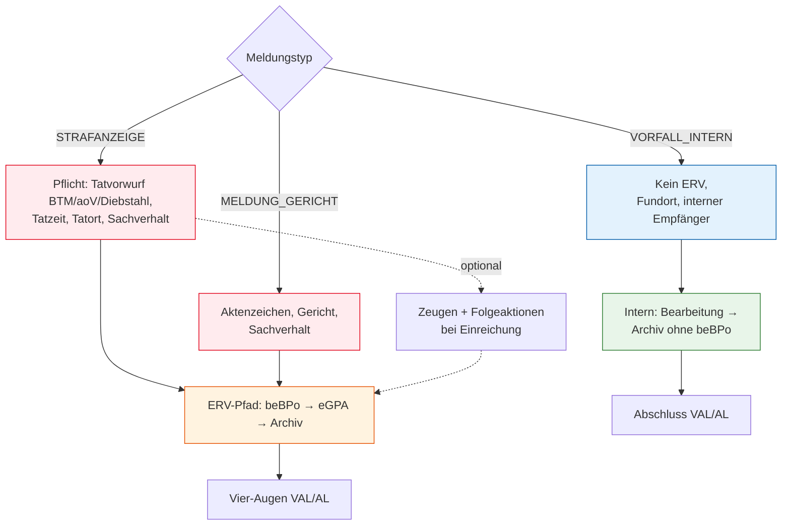
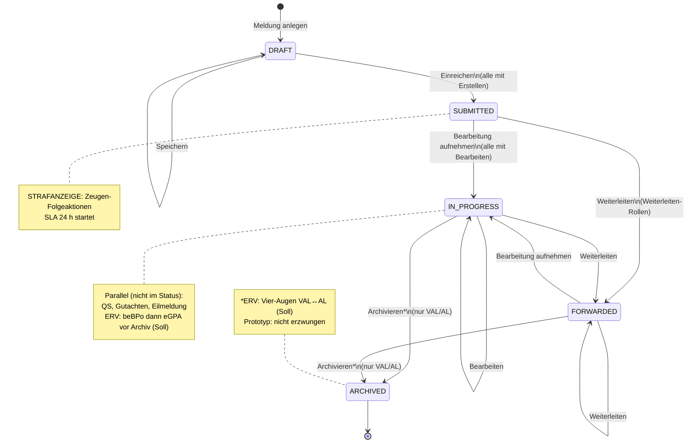
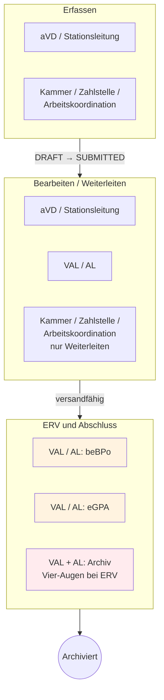
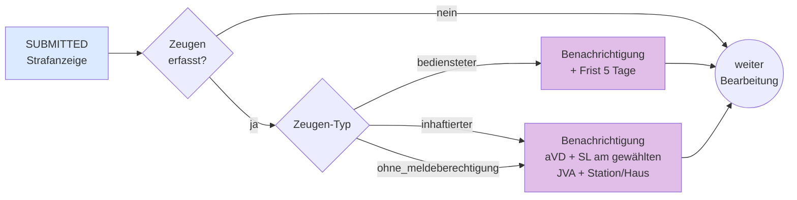
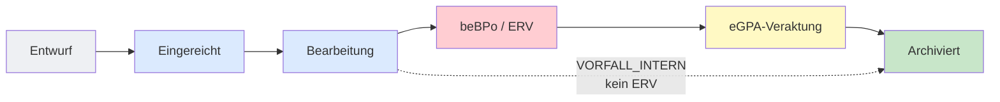

# Prozessdiagramm eMeldewesen (Gesamt)

**Version:** 1.1 | **Stand:** 2026-05-20  
**Quellen:** ARIS BPMN (13.03.2026), [08_GESAMTPROZESS_ARIS.md](08_GESAMTPROZESS_ARIS.md) (Phasentexte und Schema-Abschnitt 2 inkl. Rollen-Swimlane 2.5), Lastenheft Kap. 6, HEUREKA-Prototyp A2

**Legende in den Diagrammen**

| Stil | Bedeutung |
|------|-----------|
| Blau (`proto`) | Im **Prototyp A2** abgebildet (Status/UI/Mock) |
| Orange (`aris`) | **ARIS-Soll** / Zielsystem, im Prototyp **nicht** umgesetzt |
| Grün (`sys`) | **Externes System** (BASIS-Web, beBPo, eGPA) |
| Gestrichelte Kante `-.->` | optional / Workshop offen |

---

## 1 Gesamtprozess (Soll ARIS + Prototyp-Abgleich)

Vollständiger operativer Prozess mit Kennzeichnung, was der Prototyp bereits unterstützt.

```mermaid
flowchart TB
  START((Start)) --> A0

  subgraph phase1 [Phase 1 – Vorbereitung und Erfassung]
    A0[Erfassungsfrist beginnt]:::aris
    A0 --> A1[Gefangenen-Stammdaten<br/>BASIS-Web]:::sys
    A1 --> A2[Beobachtungsbogen /<br/>Beweismittel sichern]:::aris
    A2 --> A3[Ersterfassung:<br/>Eckdaten, Aussage, Anlagen]:::proto
    A3 --> A4{Weitere<br/>Beteiligte?}:::aris
    A4 -->|ja| A5[Beteiligte hinzuziehen,<br/>Bestätigung]:::aris
    A4 -->|nein| A6
    A5 --> A6[Richtigkeit und<br/>Vollständigkeit prüfen]:::aris
    A6 --> A7[Geschäftsvorgangsnummer<br/>4W / .x]:::aris
    A7 --> ENTWURF
  end

  ENTWURF["Status: ENTWURF<br/>(DRAFT)"]:::proto
  ENTWURF -->|Einreichen| EINGEREICHT

  subgraph phase2 [Phase 2 – Einreichung und QS]
    EINGEREICHT["Status: EINGEREICHT<br/>(SUBMITTED)"]:::proto
    EINGEREICHT --> Z1{Strafanzeige<br/>mit Zeugen?}:::proto
    Z1 -->|ja| Z2[Zeugen-Folgeaktionen:<br/>Bedienstete Frist 5 Tage /<br/>Station aVD+SL]:::proto
    Z1 -->|nein| Q0
    Z2 --> Q0
    Q0[QS Erstinstanz]:::aris
    Q0 --> Q1{Zweiterfassung<br/>nötig?}:::aris
    Q1 -->|ja| Q2[Zweiterfassung<br/>parallel/wiederholbar]:::aris
    Q1 -->|nein| Q3
    Q2 --> Q3[QS Zweitinstanz]:::aris
    Q3 --> MP{Melde-<br/>pflicht?}:::aris
  end

  MP -->|nein| ABS_INTERN
  MP -->|ja| BEARBEIT

  subgraph phase3 [Phase 3 – Interne Bearbeitung]
    BEARBEIT["Status: IN BEARBEITUNG<br/>(IN_PROGRESS)"]:::proto
    BEARBEIT --> SLA[SLA 24 h<br/>Bearbeitung aufnehmen]:::proto
    SLA --> PRUEF[Inhalt prüfen,<br/>Anlagen, Anhörungen]:::aris
    PRUEF --> WEIT{Intern<br/>weiterleiten?}:::proto
    WEIT -->|ja| WEITG["Status: WEITERGELEITET<br/>(FORWARDED)"]:::proto
    WEIT -->|nein| EIL
    WEITG --> EIL
    EIL{Eilmeldung<br/>&lt; 48 h?}:::aris
    EIL -->|ja| EILM[Eilmeldung an Empfänger]:::aris
    EIL -->|nein| GUT
    EILM --> GUT
    GUT{Gutachten /<br/>Expertise?}:::aris
    GUT -->|ja| GUTP[Revier / Revision /<br/>DB Experte]:::aris
    GUT -->|nein| VERSAND
    GUTP --> VERSAND
    VERSAND{Versand-<br/>fähig?}:::aris
  end

  subgraph phase4 [Phase 4 – Extern und Abschluss]
    VERSAND -->|ERV-Typ| BEP[beBPo / xJustiz<br/>Strukturdatei, PDF, ERV-Nachricht]:::proto
    VERSAND -->|nicht ERV| ABS_INTERN
    BEP --> SLA3[SLA 3 Werktage<br/>ab versandfähig]:::aris
    SLA3 --> EGPA[eGPA-Veraktung /<br/>Generalakte]:::proto
    EGPA --> V4[Vier-Augen<br/>VAL ↔ AL]:::aris
    V4 --> ARCH
    ABS_INTERN[Intern abschließen<br/>ohne beBPo]:::proto
    ABS_INTERN --> ARCH
    ARCH["Status: ARCHIVIERT<br/>(ARCHIVED)"]:::proto
    ARCH --> END((Ende))
    ARCH -.-> DWH[Auswertung / DWH]:::sys
  end

  classDef proto fill:#dbeafe,stroke:#005CA9,stroke-width:2px,color:#003063
  classDef aris fill:#fff3e0,stroke:#E65100,stroke-width:1px,color:#333
  classDef sys fill:#e8f5e9,stroke:#2E7D32,stroke-width:2px,color:#1b5e20
```

---

## 2 Prototyp HEUREKA A2 (vereinfachter Ist-Stand)

Nur Schritte, die in der Anwendung heute sichtbar oder auslösbar sind.

```mermaid
flowchart LR
  subgraph rollen [Rollen mit Erstellen]
    R1[aVD / SL / VAL / AL /<br/>Kammer / Zahlstelle /<br/>Arbeitskoordination]
  end

  R1 --> N[Neue Meldung<br/>Meldungstyp wählen]
  N --> D[ENTWURF<br/>Formular ausfüllen]
  D -->|Speichern Entwurf| D
  D -->|Einreichen| S[EINGEREICHT]

  S --> Z{STRAFANZEIGE<br/>+ Zeugen?}
  Z -->|ja| ZF[Mock Folgeaktionen<br/>in metadaten]
  Z -->|nein| B
  ZF --> B

  B[IN BEARBEITUNG<br/>24h-SLA-Hinweis]
  B --> F{Weiter-<br/>leiten?}
  F -->|ja| FW[WEITERGELEITET]
  F -->|nein| E
  FW --> E

  E{ERV-relevant?}
  E -->|STRAFANZEIGE<br/>MELDUNG_GERICHT| BEP[Per beBPo versenden<br/>VAL/AL Mock]
  E -->|VORFALL_INTERN| A
  BEP --> GPA[eGPA verakten<br/>VAL/AL Mock]
  GPA --> A[ARCHIVIERT<br/>VAL/AL]
  A --> END((Ende))

  style D fill:#dbeafe,stroke:#005CA9
  style S fill:#dbeafe,stroke:#005CA9
  style B fill:#dbeafe,stroke:#005CA9
  style FW fill:#dbeafe,stroke:#005CA9
  style BEP fill:#dbeafe,stroke:#005CA9
  style GPA fill:#dbeafe,stroke:#005CA9
  style A fill:#c8e6c9,stroke:#2E7D32
  style ZF fill:#e1bee7,stroke:#7b1fa2
```

---

## 3 Verzweigung nach Meldungstyp

| Meldungstyp | ERV | Externer Versand | Zeugen (Prototyp) | Typische Abschlussrolle |
|-------------|-----|------------------|-------------------|-------------------------|
| `STRAFANZEIGE` | ja | beBPo → Staatsanwaltschaft | ja (Mock) | VAL + AL (Vier-Augen) |
| `MELDUNG_GERICHT` | ja | beBPo → Gericht | nein | VAL + AL (Vier-Augen) |
| `VORFALL_INTERN` | nein | – | nein | VAL / AL |
| `VORFALL_EXTERN` | ja (inaktiv) | wie ERV | – | – |

---

## 4 Statusmodell (Prototyp) mit erlaubten Übergängen

**Wichtig:** `FORWARDED` = nur **interne** Weitergabe. Extern = eigener Nachweis über beBPo, nicht dieser Status.

---

## 5 Rollen entlang des Kernpfads

Für die **ARIS-Soll-Swimlane** inklusive QS, Gutachten und Systemen siehe [08_GESAMTPROZESS_ARIS.md](08_GESAMTPROZESS_ARIS.md) Abschnitt **2.5**; das folgende Diagramm bleibt die **vereinfachte** Kernpfad-Ansicht des Prototyps.

| Aktion | aVD | SL | VAL | AL | Kammer | Zahlstelle | Arbeitskoord. |
|--------|-----|-----|-----|-----|--------|------------|---------------|
| Erstellen / Bearbeiten | ● | ● | ● | ● | ● | ● | ● |
| Weiterleiten | ● | ● | ● | ● | ● | ● | ● |
| beBPo / eGPA | ○ | ○ | ● | ● | ○ | ○ | ○ |
| Archivieren | ○ | ○ | ● | ● | ○ | ○ | ○ |

---

## 6 SLA und Eskalation (Zeitachse, Soll)

```mermaid
gantt
  title SLA-Kern (nach Einreichung, vereinfacht)
  dateFormat X
  axisFormat %s

  section Einreichung
  SUBMITTED Start           :milestone, m1, 0, 0
  section Bearbeitung
  24h Bearbeitung aufnehmen :active, a1, 0, 24
  Eskalation SL (+4h Soll)  :crit, a2, 4, 8
  Eskalation VAL (+16h)     :crit, a3, 16, 20
  section ERV
  versandfähig (Workshop)   :milestone, m2, 24, 0
  3 Werktage beBPo          :a4, 24, 72
  eGPA nach Versand         :a5, 72, 96
  Archiv Vier-Augen         :a6, 96, 120
```

*Kalendertage/Werktage und Wochenenden: siehe [RUECKFRAGEN_UND_OFFENE_PUNKTE.md](../RUECKFRAGEN_UND_OFFENE_PUNKTE.md). Prototyp: 24-h- und 5-Tage-Hinweis in der UI.*

---

## 7 Strafanzeige: Zeugen-Folgeaktionen (Prototyp-Ergänzung)

Nicht explizit im ARIS-Text; im Prototyp bei **Einreichung** ausgelöst.

---

## 8 Anzeige im Prototyp (Prozesslandkarte UI)

Die Detailansicht zeigt eine vereinfachte Landkarte – abgeleitet aus `getProzessSchritte()`:

---

## 9 Verwandte Dokumente

| Dokument | Inhalt |
|----------|--------|
| [08_GESAMTPROZESS_ARIS.md](08_GESAMTPROZESS_ARIS.md) | Phasenbeschreibung ARIS; Schema-Abschnitt 2 (Phasen, Weichen, Status, Systeme, Rollen-Swimlane 2.5) |
| [11_PROTOTYP_KLICKPFAD_ERFASSUNG.md](11_PROTOTYP_KLICKPFAD_ERFASSUNG.md) | Tabellarischer Klickpfad und Backlog |
| [09_WORKSHOP_CHECKLISTE_INTERN_BEARBEITUNG.md](09_WORKSHOP_CHECKLISTE_INTERN_BEARBEITUNG.md) | Prüfpunkte Bearbeitung |
| [02_QUERSCHNITT_ROLLEN_STATUS.md](02_QUERSCHNITT_ROLLEN_STATUS.md) | Status und Rechte |
| [03_QUERSCHNITT_SLA_UI.md](03_QUERSCHNITT_SLA_UI.md) | SLA nach Einreichung |
| [../eMeldewesen_Prozess_ARIS.txt](../eMeldewesen_Prozess_ARIS.txt) | ARIS-Rohtext |

---

## 10 Änderungshistorie

| Datum | Version | Änderung |
|-------|---------|----------|
| 2026-05-20 | 1.1 | Verweise auf 08 Abschnitt 2.5 (Rollen-Swimlane ARIS); Quellenzeile präzisiert |
| 2026-05-19 | 1.0 | Gesamtdiagramm aus ARIS, Lastenheft und Prototyp |
