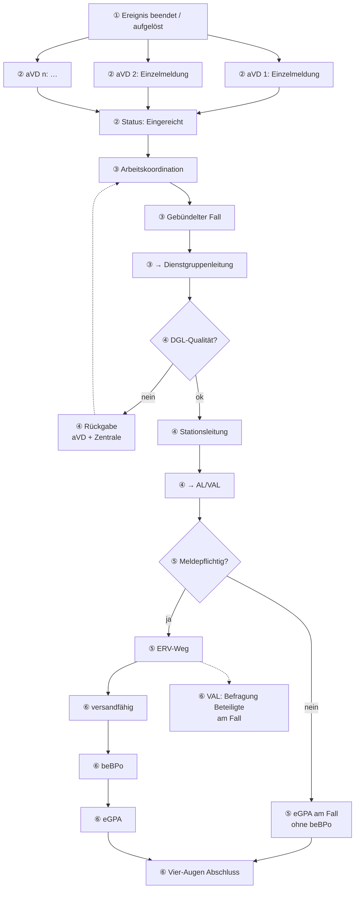

# Übergabedokument – A2 eMeldewesen (Gesamt)

**HEUREKA 2.0 · FHH Hamburg Justiz · Justizvollzug**  
**Version:** 1.2 | **Stand:** 2026-06-17  
**Word-Übergabe (Einarbeitung + Roadmap + Dokument-Kurzfassungen):** [A2_eMeldewesen_UEBERGABE.docx](A2_eMeldewesen_UEBERGABE.docx) · Neu erzeugen: `docs/meldewesen-a2-main/scripts/` (siehe README dort)
**Zielgruppe:** Fachliche Projektbeteiligte, Workshop-Leitung, Entwicklung, Lastenheft-Autoren

Dieses Dokument bündelt **Gesamtprozess**, **Prototyp-Stand**, **Daten- und Prozessschemata**, **offene Fragen** sowie **alle relevanten Projektdateien** (inkl. hochgeladener Quellen) in einer Übergabe für die nächste Projektphase.

---

## Inhaltsverzeichnis

1. [Zweck und Lesereihenfolge](#1-zweck-und-lesereihenfolge) (inkl. [Begriffe und Abgrenzungen](#14-begriffe-und-abgrenzungen))
2. [Gesamtprozess (Soll)](#2-gesamtprozess-soll)
3. [Rollen und Entscheidungen](#3-rollen-und-entscheidungen)
4. [Fachobjekte und Schemata](#4-fachobjekte-und-schemata)
5. [Prototyp-Stand](#5-prototyp-stand)
6. [Bündelung – Voraussetzungen](#6-bündelung--voraussetzungen)
7. [Demo-Klickpfade](#7-demo-klickpfade)
8. [Offene Fragen und Backlog](#8-offene-fragen-und-backlog) *(Kurzindex → [§13](#13-offene-punkte-und-nächste-schritte))*
9. [Hochgeladene und referenzierte Quelldateien](#9-hochgeladene-und-referenzierte-quelldateien)
10. [Projektdateien – Verzeichnis](#10-projektdateien--verzeichnis)
11. [Anhang: Grundsätze BZ JV](#11-anhang-grundsätze-bz-jv)
12. [Offene Punkte und nächste Schritte](#13-offene-punkte-und-nächste-schritte)
13. [Chronik](#12-chronik)

---

## 1. Zweck und Lesereihenfolge

### 1.1 Zweck

| Aspekt | Beschreibung |
|--------|--------------|
| **Validierung** | JVA-Bedienstete testen den Prototyp gegen den dokumentierten Soll-Prozess |
| **Lastenheft** | Fachliche Grundlage für Appian/ServiceNow oder LC-Plattform |
| **Übergabe** | Ein Einstiegspunkt für alle Beteiligten ohne Chat-Verlauf |

### 1.2 Maßgeblichkeit der Dokumente

| Priorität | Dokument | Rolle |
|-----------|----------|--------|
| 1 | [`.cursorrules`](../../../.cursorrules) | Technische Konventionen Prototyp (Rollen, Routen, Design) |
| 2 | [GESAMTPROZESS.md](GESAMTPROZESS.md) v2.0 | **Fachliche Soll-Referenz** End-to-End |
| 3 | **Dieses Dokument** | Übergabe-Gesamtüberblick |
| 4 | [VALIDIERUNG_PROZESS.md](VALIDIERUNG_PROZESS.md) | **Validierungs-Matrix** — sicher / Vorentwurf / zu validieren (Stand Workshop-Dialog) |
| 5 | [ZU_KLAERENDE_BEGRIFFLICHKEITEN.md](ZU_KLAERENDE_BEGRIFFLICHKEITEN.md) | Begriffskonflikte, WABE-Mapping; **§13 Fristen (OP-F-*)**; **§14 Zentrale/Rollenmatrix (OP-R-*)** |
| 6 | [PROZESS_SOLL_UND_STAND.md](PROZESS_SOLL_UND_STAND.md) | Soll vs. Prototyp (teilweise älter als aktueller Code-Stand) |
| 7 | [RUECKFRAGEN_UND_OFFENE_PUNKTE.md](RUECKFRAGEN_UND_OFFENE_PUNKTE.md) | OP-*-Backlog, Workshop-Chronik |
| 8 | [Praxisfeedback.md](Praxisfeedback.md) | Roh-Feedback Blocks A–P |

Bei Widerspruch zwischen **GESAMTPROZESS** und **älterem Lastenheft/ARIS** gilt der **überarbeitete Gesamtprozess** (Fall-Bündelung, DGL→SL→AL).

### 1.3 Empfohlene Lesereihenfolge (30–60 Min.)

1. [VALIDIERUNG_PROZESS.md](VALIDIERUNG_PROZESS.md) — **Validierungsstand** je Prozessschritt
2. Abschnitt **[13 – Offene Punkte und nächste Schritte](#13-offene-punkte-und-nächste-schritte)** — Roadmap und **Gesamtprozess-Abgleich**
3. Abschnitt **1.4** (Begriffe) und [ZU_KLAERENDE_BEGRIFFLICHKEITEN.md](ZU_KLAERENDE_BEGRIFFLICHKEITEN.md)
4. Abschnitt 2–3 dieses Dokuments (Prozess + Rollen)
5. [GESAMTPROZESS.md](GESAMTPROZESS.md) Abschnitt 4–9
6. Abschnitt 5–7 hier (Prototyp + Demo)
7. [RUECKFRAGEN_UND_OFFENE_PUNKTE.md](RUECKFRAGEN_UND_OFFENE_PUNKTE.md) → Tabelle **OP-***
8. [UEBERGABE_PROTOTYP_ENTWICKLUNG.md](UEBERGABE_PROTOTYP_ENTWICKLUNG.md) für Entwickler-Einstieg

### 1.4 Begriffe und Abgrenzungen

**Ergänzend:** Ausführliche Klärungsvorschläge und WABE-Bezug → [ZU_KLAERENDE_BEGRIFFLICHKEITEN.md](ZU_KLAERENDE_BEGRIFFLICHKEITEN.md)

**Maßgeblich** für den überarbeiteten Gesamtprozess (Fall-Bündelung, DGL→SL→AL/VAL). Bei Widerspruch zum **älteren Lastenheft** (z. B. `VORFALL_INTERN` als Typ-Definition „Vorfall“) gilt [GESAMTPROZESS.md](GESAMTPROZESS.md) v2.0.

#### Prozess-Ebenen (von außen nach innen)

| Begriff | Bedeutung | Nicht gemeint |
|---------|-----------|---------------|
| **Ereignis** | Vollzugsbedeutsames Geschehen in der JVA (beendet/aufgelöst) | Systemobjekt |
| **Vorfall** | Synonym zu **Ereignis** im Gesamtprozess – **vor** der Bündelung | Der gebündelte **Fall** im System |
| **Einzelmeldung** (`Meldung`) | Schriftliche Erfassung **je beteiligte/r aVD**; Ich-Perspektive; Status z. B. `SUBMITTED` | Der gebündelte Fall |
| **Fall** / **gebündelter Fall** (`MeldungsFall`) | Container für **alle** Einzelmeldungen zum **gleichen** Ereignis; **ein** Meldungstyp pro Fall (L1) | Eine einzelne aVD-Meldung |
| **Fallmeldung** | **Prozessschritt**, nicht eigener Dokumenttyp: DGL/SL **leiten den gebündelten Fall** weiter (K1, K4) | Neue Meldung neben den Einzelmeldungen |

#### Rollen (Synonyme bewusst)

| Kanonischer Code | UI / Kurzform | Hinweis |
|------------------|---------------|---------|
| `arbeitskoordination` | **Zentrale**, **AK** | **Einzige** Rolle mit Fall-Bündelung |
| `dienstgruppenleitung` | **DGL** | Qualitätsprüfung; **keine** Meldepflicht-Entscheid |
| `stationsleitung` | **SL**, ggf. **Wohngruppenleitung** | JVA-abhängige Bezeichnung, gleicher Rollencode |
| `anstaltsleitung` | **AL** | Meldepflicht, ERV, interner Abschluss bei „nein“ (J4) |
| `val` | **VAL**, Vollzugsabteilungsleitung | Optional Meldepflicht-Entscheid (K2); Befragung **Beteiligter** |

Rollencodes sind **immer lowercase** (`.cursorrules`).

#### Meldepflicht und ERV

| Begriff | Bedeutung | Abgrenzung |
|---------|-----------|------------|
| **Meldepflichtig** (Entscheid AL/VAL) | Vorfall muss **extern** gemeldet werden | Entscheid auf **Fall-Ebene** (K2) |
| **beBPo-pflichtig** | Synonym zu **meldepflichtig ja** (G1) | Kein beBPo bei „nein“ |
| **ERV** (Prozess) | Gesamter **externer** Weg: **versandfähig** → **beBPo** → **eGPA** → Vier-Augen | Nicht = interner Abschluss |
| **`ERV_WEG`** (Fall-Status) | Fall ist meldepflichtig und in der ERV-Kette | Technischer Status, nicht die Entscheid selbst |
| **`ervRelevant`** (Meldungsfeld) | Meldungstyp ist grundsätzlich ERV-fähig (z. B. Strafanzeige) | **Nicht** identisch mit AL/VAL-Entscheid „meldepflichtig“ |
| **Versandfähig** | Freigabe zum beBPo-Versand (O2); setzen **AL oder VAL** | Schritt **vor** beBPo, **nach** Meldepflicht-Entscheid „ja“ |

#### Kanäle und Verfahren

| Begriff | Bedeutung |
|---------|-----------|
| **beBPo** | Behördenpostfach – **fachlicher** Kanal für externen Versand |
| **xJustiz** | **Technischer** Standard/Protokoll für beBPo (im Prototyp: Mock-XML) |
| **eGPA** / **Veraktung** | Elektronische Gesamtstrafenakte; interne Ablage (Mock im Prototyp) |
| **ERV-Kette am Fall** | `versandfaehig` → `xjustiz-versand` (beBPo) → `verakten` (eGPA) → `abschliessen` (Vier-Augen) |

Einzelmeldungs-ERV (`/api/meldungen/:id/...`) gilt nur für **nicht gebündelte** Meldungen; im aktiven Fall-Pfad wird ERV **am Fall** erzwungen.

#### Status und UI (häufige Verwechslung)

| Begriff | Bedeutung | Nicht gemeint |
|---------|-----------|---------------|
| **Fachliche Prüfung** | Bearbeitung durch VAL/AL (Zeugen, Beweismittel, Meldepflicht) | „Noch am Formular tippen“ |
| **`IN_PROGRESS`** / UI „In Bearbeitung“ | Technischer Status; oft **fachliche Prüfung** | Missverständlich benannt (→ [HAPPY_PATH_STRAFANZEIGE.md](HAPPY_PATH_STRAFANZEIGE.md)) |
| **Vier-Augen-Abschluss** | Zweite Freigabe nach eGPA; **AL oder VAL** (O3) | Nur eine Person hat gezeichnet |
| **`ABGESCHLOSSEN_INTERN`** | Fall vollständig abgeschlossen | Einzelmeldung noch offen |
| **`ARCHIVED`** | Einzelmeldung archiviert (nach Fall-Abschluss) | Fall-Status |

#### Beweise und Sicherstellung

| Begriff | Praxis (Soll) | Nicht gemeint |
|---------|---------------|---------------|
| **Sicherstellung** | JVA **bewahert** Spuren/Gegenstände für ggf. Polizeiermittlungen | Eigene **Erhebung** durch JVA |
| **Beweismittel** (UI/Prototyp) | Feld `beweismittelGesichert` – dokumentiert **Sicherstellung** | Polizeiliche Beweiserhebung |

Terminologie in UI/Lastenheft auf **Sicherstellung** vereinheitlichen (Praxisfeedback E/BM).

#### API-Hinweis (Dokumentation)

| Kanonisch | Veraltet / nicht verwenden |
|-----------|----------------------------|
| `POST /api/faelle/:id/entscheid-meldepflicht` | `entscheid-al` (nur in älteren Notizen) |

---

## 2. Gesamtprozess (Soll)

### 2.1 Kernprinzip

> **Ein Vorfall** → **mehrere Einzelmeldungen** (parallele aVD-Perspektiven) → **ein gebündelter Fall** → DGL → **Stationsleitung** → **AL/VAL** → Entscheid Meldepflicht → **eGPA** (intern) oder **ERV** (versandfähig → beBPo → eGPA).

**⚠️ Annahme (nicht validiert):** Der Schritt **Fall-Bündelung** (Phase ③, Zentrale) ist **Vorentwurf** aus Praxisfeedback – **Workshop-Validierung ausstehend** (**OP-FB-01**). Der Prototyp demonstriert diese Annahme.

### 2.2 Prozessdiagramm



### 2.3 Phasenübersicht

| Phase | Wer | Was |
|-------|-----|-----|
| **① Ereignis** | – | Meldepflicht **unmittelbar nach Ereignisende**; aVD können **unmittelbar** melden (**OP-ORG-01** Freistellung). **Schwerwiegend:** **telefonische Vorabmeldung**, ggf. **Polizei** → danach Phase ② (**OP-M-01**) |
| **② Ersterfassung** | **Alle beteiligten aVD** | Je Person **eine** Meldung; **Ich-Perspektive**; Insassen **nach Hafthaus** filterbar; Tatzeit/Tatort/Sachverhalt; W-Fragen; Sicherstellung Ja/Nein; **keine Zeugen**, nur **Beteiligte** |
| **③ Bündelung** | **Nur Zentrale** (`arbeitskoordination`) | Gleicher Vorfall → **ein Fall**; **ein Meldungstyp** pro Fall (L1, **sicher**); Weiterleitung DGL **ohne Hartblock** bei fehlender aVD-Meldung (J2, **sicher**) — **⚠️ Gesamtphase Annahme, OP-FB-01** |
| **④ DGL** | `dienstgruppenleitung` | Fachliche Kriterien + Stimmigkeit; Rückgabe **aVD + Zentrale** (**sicher**, F4); **beliebig oft** (F5, **sicher**); Freigabe → **SL** → AL — **zu validieren** (OP-FB-01) |
| **⑤ SL** | `stationsleitung` | **Fallmeldung** an AL/VAL (K1) — **zu validieren** (OP-FB-01) |
| **⑥ Entscheid** | **AL oder VAL** (K2, **zu validieren**) | Meldepflichtig ja/nein; **meldepflichtig = ERV** (G1, **sicher**) |
| **⑦ Abschluss** | **AL / ggf. VAL** | **Nein:** Veraktung ohne beBPo (**OP-EGPA-01**). **Ja:** versandfähig → beBPo → Veraktung — **zu validieren**; Vier-Augen **OP-V-04** |

### 2.4 Abgrenzung

| Gehört dazu | Gehört nicht dazu |
|-------------|-------------------|
| Bediensteten-Meldewesen A2 | Gefangenenportal (A1) |
| Fall-Bündelung paralleler aVD-Meldungen | **Basisbeobachtungen** = Dienstprotokoll aVD (P1, separates JVP-Thema) |
| Mock beBPo/eGPA im Prototyp | Echte AD, BASIS-Web, beBPo, eGPA |

### 2.5 Fristen (SLA, beschlossen)

| Frist | Regel | Referenz |
|-------|-------|----------|
| Ersterfassung | **24 h** ab **Ereignisende** | H1, N2 |
| Externe Meldung (ERV) | **24 h** ab **Ereignisende**, **Werktage** | H2, N2 |
| Wochenende/Feiertage | Sammeln bis **Montag 08:00** | N1 |
| Eskalation Frist | **Erststufe: Stationsleitung** | N3 |
| Zeugenaussage Bedienstete | ~~**5 Werktage** (H5)~~ → **entfällt** (kein Zeugenkonzept; **OP-Z-01**) | H5 |
| Nachreichung (Rückgabe) | **5 Werktage** | H6 |
| Dringend-Kennzeichen | **Entfällt** (H7) | Schwerwiegende Fälle → **telefonische Vorabmeldung** vor schriftlich; ggf. Polizei (**OP-M-01**, GZ-B2) |

---

## 3. Rollen und Entscheidungen

### 3.1 Rollenmatrix (kanonische Codes)

| Code | UI-Label | Hauptaufgabe im Gesamtprozess |
|------|----------|-------------------------------|
| `avd` | Allgemeiner Vollzugsdienst | Einzelmeldung erfassen/einreichen |
| `arbeitskoordination` | Arbeitskoordination (Zentrale) | **Einzige** Rolle mit **Fall-Bündelung** |
| `dienstgruppenleitung` | Dienstgruppenleitung | Qualitätsprüfung gebündelter Fälle |
| `stationsleitung` | Stationsleitung / Wohngruppenleitung | Fallmeldung von DGL → Weiterleitung AL/VAL |
| `anstaltsleitung` | Anstaltsleitung | Meldepflicht-Entscheid (K2, **zu validieren**); ERV; interner Abschluss (**OP-ABS-01**) |
| `val` | Vollzugsabteilungsleitung | Meldepflicht-Entscheid optional (K2, **zu validieren**); ERV (**OP-ERV-03**); Befragung **Beteiligter** |
| `kammer` | Kammer | Sicherstellung nur wenn betroffen (Workshop offen) |

Vollständige Berechtigungsmatrix: `.cursorrules` Abschnitt 2.3. **Fall-Rechte Zentrale** (Bündeln, E1/E2) → [ZU_KLAERENDE_BEGRIFFLICHKEITEN.md](ZU_KLAERENDE_BEGRIFFLICHKEITEN.md) §14 (**OP-R-01–08**).

### 3.2 Entscheidungspunkte

| # | Entscheidung | Entscheider | Optionen |
|---|--------------|-------------|----------|
| E1 | Gleicher Vorfall? | Zentrale | Bündeln / nicht bündeln |
| E2 | Fall vollständig? | Zentrale / DGL | Weiter / fehlende Meldung **anfordern** (J2) |
| E3 | Qualität ausreichend? | DGL | → SL / Rückgabe |
| E3b | An AL/VAL? | SL | Weiterleitung |
| E4 | Meldepflichtig? | **AL oder VAL** | Ja (ERV) / Nein (intern) |
| E5 | ERV-Kette | AL + VAL | versandfähig → beBPo → eGPA → Vier-Augen **am Fall** |
| E6 | **Befragung inhaftierter Beteiligter** (VAL) | VAL | Anordnung + Ergebnis **am Fall** (O4); **kein** Zeugenprozess |

---

## 4. Fachobjekte und Schemata

### 4.1 Datenmodell (Prisma)

**Quelldatei:** [`backend/prisma/schema.prisma`](../backend/prisma/schema.prisma)

#### Kerntabellen

| Modell | Tabelle | Zweck |
|--------|---------|--------|
| `Gefangene` | `gefangene` | Mock-Stammdaten (BASIS-Web) |
| `Bedienstete` | `bedienstete` | Mock-Nutzer / Rollen |
| `Meldung` | `meldungen` | Einzelmeldung je aVD |
| `MeldungsFall` | `meldungs_faelle` | Gebündelter Vorfall |
| `StatusVerlauf` | `status_verlauf` | Status-Historie je Meldung |
| `Anhang` | `anhaenge` | Dateianhänge (nur Entwurf) |
| `Veraktung` | `veraktungen` | eGPA (Mock, Meldungs-Ebene legacy) |
| `XJustizVersand` | `xjustiz_versand` | beBPo (Mock, Meldungs-Ebene legacy) |
| `Benachrichtigung` | `benachrichtigungen` | In-App-Glocke |
| `Notiz` | `notizen` | Arbeitsnotizen |

#### `Meldung` – wichtige Felder

| Feld | Typ | Bedeutung |
|------|-----|-----------|
| `meldungsNr` | String | z. B. `MEL-012` |
| `meldungsTyp` | Enum | `STRAFANZEIGE`, `VORFALL_INTERN`, `MELDUNG_GERICHT`, … |
| `status` | Enum | siehe 4.2 |
| `sachverhalt` | String | Rich-Text-Inhalt |
| `metadaten` | JSON | Tatzeit, Tatort, Zeugen, Beweismittel, … |
| `ervRelevant` | Boolean | ERV-Pflicht |
| `gefangeneId` | FK | Hauptbeteiligte/r |
| `fallId` | FK | Zuordnung zum gebündelten Fall |
| `zustaendigId` | FK | Erfassende/r aVD |

#### `MeldungsFall` – wichtige Felder

| Feld | Typ | Bedeutung |
|------|-----|-----------|
| `fallNr` | String | z. B. `FALL-001` |
| `status` | Enum | siehe 4.3 |
| `bezeichnung` | String? | z. B. Tatort + Kurztext |
| `meldepflichtig` | Boolean? | Entscheid AL/VAL |
| `entscheidVonRolle` | String? | `anstaltsleitung` \| `val` |
| `versandfaehigAm` | DateTime? | ERV-Schritt 1 (O2) |
| `bepoVersendetAm` / `bepoNachrichtenId` | | ERV-Schritt 2 |
| `egpaVeraktetAm` / `egpaAktenzeichen` | | ERV-Schritt 3 / intern |
| `abgeschlossenAm` | DateTime? | Vier-Augen-Abschluss |

### 4.2 Enum `MeldungsStatus` (Einzelmeldung)

| Status | Bedeutung |
|--------|-----------|
| `DRAFT` | Entwurf |
| `SUBMITTED` | Eingereicht, wartet auf Bündelung |
| `FORWARDED` | Im Fall, in Prüfkette |
| `IN_PROGRESS` | Bearbeitung (z. B. nach Meldepflicht-Entscheid) |
| `ARCHIVED` | Abgeschlossen |

### 4.3 Enum `MeldungsFallStatus` (Fall)

| Status | Bedeutung | Nächster Schritt |
|--------|-----------|------------------|
| `SAMMELN` | Zentrale bündelt | → DGL |
| `ZUR_DGL` | Bei DGL | Freigabe SL oder Rückgabe |
| `ZURUECK_AK` | DGL-Rückgabe | AK ergänzt |
| `ZUR_SL` | Bei Stationsleitung | → AL/VAL |
| `ZUR_AL` | Zur Meldepflicht-Entscheid | AL/VAL entscheidet |
| `EGPA_INTERN` | Nicht meldepflichtig | eGPA am Fall (ohne beBPo) |
| `ERV_WEG` | Meldepflichtig | versandfähig → beBPo → eGPA |
| `ABGESCHLOSSEN_INTERN` | Vollständig abgeschlossen | – |

### 4.4 Enum `RolleTyp` (Auszug)

`anstaltsleitung`, `val`, `dienstgruppenleitung`, `stationsleitung`, `avd`, `arbeitskoordination`, `kammer`, `zahlstelle`, `sonderdienst`, `admin`

### 4.5 API-Endpunkte Fall-Pfad

**Basis:** `/api/faelle` · Implementierung: [`backend/src/services/fallService.js`](../backend/src/services/fallService.js)

| Methode | Route | Rolle | Funktion |
|---------|-------|-------|----------|
| GET | `/api/faelle` | AK, DGL, SL, AL, VAL | Fall-Listen (rollenfilter) |
| GET | `/api/faelle/ungebundene-meldungen` | AK | `SUBMITTED` ohne Fall |
| GET | `/api/faelle/buendlungs-vorschlaege` | AK | Gruppierung Tatzeit/Tatort |
| POST | `/api/faelle` | AK | Fall anlegen + Meldungen verknüpfen |
| POST | `/api/faelle/:id/weiterleiten-dgl` | AK | → `ZUR_DGL` |
| POST | `/api/faelle/:id/rueckgabe` | DGL | → `ZURUECK_AK` |
| POST | `/api/faelle/:id/weiterleiten-sl` | DGL | → `ZUR_SL` |
| POST | `/api/faelle/:id/weiterleiten-al` | SL | → `ZUR_AL` |
| POST | `/api/faelle/:id/entscheid-meldepflicht` | AL, VAL | → `EGPA_INTERN` / `ERV_WEG` |
| POST | `/api/faelle/:id/versandfaehig` | AL, VAL | ERV-Schritt |
| POST | `/api/faelle/:id/xjustiz-versand` | AL, VAL | beBPo Mock am Fall |
| POST | `/api/faelle/:id/verakten` | AL, VAL | eGPA Mock am Fall |
| POST | `/api/faelle/:id/abschliessen` | AL, VAL | Vier-Augen, Meldungen `ARCHIVED` |

Einzelmeldungs-ERV (`/api/meldungen/:id/...`) bleibt für **nicht gebündelte** Meldungen; bei aktivem Fall-Pfad wird ERV am Fall erzwungen.

### 4.6 Frontend-Routen (Auszug)

| Route | Seite |
|-------|-------|
| `/emeldewesen` | Hub (Fall-Bündelung je Rolle) |
| `/faelle/:id` | Fall-Detail inkl. ERV-Panel |
| `/meldungen/:id` | Einzelmeldung (Banner verweist auf Fall) |

---

## 5. Prototyp-Stand

**Stand Code:** Juni 2026 (Fall-Pfad mit DGL→SL→AL, ERV am Fall)

### 5.1 Umgesetzt

| Bereich | Stand |
|---------|--------|
| Rollenmodell | `avd`, `arbeitskoordination`, `dienstgruppenleitung`, `stationsleitung`, `al`, `val`, … |
| Fall-Modell | `MeldungsFall` mit Status inkl. `ZUR_SL`, `EGPA_INTERN`, ERV-Felder |
| Prozesskette | Zentrale → DGL → **SL** → AL/VAL → ERV **am Fall** |
| Meldepflicht | **AL oder VAL** |
| ERV am Fall | versandfähig → beBPo → eGPA → abschließen |
| Bündelung | Mehrere Meldungen, gleicher Typ, Vorschläge Tatzeit/Tatort — **⚠️ Annahme (OP-FB-01)** |
| Seed-Demo | FALL-001 (`ZUR_SL`), FALL-002 (`ZUR_AL`) |
| Einzelmeldung | Erfassung, Zeugen, Beweismittel, Arbeitskorb, Nachreichung |

### 5.2 Noch nicht / teilweise umgesetzt

| ID | Thema |
|----|--------|
| OP-DGL-01 | Ausformulierte DGL-Checkliste |
| OP-DGL-03 | DGL-Rückgabe erreicht **aVD** (nur Zentrale heute) |
| OP-J-02 | DGL „fehlende Meldung anfordern“ |
| OP-W-01/02 | W-Fragen-Assistent Pflicht; Textbausteine |
| OP-Z-01 | ZeugenEditor **entfernen** (kein Zeugenkonzept — nur Beteiligte) |
| OP-M-01 | **Telefonische Vorabmeldung** (schwerwiegende Fälle) — Details/UI |
| OP-Z-02 | Feld **Polizei Ja/Nein** (M1, fachlich geklärt — UI fehlt) |
| OP-H-01 / **OP-F-*** | SLA/Fristen Soll vs. Code – [ZU_KLAERENDE_BEGRIFFLICHKEITEN.md](ZU_KLAERENDE_BEGRIFFLICHKEITEN.md) §13 |
| **OP-R-01–08** | Rolle **Zentrale** in Rollenmatrix (Fall-Rechte, Sichtbereich) – [ZU_KLAERENDE_BEGRIFFLICHKEITEN.md](ZU_KLAERENDE_BEGRIFFLICHKEITEN.md) §14 |
| OP-H-03 | Eskalationsschleife nach SL (Workshop) |
| OP-BM-01/02 | Kammer bei Sicherstellung |
| OP-JVP-01 | Basisbeobachtungen = Dienstprotokoll (Workshop) |
| **OP-FB-01** | **Fall-Bündelung (Phase ③)** – Gesamtprozess **workshop-validieren** (Annahme, nicht beschlossen) |
| **OP-ORG-01** | **Freistellung aVD** (Phase ①) – formale Regelung je JVA/übergreifend **unbekannt**; unmittelbare Meldung **sicher** |
| OP-JVA-01 | JVA-Abweichungen Rollenkette |
| OP-P-01 | Fehlende Schritte/Rollen im Gesamtprozess |
| OP-V-02 | VAL-Befragung Anordnung/Ergebnis **am Fall** (Felder/UI) |
| **OP-K-03** | Meldepflicht-Entscheid **AL oder VAL** — **zu validieren** |
| **OP-ABS-01** | Interner Abschluss „nein“: **AL oder ggf. VAL** |
| **OP-ERV-03** | ERV-Weg: **eine Person** (AL oder VAL) ausreichend? |
| **OP-EGPA-01** | **Übergangs-Veraktung** (eGPA nicht ausgerollt); ERV-Kette validieren |
| **OP-V-04** | **Vier-Augen** Abschluss — Regeln validieren |

### 5.3 Bewusst nicht im Prototyp

Echte AD-Auth, eGPA, beBPo, BASIS-Web, Gefangenenportal (A1), E-Mail-Versand, CSRF/Rate-Limiting.

---

## 6. Bündelung – Voraussetzungen

> **⚠️ Annahme (nicht validiert):** Die folgenden Regeln beschreiben den **modellierten** Fall-Bündelungsprozess im Prototyp. Fachliche Bestätigung durch JVA-Workshops steht aus (**OP-FB-01**).

Damit die **Zentrale (AK)** Meldungen bündeln kann:

| Regel | Detail |
|-------|--------|
| **Einreichen** | Status `SUBMITTED` (nicht Entwurf) |
| **Kein Fall** | Meldung noch nicht zugeordnet |
| **Gleicher Meldungstyp** | z. B. beide `VORFALL_INTERN` |
| **Tatzeit + Tatort** | Gleich → Bündelungs**vorschlag** (Assistenz, keine Auto-Bündelung) |
| **Parallele aVD** | Verschiedene `zustaendig`, ggf. verschiedene Gefangene erlaubt |

**Pflicht beim Einreichen:** Gefangene/r, Tatzeit, Tatort (Liste), Sachverhalt, Beweismittel Ja/Nein; bei Strafanzeige zusätzlich Tatvorwurf.

---

## 7. Demo-Klickpfade

### 7.1 Start Prototyp

```bash
cd docs/meldewesen-a2-main
docker compose up
cd backend && npm run db:push && npm run seed
```

Frontend: `http://localhost:5173` · Rolle im **gelben Prototyp-Banner** wechseln.

### 7.2 Demo-Nutzer (Auszug)

| ID | Rolle | Name |
|----|-------|------|
| AVD-02, AVD-04 | aVD | Tobias Klein, Kevin Schulz |
| AK-01 | Zentrale | Stefan Lindemann |
| DGL-01 | DGL | Andrea Schmitz |
| SL-01 | Stationsleitung | Pedro Guerrero |
| AL-01 | Anstaltsleitung | Dr. Christine Möller |
| VAL-01 | VAL | Sabine Werner |

### 7.3 Pfad A – Gesamtprozess ab Bündelung

1. **AVD-02** + **AVD-04**: je Vorfall intern einreichen (gleicher Tatort/Tatzeit) **oder** Seed nutzen  
2. **AK-01**: Fall-Bündelung → **Fall bündeln** → an DGL  
3. **DGL-01**: Qualität ok → **Stationsleitung**  
4. **SL-01**: Fallmeldung an AL/VAL  
5. **AL-01** oder **VAL-01**: Meldepflicht → ERV-Panel am Fall-Detail  

### 7.4 Pfad B – Seed-Sprungpunkte

| Fall | Status | Meldungen | Einstieg |
|------|--------|-----------|----------|
| **FALL-001** | `ZUR_SL` | MEL-012, MEL-013 | **SL-01** |
| **FALL-002** | `ZUR_AL` | MEL-019, MEL-020 | **AL-01** / **VAL-01** |
| – | ungebunden | MEL-018 | **AK-01** (Bündeln von Null) |

---

## 8. Offene Fragen und Backlog

> **Ausführlich:** Abschnitt **[13 – Offene Punkte und nächste Schritte](#13-offene-punkte-und-nächste-schritte)** (Prioritäten, Roadmap, **Gesamtprozess-Abgleich**, Checklisten).  
> **Validierungsstand je Schritt:** [VALIDIERUNG_PROZESS.md](VALIDIERUNG_PROZESS.md).  
> **Vollständige OP-*-Liste:** [RUECKFRAGEN_UND_OFFENE_PUNKTE.md](RUECKFRAGEN_UND_OFFENE_PUNKTE.md).  
> **Prototyp-Backlog (technisch):** Abschnitt [5.2](#52-noch-nicht--teilweise-umgesetzt).

Kurzindex der wichtigsten OP-IDs — Details und Reihenfolge siehe **§13**.

### 8.1 Workshop / P1 (Auszug)

| ID | Thema |
|----|--------|
| **OP-FB-01** | Fall-Bündelung (Phase ③) — **Annahme**, workshop-validieren |
| **OP-JVA-01** | JVA-Abweichungen Rollenkette |
| **OP-K-03** | Meldepflicht-Entscheid AL / VAL |
| **OP-ABS-01** | Interner Abschluss „nein“ |
| **OP-ERV-03** | ERV: eine Person ausreichend? |
| **OP-EGPA-01** | Übergangs-Veraktung (eGPA nicht ausgerollt) |
| **OP-V-04** | Vier-Augen |
| **OP-DGL-01** | DGL-Checkliste |

### 8.2 Weitere offene OP-IDs

Siehe **§13.2** (P2/P3) und [RUECKFRAGEN](RUECKFRAGEN_UND_OFFENE_PUNKTE.md) (Tabelle „Praxisfeedback – offene Punkte“).

---

## 9. Hochgeladene und referenzierte Quelldateien

### 9.1 Extern hochgeladen / verarbeitet

| Datei (Soll-Pfad) | Herkunft | Inhalt / Verwendung | Status im Repo |
|-------------------|----------|---------------------|----------------|
| **`docs/20260610_HEUREA_WABE.docx`** | HEUREKA / Bildungszentrum Justizvollzug Hamburg (WABE-Schulung) | Folien: **Grundsätze Abfassung** (GZ-A1–A5), **Abgabe** (GZ-B1–B5), **7 W-Fragen** | **Im Repository** (`a2/docs/`) |
| **`docs/meldewesen-a2-main/docs/quellen/20260610_HEUREA_WABE.docx`** | (Kopie) | Gleiche Datei neben Projektdokumentation | **Im Repository** |

*Hinweis:* Die Word-Datei enthält überwiegend **PNG-Folien** (nicht durchsuchbarer Fließtext). Relevante Folie: „Grundsätze zur Gestaltung einer Meldung“ (BZ JV, ca. Folie 36 in der Extraktion).

### 9.2 Im Projekt erzeugte Prozess- und Schaubild-Dateien

| Datei | Beschreibung |
|-------|--------------|
| [Praxisfeedback_Schaubild.html](Praxisfeedback_Schaubild.html) | Interaktives HTML-Schaubild (feedbacketer Prozess) |
| [eMeldewesen_Prozess_ARIS.txt](eMeldewesen_Prozess_ARIS.txt) | ARIS-Export / älterer Prozessentwurf |
| [LASTENHEFT/10_PROZESSDIAGRAMM.md](LASTENHEFT/10_PROZESSDIAGRAMM.md) | Mermaid-Diagramme Lastenheft |
| [LASTENHEFT/08_GESAMTPROZESS_ARIS.md](LASTENHEFT/08_GESAMTPROZESS_ARIS.md) | ARIS-Abgleich (teilweise veraltet) |

### 9.3 Technische Konfiguration

| Datei | Beschreibung |
|-------|--------------|
| [`.cursorrules`](../../../.cursorrules) | Maßgeblich für Prototyp-Entwicklung |
| [`.env.example`](../.env.example) | Docker/DB-Umgebung |
| [`backend/prisma/schema.prisma`](../backend/prisma/schema.prisma) | Datenwörterbuch |
| [`backend/seed.js`](../backend/seed.js) | Demo-Daten inkl. FALL-001/002 |

---

## 10. Projektdateien – Verzeichnis

### 10.1 Fachliche Hauptdokumente (`docs/meldewesen-a2-main/docs/`)

| Datei | Zweck |
|-------|--------|
| **UEBERGABE_GESAMT.md** | **Dieses Dokument** (Markdown) |
| **A2_eMeldewesen_UEBERGABE.docx** | **Word-Übergabe** — Einarbeitung + ausführbare Roadmap |
| [GESAMTPROZESS.md](GESAMTPROZESS.md) | Soll-Prozess v2.0 (Referenz) |
| [PROZESS_SOLL_UND_STAND.md](PROZESS_SOLL_UND_STAND.md) | Soll vs. Prototyp |
| [Praxisfeedback.md](Praxisfeedback.md) | Workshop-Feedback Blocks A–P |
| [RUECKFRAGEN_UND_OFFENE_PUNKTE.md](RUECKFRAGEN_UND_OFFENE_PUNKTE.md) | OP-* Backlog + Chronik |
| [UEBERGABE_PROTOTYP_ENTWICKLUNG.md](UEBERGABE_PROTOTYP_ENTWICKLUNG.md) | Entwickler-Einstieg |
| [quellen/README.md](quellen/README.md) | Index hochgeladener Quelldokumente |
| [HAPPY_PATH_STRAFANZEIGE.md](HAPPY_PATH_STRAFANZEIGE.md) | Strafanzeige Demo-Pfad |
| [LASTENHEFT_GLIEDERUNG.md](LASTENHEFT_GLIEDERUNG.md) | Word-Lastenheft Gliederung |
| [VALIDIERUNG_PROZESS.md](VALIDIERUNG_PROZESS.md) | Validierungs-Matrix Phasen ①–⑥ |

### 10.2 Lastenheft-Kapitel (`docs/LASTENHEFT/`)

| Datei | Inhalt |
|-------|--------|
| `00_PHASE0_ARBEITSHILFE.md` | Phase 0 |
| `01_KAPITEL_RAHMEN.md` | Rahmen |
| `02_QUERSCHNITT_ROLLEN_STATUS.md` | Rollen, Status |
| `03_QUERSCHNITT_SLA_UI.md` | SLA, UI |
| `04_MELDUNGSTYP_STRAFANZEIGE.md` | Strafanzeige |
| `05_MELDUNGSTYP_INTERN_GERICHT.md` | Intern / Gericht |
| `06_MELDUNGSTYP_INAKTIV.md` | Inaktive Typen |
| `07_ABNAHME_UND_ANHANG.md` | Abnahme |
| `08_GESAMTPROZESS_ARIS.md` | ARIS (älter) |
| `09_WORKSHOP_CHECKLISTE_INTERN_BEARBEITUNG.md` | Checkliste |
| `10_PROZESSDIAGRAMM.md` | Diagramme |
| `11_PROTOTYP_KLICKPFAD_ERFASSUNG.md` | Klickpfad Erfassung |
| `12_PROTOTYP_POPUP_ZIELOPTIONEN.md` | Zieloptionen-Modal |
| `ANHANG_A_JVA_MATRIX.md` | JVA-Matrix (Vorlage) |
| `ANHANG_B_FELDER.md` | Feldkatalog |

### 10.3 Umsetzungsdokumentation

| Datei | Thema |
|-------|--------|
| [UMSETZUNG_BEWEISMITTEL_NACHREICHUNG.md](UMSETZUNG_BEWEISMITTEL_NACHREICHUNG.md) | Beweismittel-Nachreichung |
| [UMSETZUNG_ARBEITSKORB_NAVIGATION.md](UMSETZUNG_ARBEITSKORB_NAVIGATION.md) | Arbeitskorb |
| [UMSETZUNG_BENACHRICHTIGUNGEN.md](UMSETZUNG_BENACHRICHTIGUNGEN.md) | Benachrichtigungen |
| [PROTOKOLL_AENDERUNGEN.md](PROTOKOLL_AENDERUNGEN.md) | Änderungsprotokoll |
| [PRUEFAUFTRAG_MITARBEITER.md](PRUEFAUFTRAG_MITARBEITER.md) | Prüfauftrag |
| [GIT_UND_GITHUB.md](GIT_UND_GITHUB.md) | Git-Hinweise |

### 10.4 Prototyp-Code (wichtigste Pfade)

| Pfad | Inhalt |
|------|--------|
| `backend/src/services/fallService.js` | Fall-Workflow |
| `backend/src/routes/faelle.js` | Fall-API |
| `frontend/src/pages/FallDetail.jsx` | Fall-UI |
| `frontend/src/components/emeldewesen/FallErvPanel.jsx` | ERV am Fall |
| `frontend/src/components/emeldewesen/FallBuendelungPanel.jsx` | Bündelung |
| `frontend/src/context/RollenContext.jsx` | Rollen Frontend |
| `backend/src/middleware/mockAuth.js` | Rollen Backend |

### 10.5 Sicherung

Ordner [`Sicherung 2105/`](Sicherung%202105/) – Snapshot Lastenheft-Kapitel vom 21.05.

---

## 11. Anhang: Grundsätze BZ JV

*Quelle: `docs/20260610_HEUREA_WABE.docx` (Bildungszentrum Justizvollzug Hamburg)*

### Abfassung (GZ-A1–A5)

| Nr | Grundsatz |
|----|-----------|
| GZ-A1 | Nur **überprüfbare, belegbare** Tatsachen |
| GZ-A2 | Frei von **Wertung** |
| GZ-A3 | **Genau und klar** für Nicht-Augenzeugen |
| GZ-A4 | **W-Fragen** beantworten: Wer · Was · Wann · Wo · Wie · Warum · Wohin |
| GZ-A5 | **Chronologische** Reihenfolge |

### Abgabe (GZ-B1–B5)

| Nr | Grundsatz |
|----|-----------|
| GZ-B1 | Schriftlich **so schnell wie möglich** (→ 24 h SLA) |
| GZ-B2 | Bei **Eilbedürftigkeit** mündliche Meldung vor schriftlicher (**OP-M-01**) |
| GZ-B3 | **Emotionsabstand** vor Abgabe (Qualität, kein Extra-Timer) |
| GZ-B4 | **Gegenlesen** durch Vertrauensperson (ohne inhaltliche Korrektur) |
| GZ-B5 | Im **Krisenfall** Meldung **nachreichen** (→ 5 WT Nachreichung) |

---

## 13. Offene Punkte und nächste Schritte

Dieses Kapitel bündelt **offene fachliche Punkte**, **Validierungslücken** und die **empfohlene Reihenfolge** für Workshops, Lastenheft, **Gesamtprozess-Abgleich** und Prototyp.

| Dokument | Inhalt |
|----------|--------|
| [VALIDIERUNG_PROZESS.md](VALIDIERUNG_PROZESS.md) | Status je Prozessschritt (sicher / Vorentwurf / zu validieren) |
| [RUECKFRAGEN_UND_OFFENE_PUNKTE.md](RUECKFRAGEN_UND_OFFENE_PUNKTE.md) | Vollständige OP-*-Tabelle + Chronik |
| [GESAMTPROZESS.md](GESAMTPROZESS.md) | Soll-Prozess (wird nach Workshop und Abgleich angepasst) |
| Abschnitt [5.2](#52-noch-nicht--teilweise-umgesetzt) | Prototyp-Backlog (technisch) |

### 13.1 Kurzfassung Validierungsstand

Der Gesamtprozess wurde Schritt für Schritt geprüft (Juni 2026). **Kernbefund:**

| Kategorie | Befund |
|-----------|--------|
| **Stabil geklärt** | Hafthaus-Filter Insassen; kein Zeugenkonzept; ein Meldungstyp pro Fall; DGL-Rückgabe aVD+Zentrale; meldepflichtig = ERV; VAL-Befragung nur nach „Ja“ |
| **Arbeitsannahme** | **Fall-Bündelung** (Phase ③) und **DGL → SL → AL** — Workshop-Pflicht (**OP-FB-01**) |
| **Zielsystem noch nicht da** | **eGPA** nicht ausgerollt → **übergangsweise Veraktung** (**OP-EGPA-01**) |
| **Rollen offen** | Meldepflicht-Entscheid, interner Abschluss, ERV-Personal, Vier-Augen |

Vollständige Matrix: [VALIDIERUNG_PROZESS.md](VALIDIERUNG_PROZESS.md).

### 13.2 Prioritäten (P1–P3)

#### P1 – Workshop / fachlicher Beschluss (blockiert Lastenheft & Zielsystem)

| ID | Thema | Warum P1 |
|----|--------|----------|
| **OP-FB-01** | Gesamtprozess **Fall-Bündelung** + Kette bis AL | Größte unvalidierte Annahme |
| **OP-JVA-01** | JVA-Abweichungen Rollenkette, Zentrale, DGL, SL | Anhang A |
| **OP-K-03** | Meldepflicht-Entscheid: **AL oder VAL**? | Phase ⑤ |
| **OP-ABS-01** | Interner Abschluss „nein“: **AL oder ggf. VAL**? | Phase ⑤/⑥ |
| **OP-ERV-03** | ERV-Weg: **eine Person** ausreichend? | Phase ⑤/⑥ |
| **OP-EGPA-01** | **Übergangs-Veraktung** ohne eGPA; ERV-Kette | Ist-Realität JVAs |
| **OP-V-04** | **Vier-Augen**-Regeln | Abschluss ERV/intern |
| **OP-DGL-01** | **DGL-Checkliste** (fachliche Kriterien + Stimmigkeit) | Phase ④ |

#### P2 – Lastenheft, Begriffe, Fristen (parallel vorbereiten)

| ID | Thema |
|----|--------|
| **OP-F-01–14** | Fristen/SLA — [ZU_KLAERENDE §13](ZU_KLAERENDE_BEGRIFFLICHKEITEN.md) |
| **OP-W-01 / OP-W-02** | W-Fragen 5 vs. 7; Textbausteine |
| **OP-R-01–08** | Rolle **Zentrale** — [ZU_KLAERENDE §14](ZU_KLAERENDE_BEGRIFFLICHKEITEN.md) |
| **OP-ORG-01** | Formale **Freistellung** aVD |
| **OP-M-01** | Telefonische Vorabmeldung (Details) |
| **OP-H-03** | Eskalationsschleife nach SL |
| **OP-BM-01 / OP-BM-02** | Kammer bei Sicherstellung |
| **OP-JVP-01** | Basisbeobachtungen / Dienstprotokoll (Abgrenzung A2) |
| **OP-P-01** | Fehlende Schritte/Rollen im Gesamtprozess |

#### P3 – Prototyp (Demonstration, nicht fachlicher Beschluss)

Siehe Abschnitt **[5.2](#52-noch-nicht--teilweise-umgesetzt)** — u. a. **OP-Z-01**, **OP-Z-02**, **OP-DGL-03**, **OP-J-02**, **OP-V-02**, **OP-H-01**.

### 13.3 Offene Punkte nach Prozessphase

| Phase | Offen / zu validieren | Bereits sicher (Auszug) |
|-------|----------------------|-------------------------|
| **① Ereignis** | Freistellung (**OP-ORG-01**); Fristen (**OP-F-***); Telefonat (**OP-M-01**) | Telefonat schwerwiegend; unmittelbar melden |
| **② Ersterfassung** | W-Fragen (**OP-W-01/02**); SLA Einreichung | Hafthaus-Filter; keine Zeugen; Sicherstellung |
| **③ Bündelung** | **Gesamtphase** (**OP-FB-01**) | L1; kein Hartblock an DGL |
| **④ DGL** | DGL→SL→AL; Checkliste (**OP-DGL-01**) | Rückgabe aVD+Zentrale; unbegrenzt |
| **⑤ Entscheid** | K2; Abschluss „nein“; ERV-Personal | meldepflichtig = ERV |
| **⑥ Abschluss** | eGPA/Übergang; Vier-Augen | VAL-Befragung nur nach „Ja“ |

### 13.4 Nächste Schritte (Roadmap)

#### Schritt 1 – Workshop-Vorbereitung (1–2 Wochen)

- [ ] Teilnehmer: je JVA **aVD, Zentrale, DGL, SL, AL/VAL** (mindestens eine JVA vollständig).
- [ ] Material: [VALIDIERUNG_PROZESS.md](VALIDIERUNG_PROZESS.md); Demo **Pfad A** (Abschnitt [7.3](#73-pfad-a--gesamtprozess-ab-bündelung)).
- [ ] Agenda: **OP-FB-01**, **DGL→SL→AL**, **OP-EGPA-01**, **OP-K-03 / OP-ABS-01 / OP-ERV-03**.
- [ ] Anhang A: erste Zeilen **JVA-Matrix** (**OP-JVA-01**).

#### Schritt 2 – JVA-Workshop(s) (vor Ort / hybrid)

- [ ] Prozessschritte ③–⑥ an [VALIDIERUNG_PROZESS](VALIDIERUNG_PROZESS.md) abgleichen; Beschlüsse protokollieren.
- [ ] **DGL-Checkliste** (OP-DGL-01): erste Fassung aus GZ-A1–A5.
- [ ] **Übergangs-Veraktung** dokumentieren (Ist ohne eGPA).
- [ ] Chronik [RUECKFRAGEN](RUECKFRAGEN_UND_OFFENE_PUNKTE.md) + [VALIDIERUNG_PROZESS](VALIDIERUNG_PROZESS.md) aktualisieren.

#### Schritt 3 – **Gesamtprozess-Abgleich** (nach Workshop, 2–4 Wochen)

Verbindlicher Abgleich aller Prozessdarstellungen — **Voraussetzung** für verbindliches Lastenheft und Zielsystem.

- [ ] **[GESAMTPROZESS.md](GESAMTPROZESS.md)** als führende Soll-Referenz bestätigen oder an Workshop-Beschlüssen anpassen.
- [ ] **Lastenheft** Kap. 3/4 und [LASTENHEFT_GLIEDERUNG.md](LASTENHEFT_GLIEDERUNG.md) mit GESAMTPROZESS synchronisieren.
- [ ] Veraltete Diagramme markieren/ersetzen: [08_GESAMTPROZESS_ARIS.md](LASTENHEFT/08_GESAMTPROZESS_ARIS.md), ggf. [10_PROZESSDIAGRAMM.md](LASTENHEFT/10_PROZESSDIAGRAMM.md).
- [ ] [PROZESS_SOLL_UND_STAND.md](PROZESS_SOLL_UND_STAND.md) und Prototyp (Abschnitt [5](#5-prototyp-stand)) gegen beschlossenen Soll-Prozess prüfen.
- [ ] [HAPPY_PATH_STRAFANZEIGE.md](HAPPY_PATH_STRAFANZEIGE.md) als **Legacy** kennzeichnen (**OP-T-07**), wo Fall-Pfad abweicht.
- [ ] [VALIDIERUNG_PROZESS.md](VALIDIERUNG_PROZESS.md): keine offenen **P1**-Punkte in Phase ③–⑥ mehr als „zu validieren“.
- [ ] **Abnahme Abgleich:** Fachauftrag + Workshop-Leitung dokumentieren (Datum, Version GESAMTPROZESS).

#### Schritt 4 – Lastenheft & Anforderungen (an Schritt 3 anschließend)

- [ ] Beschlossene Punkte in Anforderungs-IDs (HEUREKA) überführen.
- [ ] Fristen (**OP-F-***) in Anhang A / Kap. SLA verbindlich formulieren.
- [ ] Rollenmatrix: Zentrale (**OP-R-***) in Lastenheft 02 und `.cursorrules`-Doku.

#### Schritt 5 – Prototyp-Iteration (parallel ab Schritt 2, nach P1-Priorität)

- [ ] P3-Quick-Wins: OP-Z-01, OP-Z-02, OP-DGL-03.
- [ ] Fall-Pfad / ERV-Panel an Workshop-Beschlüsse und **Übergangs-Veraktung** anpassen.
- [ ] Keine dauerhafte P1-Implementierung ohne fachlichen Beschluss.

#### Schritt 6 – Übergabe Zielsystem (LC-Plattform)

- [ ] Abnahmekriterien aus Lastenheft + abgeschlossenem Gesamtprozess-Abgleich.
- [ ] Mock-Grenzen (kein echtes beBPo/eGPA/AD).
- [ ] Traceability: OP-* → A2-ID → Testfall.

**Laufender Abgleich:** Word-Lastenheft ↔ Repo **wöchentlich** (Fachauftrag) — [LASTENHEFT/00_PHASE0_ARBEITSHILFE.md](LASTENHEFT/00_PHASE0_ARBEITSHILFE.md) §2.

### 13.5 Checklisten

#### Workshop-Leitung

- [ ] Phase ③ als **Annahme** kommuniziert?
- [ ] **DGL → SL → AL** in jeder JVA so gelebt?
- [ ] **Aktuelle Veraktung** ohne eGPA?
- [ ] Wer entscheidet **Meldepflicht** und schließt ab?
- [ ] **Fristen** (24 h, Werktage, Montag 08:00) JVAs-weit tragfähig?

#### Nächste Prototyp-Demo

- [ ] Banner: AK-01 → DGL-01 → SL-01 → AL-01/VAL-01.
- [ ] Seed FALL-001/002 oder frische Bündelung (Abschnitt 7).
- [ ] Bekannte Lücken benennen (ZeugenEditor, Polizei-Feld, aVD-Rückgabe).

#### Gesamtprozess-Abgleich (Schritt 3)

- [ ] Eine **Version** GESAMTPROZESS als „beschlossen“ markiert?
- [ ] ARIS/ältere Diagramme mit Verweis auf GESAMTPROZESS v2.x?
- [ ] Prototyp-Backlog 5.2 gegen Abgleich-Ergebnis bereinigt?

### 13.6 Risiken, wenn P1 / Abgleich ausbleiben

| Risiko | Folge |
|--------|--------|
| Fall-Bündelung nicht validiert | Zielsystem mit **falschem** Hauptprozess |
| **Kein Gesamtprozess-Abgleich** | GESAMTPROZESS, Lastenheft, ARIS und Prototyp **widersprechen** sich |
| eGPA-Übergang unklar | Lücke zwischen Mock und JVA-Alltag |
| Rollenentscheid offen | Berechtigungsmatrix / UI widersprechen Praxis |

### 13.7 Pflege

1. Workshop-Entscheid → [RUECKFRAGEN](RUECKFRAGEN_UND_OFFENE_PUNKTE.md) Chronik.
2. Status → [VALIDIERUNG_PROZESS](VALIDIERUNG_PROZESS.md).
3. Soll → [GESAMTPROZESS](GESAMTPROZESS.md) (nach **Schritt 3**).
4. Dieses Kapitel bei größeren Übergabe-Releases kurz nachziehen.

---

## 12. Chronik

### 12.1 Letzte wesentliche Änderungen

| Datum | Änderung |
|-------|----------|
| 2026-06-17 | **§13** Offene Punkte, Roadmap, **Gesamtprozess-Abgleich** (Schritt 3); [VALIDIERUNG_PROZESS.md](VALIDIERUNG_PROZESS.md) |
| 2026-06-02 | **Glossar** §1.4 Begriffe und Abgrenzungen; GESAMTPROZESS-Referenz v2.0 |
| 2026-06-02 | **Fall-Pfad** im Prototyp: DGL→SL→AL/VAL, ERV am Fall, Seed FALL-001/002 |
| 2026-06-02 | Blocks M–P, Grundsätze BZ JV → GESAMTPROZESS v2.0 |
| 2026-06-11 | Blocks J–L, Fristen H1–H7, Gesamtprozess 1.0 |
| 2026-06-09 | Fall-Bündelung Prototyp, Rolle DGL |

### 12.2 Nächste Schritte

Siehe Abschnitt **[13 – Offene Punkte und nächste Schritte](#13-offene-punkte-und-nächste-schritte)** (Roadmap Schritte 1–6, Checklisten).

---

*Ende Übergabedokument · Bei Ergänzungen auch [RUECKFRAGEN_UND_OFFENE_PUNKTE.md](RUECKFRAGEN_UND_OFFENE_PUNKTE.md) Chronik pflegen.*
