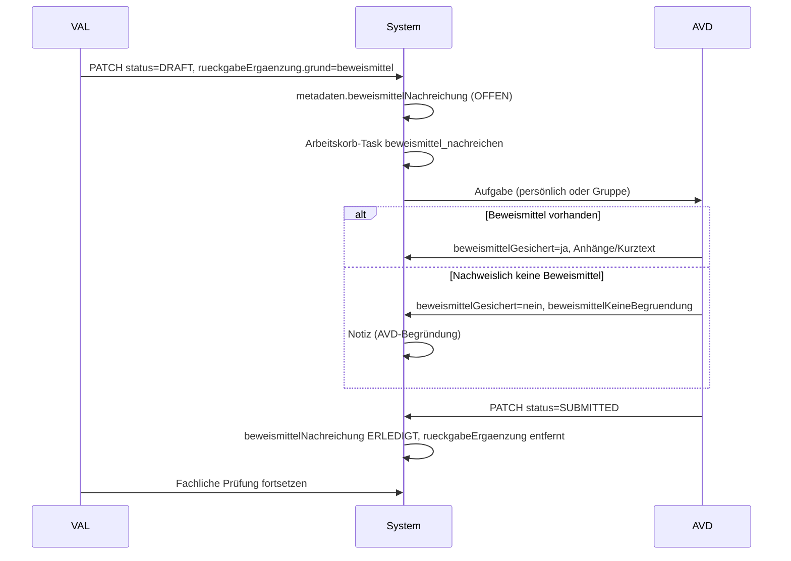

# Umsetzungsdokumentation: Beweismittel-Nachreichung durch AVD (Rückgabe-Weg)

**Stand:** 2026-06-05 (ergänzt: Inline-Arbeitskorb-UI, `BeweismittelErfassung`, Abschluss-API)  
**Lastenheft:** A2-F-QS-004, A2-F-STA-003  
**Happy Path:** HP-26b–HP-26f (Schwerpunkt Beweismittel: HP-26c–HP-26e)  
**Hackathon:** H-P54  

---

## 1. Ziel und Ausgangslage

VAL/AL können eine Meldung zur **Ergänzungserfassung** zurückgeben, wenn Zeugen- und/oder Beweismittel-Daten nicht rechtzeitig vollständig sind. Der gewählte Umsetzungsweg für **Beweismittel** ist die **Rückgabe** (Status → `DRAFT`), nicht ein paralleler Upload außerhalb des Entwurfs.

### Bereits vorhanden (vor dieser Erweiterung)

| Baustein | Status |
|----------|--------|
| Beweismittel Ja/Nein + Kurztext bei Ersterfassung | umgesetzt |
| Datei-Upload (Anhänge), API nur im Status `DRAFT` | umgesetzt |
| Rückgabe-Dialog mit Grund `zeugen` / `beweismittel` / `beides` | umgesetzt |
| Ergänzungs-Meldungen (`DRAFT` + `rueckgabeErgaenzung`) in Team-Übersicht | umgesetzt |

### Ergänzt in dieser Umsetzung

| Lücke (Plan) | Lösung |
|--------------|--------|
| Rückgabe nur aus `IN_PROGRESS` | Rückgabe auch aus `SUBMITTED` und `FORWARDED` |
| Kein Arbeitskorb-Task für Beweismittel | Neuer Typ `beweismittel_nachreichen` |
| Keine gezielte Zuweisung / KPI | Team-Übersicht: KPI `beweismittelOffen`, Filter, Zuweisen |
| Upload-UI bei falschem Status | Upload-Button nur bei `DRAFT` |
| AVD findet Aufforderung nicht | Task im Arbeitskorb + Team-Übersicht Stationstasks |
| Nachfordern auch wenn Ersterfassung „Nein“ | Rückgabe unabhängig von `beweismittelGesichert`; auch aus Aufgabe **Fachliche Prüfung** |
| AVD muss „Ja“ wählen (Zwischenstand) | **Korrigiert:** „Nein“ mit Pflicht-Begründung weiterhin möglich |

### Bewusst nicht umgesetzt (Plan Abschnitt 6)

- Upload-API-Regel „nur Entwurf“ bleibt unverändert (passt zum Rückgabe-Weg).
- Fachliche Prüfung bleibt VAL-exklusiv (kein Stationstask in Team-Übersicht).
- Proaktiver Hinweis bei Einreichung **ohne** Anhänge bei `beweismittelGesichert: nein` (Plan-Punkt 5) – weiterhin **offen**.

---

## 2. Prozessablauf



### Rollen und Sichtbarkeit

| Schritt | Rolle | Wo sichtbar |
|---------|-------|-------------|
| Beweismittel anfordern | VAL / AL | Meldungsdetail → „Zur Ergänzung zurückgeben“ / „Beweismittel nachfordern“; **auch** Arbeitskorb-Aufgabe **Fachliche Prüfung** |
| Task dispositionieren | VAL / AL | Team-Übersicht → KPI „Beweismittel offen“, Button **„Verantwortlichkeit zuweisen“** |
| Nachreichen / begründen | AVD / SL | Arbeitskorb-Task `beweismittel_nachreichen`, Meldungsdetail (Entwurf), Formular |
| Fachliche Prüfung | VAL | VAL-Arbeitskorb (`fachliche_pruefung`), **nicht** Team-Übersicht |

### Fachregel: Ersterfassung „Nein“ und Nachreichung

VAL kann **auch dann** Beweismittel nachfordern, wenn der AVD bei der Ersterfassung **`beweismittelGesichert: nein`** gewählt hat (z. B. weil zunächst nur Zeugenaussagen vorlagen). Die Nachreichung ist eine **erneute Klärung**, kein Widerspruch zum Erstwert.

Der AVD hat nach Rückgabe **zwei gleichwertige Wege**:

| Antwort AVD | Pflicht bei Einreichung | Ergebnis `beweismittelNachreichung.ergebnis` |
|-------------|-------------------------|-----------------------------------------------|
| **Ja** – Beweismittel liegen vor | Kurzbezeichnung (`beweismittelAngaben`); Anhänge optional | `nachgereicht` |
| **Nein** – nachweislich keine Beweismittel (z. B. nur Zeugen) | Begründung (`beweismittelKeineBegruendung`) | `keine` |

Bei **Nein** mit Begründung erzeugt das System beim Einreichen automatisch eine **Notiz** (sichtbar für VAL in der Meldungs-Seitenleiste), z. B.:

> Beweismittel-Nachreichung: Keine Beweismittel vorhanden (AVD …). Begründung: …

VAL prüft die Begründung und kann die fachliche Prüfung fortsetzen oder erneut zurückgeben.

---

## 3. Datenmodell

### `metadaten.rueckgabeErgaenzung` (bestehend)

```json
{
  "grund": "beweismittel",
  "kommentar": "Fotos vom Tatort fehlen",
  "fristBis": "2026-06-15",
  "zurueckgegebenAm": "2026-06-05T12:27:25.342Z",
  "zurueckgegebenVon": "VAL-01"
}
```

Gründe: `zeugen` | `beweismittel` | `beides` | `sonstiges`

### `metadaten.beweismittelNachreichung` (neu)

Wird bei Rückgabe mit Grund `beweismittel` oder `beides` angelegt:

```json
{
  "status": "OFFEN",
  "fristBis": "2026-06-15",
  "kommentar": "Fotos vom Tatort fehlen",
  "angefordertVon": "VAL-01",
  "angefordertAm": "2026-06-05T12:27:25.342Z",
  "erfassenderAn": "AVD-02",
  "erfassenderAnName": "Tobias Klein",
  "zugewiesenAn": "AVD-02",
  "zugewiesenAnName": "Tobias Klein",
  "zugewiesenVon": null,
  "zugewiesenAm": null
}
```

- **OFFEN** → Task im Arbeitskorb sichtbar  
- **ERLEDIGT** → bei Wiedereinreichung (`SUBMITTED`); `rueckgabeErgaenzung` wird entfernt  
- **ergebnis** → `nachgereicht` \| `keine` (gesetzt bei Erledigung)
- **begruendungKeine** → Text der AVD-Begründung, wenn `ergebnis = keine`
- **erledigtVon** / **erledigtAm** → Bearbeiter und Zeitpunkt der Wiedereinreichung

### `metadaten.beweismittelKeineBegruendung` (neu)

Rich-Text-Feld im Formular; nur relevant bei aktiver Beweismittel-Nachreichung und Auswahl **Nein**:

```json
{
  "beweismittelKeineBegruendung": "<p>Sachverhalt nur durch Zeugenaussagen belegbar, keine physischen Spuren.</p>"
}
```

- Pflicht **nur bei Einreichung** (`SUBMITTED`), wenn `beweismittelNachreichung.status = OFFEN` und `beweismittelGesichert = nein`
- Wird im Meldungsdetail unter „Beweismittel gesichert: Nein“ angezeigt
- Fließt in die automatische Notiz ein (Plaintext ohne HTML-Tags)

### Arbeitskorb-Task-ID

```
{meldungId}|beweismittel_nachreichen|beweismittel
```

### Zuweisungslogik (Empfänger-Auflösung)

`resolveBeweismittelEmpfaenger()` ermittelt den Zuständigen in dieser Reihenfolge:

1. `beweismittelNachreichung.zugewiesenAn` (nach Übernahme oder Team-Zuweisung)
2. `metadaten.zugewiesenAn` (bestehende Meldungs-Zuweisung)
3. `beweismittelNachreichung.erfassenderAn` (bei Anlage gesetzt)
4. letzter `StatusVerlauf` mit Status `SUBMITTED` durch AVD/Stationsleitung (ursprünglicher Einreicher)
5. `gefangene.betreuenderBeamter` (falls AVD/SL)

**Persönliche Aufgabe:** Wenn ein Empfänger ermittelt wird, erscheint der Task nur bei diesem Nutzer unter „Meine Aufgaben“ – unabhängig von der Abteilung der Gefangenen.

**Gruppenaufgabe:** Nur wenn kein Empfänger ermittelt werden kann; dann sichtbar für AVD/SL der Station (`gefangene.haus` = Nutzer-Abteilung), mit Übernahme/Zuweisung durch VAL.

Bei neuer Rückgabe mit Grund `beweismittel`/`beides` setzt das Backend `erfassenderAn` und `zugewiesenAn` direkt auf den ermittelten Empfänger.

### Frist-Eskalation (`frist_only`)

Nach Ablauf von `beweismittelNachreichung.fristBis` (on-read bei Arbeitskorb/Team-Übersicht):

1. `zugewiesenAn` / `erfassenderAn` werden geleert, `inGruppenpostfach: true`, `eskaliertAm` gesetzt
2. Task erscheint als **Gruppenaufgabe** für die Station der Gefangenen
3. Benachrichtigung `AUFGABE_ESKALIERT` an VAL und SL der Station
4. `resolveBeweismittelEmpfaenger()` liefert bei `inGruppenpostfach` / `eskaliertAm` keinen persönlichen Empfänger

Service: `backend/src/services/beweismittelEskalationService.js`

VAL/AL können vor Fristablauf manuell **„Zurück an Gruppe“** (`PATCH …/zuweisen` mit `zugewiesenAn: null`).

---

## 4. Backend-Änderungen

### `backend/src/services/arbeitskorbService.js`

- `AUFGABEN_TYPEN.BEWEISMITTEL_NACHREICHEN = 'beweismittel_nachreichen'`
- `sammleBeweismittelAufgabeAusMeldung()` – Task bei `DRAFT` + offener Nachreichung
- `resolveBeweismittelEmpfaenger()` – Empfänger-Auflösung (s. o.)
- `sammleBeweismittelDispositionAufgaben()` – für Team-Übersicht (ohne Nutzerfilter, mit aufgelöstem Empfänger)
- `uebernehmenArbeitskorbAufgabe()` – Gruppenübernahme wie bei Zeugenaussage Inhaftierter
- `zuweisenArbeitskorbAufgabe()` – Zuweisen, Ummelden, Zurück an Gruppe (`zugewiesenAn: null`)
- `beweismittelEskalationService.js` – Frist-Check und Eskalation
- `listArbeitskorbAufgaben`: Meldungen mit Status `DRAFT` (nicht nur `ARCHIVED` ausgeschlossen), damit Ergänzungs-Tasks erscheinen

### `backend/src/routes/index.js`

Bei `PATCH /api/meldungen/:id/status`:

| Request | Wirkung |
|---------|---------|
| `status: DRAFT` + `rueckgabeErgaenzung`, Grund `beweismittel`/`beides` | `beweismittelNachreichung` anlegen, Verlauf „Beweismittel-Nachreichung angefordert“ |
| `status: SUBMITTED` aus `DRAFT` mit offener Nachreichung | `beweismittelNachreichung` → `ERLEDIGT`, `ergebnis`, `begruendungKeine`; bei `keine` → **Notiz** anlegen; `rueckgabeErgaenzung` löschen |

### `backend/src/utils/meldungPflichtfelder.js`

Bei offener Beweismittel-Nachreichung und `beweismittelGesichert = nein`: Pflichtfeld `beweismittelKeineBegruendung` (Frontend und Backend konsistent).

### `backend/src/services/beweismittelNachreichungService.js`

Gemeinsame Logik für Abschluss der Nachreichung: Validierung, `metaNachBeweismittelEinreichung`, `einreichenNachBeweismittelNachreichung` (DRAFT → SUBMITTED, Notiz bei „keine“). Genutzt von `abschliessenArbeitskorbAufgabe`.

### `backend/src/services/dispositionService.js`

- Beweismittel-Tasks in `aufgaben[]` (parallel zu Zeugenaussagen)
- KPI `beweismittelOffen`
- `rueckgabeGrund` in Ergänzungs-Meldungen für Filter/Badge

---

## 5. Frontend-Änderungen

| Datei | Änderung |
|-------|----------|
| `frontend/src/utils/arbeitskorb.js` | Konstante + Label `beweismittel_nachreichen` |
| `frontend/src/components/meldung/MeldungAktionen.jsx` | Rückgabe ab `SUBMITTED`/`IN_PROGRESS`/`FORWARDED`; Schnellaktion „Beweismittel nachfordern“; Hinweis wenn Ersterfassung „Nein“ |
| `frontend/src/components/meldung/BeweismittelErfassung.jsx` | Gemeinsames Ja/Nein-Feldset (Standard + Nachreichung) für MeldungForm und Arbeitskorb |
| `frontend/src/components/meldung/MeldungForm.jsx` | Nutzt `BeweismittelErfassung`; Nachreichung: Ja/Nein; bei Nein Pflichtfeld `beweismittelKeineBegruendung` |
| `frontend/src/components/meldung/RueckgabeDialog.jsx` | Prop `initialGrund` |
| `frontend/src/pages/MeldungDetail.jsx` | Banner (Ja/Nein-Optionen); Anzeige Begründung im Stammdatenblock |
| `frontend/src/components/meldung/DetailSeitenleiste.jsx` | Upload nur bei `DRAFT`; kein VAL-Hinweistext mehr (Hinweis nur im Arbeitskorb-Formular links) |
| `frontend/src/pages/ArbeitskorbAufgabe.jsx` | `BeweismittelMeldungsBezug` (Ersterfassung + VAL-Aufforderung); Task **Beweismittel nachreichen**: hervorgehobene Karte, roter VAL-Hinweis, Inline-`BeweismittelErfassung`; Abschluss → **Arbeitskorb** (s. [UMSETZUNG_ARBEITSKORB_NAVIGATION.md](UMSETZUNG_ARBEITSKORB_NAVIGATION.md)) |
| `frontend/src/utils/arbeitskorb.js` | `getNavigationNachAufgabenAbschluss()` |
| `frontend/src/pages/Arbeitskorb.jsx` | Erfolgs-Banner nach Aufgaben-Abschluss |
| `frontend/src/components/emeldewesen/TeamUebersichtPanel.jsx` | Button **„Verantwortlichkeit zuweisen“** (statt „Station zuweisen“) |
| `frontend/src/components/emeldewesen/ArbeitskorbPanel.jsx` | Badge, lesbare Typ-Labels |
| `frontend/src/components/emeldewesen/TeamUebersichtPanel.jsx` | KPI, Filter, Grund-Badge Ergänzung |
| `frontend/src/pages/EMeldewesenHub.jsx` | Team-Badge zählt `beweismittelOffen` |

---

## 6. API-Endpunkte (relevant)

| Methode | Pfad | Beschreibung |
|---------|------|--------------|
| `PATCH` | `/api/meldungen/:id/status` | Rückgabe (`DRAFT` + `rueckgabeErgaenzung`) / Wiedereinreichung (`SUBMITTED`) |
| `POST` | `/api/meldungen/:id/anhaenge` | Anhänge (nur `DRAFT`) |
| `GET` | `/api/arbeitskorb` | Offene Tasks inkl. `beweismittel_nachreichen` |
| `PATCH` | `/api/arbeitskorb/:id/uebernehmen` | Gruppenaufgabe übernehmen |
| `PATCH` | `/api/arbeitskorb/:id/abschliessen` | Beweismittel-Nachreichung: Metadaten + `SUBMITTED` (Body: `beweismittelGesichert`, `beweismittelAngaben`, `beweismittelKeineBegruendung`) |
| `PATCH` | `/api/arbeitskorb/:id/zuweisen` | VAL/AL weist AVD zu |
| `GET` | `/api/disposition/team-uebersicht` | KPIs + Stationstasks + Ergänzungs-Meldungen |

---

## 7. Manuelle Abnahme

### Szenario A: Beweismittel nachreichen (Ja)

1. VAL: Rückgabe `grund=beweismittel` (auch wenn Ersterfassung `beweismittelGesichert: nein`) → `DRAFT`, `beweismittelNachreichung: OFFEN`
2. Team-Übersicht: `beweismittelOffen: 1`, Task `beweismittel_nachreichen`
3. AVD: Arbeitskorb → Task „Beweismittel nachreichen“ übernehmen → links **Ja** wählen, Kurztext + Anhänge → „Beweismittel speichern und Meldung einreichen“ → `ergebnis: nachgereicht`, Task erledigt

### Szenario B: Keine Beweismittel bestätigen (Nein + Begründung)

1. VAL: „Beweismittel nachfordern“ aus **Fachliche Prüfung** (Arbeitskorb) oder Meldungsdetail
2. AVD: Arbeitskorb-Task → **Nein** wählen, Feld **„Begründung: keine Beweismittel vorhanden“** ausfüllen (z. B. nur Zeugenaussagen)
3. AVD: „Beweismittel speichern und Meldung einreichen“ → `ergebnis: keine`, **Notiz** in Seitenleiste, `beweismittelKeineBegruendung` im Detail sichtbar
4. VAL: fachliche Prüfung fortsetzen

### Test-Header (Mock-Auth)

```
x-mock-rolle: VAL | AVD
x-mock-nutzer-id: VAL-01 | AVD-02
x-mock-abteilung: Abteilung 1
x-mock-jva: JVA Billwerder
```

---

## 8. Verwandte Dokumente

| Dokument | Bezug |
|----------|-------|
| [UMSETZUNG_ARBEITSKORB_NAVIGATION.md](UMSETZUNG_ARBEITSKORB_NAVIGATION.md) | Rückkehr zum Arbeitskorb; fachliche Prüfung nur VAL/AL |
| [PROTOKOLL_AENDERUNGEN.md](PROTOKOLL_AENDERUNGEN.md) | Chronik der Commits/Änderungen |
| [HAPPY_PATH_STRAFANZEIGE.md](HAPPY_PATH_STRAFANZEIGE.md) | HP-26b–f |
| [HACKATHON_A2_AUFNAHME_TODOS.md](HACKATHON_A2_AUFNAHME_TODOS.md) | H-P54 |
| [LASTENHEFT/02_QUERSCHNITT_ROLLEN_STATUS.md](LASTENHEFT/02_QUERSCHNITT_ROLLEN_STATUS.md) | A2-F-QS-004, A2-F-STA-003 |
| [LASTENHEFT/12_PROTOTYP_POPUP_ZIELOPTIONEN.md](LASTENHEFT/12_PROTOTYP_POPUP_ZIELOPTIONEN.md) | Z-66 |
