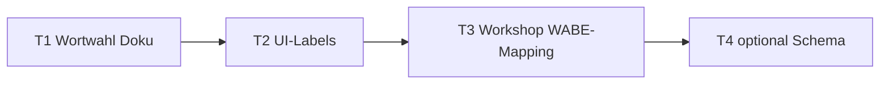

# Zu klärende Begrifflichkeiten – A2 eMeldewesen

**HEUREKA 2.0 · FHH Hamburg Justiz · Justizvollzug**  
**Version:** 1.2 | **Stand:** 2026-06-02  
**Zielgruppe:** Workshop-Leitung, Fachliche Projektbeteiligte, Lastenheft-Autoren, Entwicklung

Dieses Dokument sammelt **unklare, synonym verwendete oder widersprüchliche Begriffe** zwischen **Ist-Fachverfahren (WABE/ANNA/elBe)**, **Gesamtprozess A2**, **Lastenheft** und **Prototyp**. Für jeden Begriff: Ist-Stand, Konflikt, **Vorschlag zur Klärung**, Zuständigkeit (Workshop / Doku / UI / Technik).

**Ergänzt:** [UEBERGABE_GESAMT.md](UEBERGABE_GESAMT.md) §1.4 (Kurzglossar) · **Validierungsstand:** [VALIDIERUNG_PROZESS.md](VALIDIERUNG_PROZESS.md) · **Maßgeblich Prozess:** [GESAMTPROZESS.md](GESAMTPROZESS.md) v2.0

**Quelle WABE:** [20260610_HEUREA_WABE.docx](quellen/20260610_HEUREA_WABE.docx) (Screenshots ANNA/elBe, WABE-Hauptmenü, Meldungsbeispiele)

---

## Inhaltsverzeichnis

1. [Vorgehen und Priorisierung](#1-vorgehen-und-priorisierung)
2. [WABE / ANNA / elBe – Ausgangsbegriffe](#2-wabe--anna--elbe--ausgangsbegriffe)
3. [Prozess-Ebenen (Ereignis → Fall)](#3-prozess-ebenen-ereignis--fall) · [3.1 Fall-Bündelung (Annahme)](#31-fall-bündelung--annahme-nicht-validiert)
4. [Rollen und Organisation](#4-rollen-und-organisation)
5. [Meldepflicht, ERV und Kanäle](#5-meldepflicht-erv-und-kanäle)
6. [Status, UI und Abschluss](#6-status-ui-und-abschluss)
7. [Beweise und externe Stellen](#7-beweise-und-externe-stellen)
8. [Lastenheft vs. Gesamtprozess](#8-lastenheft-vs-gesamtprozess)
9. [Workshop-Entscheidungen (nicht durch Umbenennung lösen)](#9-workshop-entscheidungen-nicht-durch-umbenennung-lösen)
10. [Umsetzungsplan](#10-umsetzungsplan)
11. [Mini-Referenz „So schreiben wir ab jetzt“](#11-mini-referenz-so-schreiben-wir-ab-jetzt)
12. [Offene Terminologie-Punkte (OP-T-*)](#12-offene-terminologie-punkte-op-t)
13. [Fristen und SLA (zu validieren, OP-F-*)](#13-fristen-und-sla-zu-validieren-op-f)
14. [Rolle Zentrale in der Rollenmatrix (zu validieren, OP-R-*)](#14-rolle-zentrale-in-der-rollenmatrix-zu-validieren-op-r)

---

## 1. Vorgehen und Priorisierung

| Phase | Inhalt | Aufwand |
|-------|--------|---------|
| **T1** | Kanonische Wortwahl in Doku festziehen (dieses Dokument + GESAMTPROZESS) | gering |
| **T2** | UI-Labels Prototyp angleichen | mittel |
| **T3** | WABE→A2-Mapping im Workshop validieren | Workshop |
| **T4** | Optional: Schema/API (z. B. `ervRelevant`, Status-Enums) | höher |

Bei Widerspruch gilt: **GESAMTPROZESS v2.0** > älteres Lastenheft/ARIS > Prototyp-IST.

---

## 2. WABE / ANNA / elBe – Ausgangsbegriffe

### 2.1 Systemlandschaft (Ist-Verfahren)

| Begriff | Bedeutung im WABE-Kontext | Quelle |
|---------|---------------------------|--------|
| **WABE** | Legacy-**Vorgangserfassung** (Hauptmenü; Stand laut Screenshot ca. 2006) | WABE.docx, Bild 1 |
| **ANNA** | Nachfolge-/Oberflächenmodul mit Reiter **MENÜ · ANNA · elBe** | WABE.docx, Bild 2–3 |
| **elBe** | **Elektronische Bearbeitung** von Vorgängen („elBe Vorgänge“) | WABE.docx, Bild 2 |
| **ERV / BeBPo** | Im Fenstertitel: „Ablösung/Überführung WABE unter Berücksichtigung **ERV/BeBPo**“ | WABE.docx, Bild 2 |

### 2.2 Vorkommnis / Vorkommnisse (WABE)

**Schreibweisen:** Im Fachverfahren **Vorkommnis** (Singular) / **Vorkommnisse** (Plural); umgangssprachlich teils „Vorkommniss“.

| Kontext | Verwendung |
|---------|------------|
| **WABE-Hauptmenü** | Button **„Info-Ordner: Vorkommnisse“** (rot hervorgehoben) – eigene Vorgangsart neben Beschwerden, Anträgen usw. |
| **ANNA / elBe** | Icon **„Vorkommnisse“** in einer Reihe mit: Ermittlungsverfahren gegen Gef./Ext., Ermittlungsverfahren gegen Bedienstete, Beschwerde, Gerichtliche Verfahren |
| **Meldungsbeispiel** (WABE-Schulung) | Fließtext-Meldung zu Zwischenfall (Alarm, §74-Verlegung, Polizei PK 34) – **ohne** explizites Label „Vorkommnis“ im Text |

**Abgrenzung in WABE (hypothese, Workshop bestätigen):**

| WABE-Kategorie | Vermutete Bedeutung | Mögliche Nähe zu A2 |
|----------------|---------------------|---------------------|
| **Vorkommnisse** | Vollzugsrelevante **Zwischenfälle**/Informationen, ggf. **ohne** formales Ermittlungsverfahren | `VORFALL_INTERN`, interner Fall-Pfad |
| **Ermittlungsverfahren gegen Gef./Ext.** | Strafrechtlich relevant, Aktenzeichen JVA/StA/Pol. | `STRAFANZEIGE`, ERV-Weg |
| **Ermittlungsverfahren gegen Bedienstete** | Delikt gegen Bedienstete | eigener Typ? / `STRAFANZEIGE` Untertyp? |
| **Beschwerde** | Beschwerdewesen | **nicht** A2-Kern (eigenes Verfahren) |
| **Gerichtliche Verfahren** | Gerichtskommunikation | `MELDUNG_GERICHT` |

### 2.3 Klärungsvorschlag: Vorkommnis ↔ A2

| Option | Beschreibung | Empfehlung |
|--------|--------------|------------|
| **A** | **Vorkommnis** = **Ereignis** (real) → in A2 als **mehrere Einzelmeldungen + Fall** | **Bevorzugt** für Prozess-Sprache |
| **B** | **Vorkommnis** = **Meldungstyp** synonym zu `VORFALL_INTERN` | Nur in Typ-/Statistik-Sprache (Lastenheft) |
| **C** | **Vorkommnis** = **WABE-Vorgangsart**, die **nicht 1:1** auf einen A2-Meldungstyp abbildbar ist | Mapping-Tabelle Workshop |

**Vorschlag Workshop (OP-T-01):**

1. Ist ein **Vorkommnis** in WABE **immer** meldepflichtig prüfbar – oder oft **nur informativ** (Info-Ordner)?
2. Wann wird aus einem **Vorkommnis** ein **Ermittlungsverfahren** (elBe-Kategorie gewechselt)?
3. Entspricht die A2-**Fall-Bündelung** der WABE-**„Zusammenführung durch die Gruppenleitung“** (WABE.docx Seite 5)?

**Bis zur Klärung schreiben:**

- In **Prozess-Doku:** „**Ereignis**“ (nicht „Vorkommnis“), außer bei explizitem WABE-Bezug.
- In **WABE-Abgrenzung:** „**Vorkommnis (WABE)**“ mit Verweis auf dieses Dokument.
- In **UI:** kein Label „Vorkommnis“ einführen, bevor OP-T-01 beantwortet ist.

---

## 3. Prozess-Ebenen (Ereignis → Fall)

| Begriff | Problem | Vorschlag |
|---------|---------|-----------|
| **Ereignis** vs **Vorfall** | Synonym in GESAMTPROZESS, aber **Vorfall** im Lastenheft = **Meldungstyp** | **Kanonisch: Ereignis** (Prozess). **Vorfall** nur mit Zusatz: „Vorfall (Typ)“ = `VORFALL_INTERN` |
| **Meldung** vs **Einzelmeldung** | „Meldung“ unklar nach Bündelung | **Einzelmeldung** für aVD-Eingabe; **Meldung** nur wenn Kontext eindeutig |
| **Fall** vs **gebündelter Fall** | Doppelung | **Fall** reicht; `MeldungsFall` nur technisch |
| **Fallmeldung** | Klingt nach neuem Dokumenttyp | Ersetzen durch **„Fall an SL/AL weiterleiten“** (Prozessschritt) |
| **Vorkommnis (WABE)** vs **Fall (A2)** | WABE: Kategorie/Ordner; A2: gebündeltes Objekt | Mapping Workshop (§2.3); nicht gleichsetzen |

### 3.1 Fall-Bündelung – **Annahme (nicht validiert)**

> **⚠️ Der gesamte Prozessschritt Phase ③ (Fall-Bündelung durch Zentrale)** ist im Prototyp und in der Prozessdoku als **Arbeitsannahme** modelliert – **noch nicht workshop-validiert**.

| Aspekt | Stand heute | Validierung |
|--------|-------------|-------------|
| **Prozessschritt** | Ereignis → parallele Einzelmeldungen → **Zentrale bündelt** → DGL → … | **OP-FB-01** (Workshop) |
| **Quelle** | Praxisfeedback Blocks F, P, D (Vorentwurf, eine JVA-Perspektive) | Mehrere JVAs (OP-JVA-01) |
| **Prototyp** | `MeldungsFall`, Hub, API – **demonstriert die Annahme** | Kein Nachweis fachlicher Beschluss |
| **Offen** | Kriterien F1/F2, techn. Verknüpfung B2, JVA-Abweichungen A4 | F1–F2, B2, OP-JVA-01 |

**Bis zur Validierung:** In Doku und UI als **„Annahme: Fall-Bündelung“** kennzeichnen; nicht als beschlossenen Soll-Prozess verkaufen.

---

## 4. Rollen und Organisation

Bewusste Synonyme – **kanonisch ist der Rollencode** (`.cursorrules`).

| Code | Kurzformen | Klärungsbedarf |
|------|------------|----------------|
| `arbeitskoordination` | Zentrale, AK | **OP-R-01–08:** Fall-Rechte und Sichtbereich in Rollenmatrix – [§14](#14-rolle-zentrale-in-der-rollenmatrix-zu-validieren-op-r) |
| `dienstgruppenleitung` | DGL | Kein |
| `stationsleitung` | SL, Wohngruppenleitung | **OP-JVA-01:** Label je JVA in Anhang A |
| `anstaltsleitung` | AL | Kein |
| `val` | VAL | Kein |

**WABE-Bezug:** „Gruppenleitung“ / „Zusammenführung durch die Gruppenleitung“ (WABE) – ist das **DGL**, **SL** oder historische Rolle? → **OP-T-02** (Workshop).

---

## 5. Meldepflicht, ERV und Kanäle

| Begriff | Problem | Vorschlag |
|---------|---------|-----------|
| **meldepflichtig** | Entscheid AL/VAL auf Fall-Ebene | **Kanonisch** für Entscheid „ja/nein“ |
| **beBPo-pflichtig** | = meldepflichtig ja (G1) | In UI **nicht** doppelt; beBPo nur am **Versand-Schritt** |
| **ERV** (Oberbegriff) | Wird für Prozess, Status und Typ verwendet | **ERV** nur für **Gesamtkette** extern; sonst präziser (s. u.) |
| **`ERV_WEG`** | Fall-Status | In UI: **„Externer Versand (ERV)“** oder Status-Label aus `fallService` |
| **`ervRelevant`** | Meldungsfeld; klingt wie Entscheid | Fachtext: **„ERV-Bezug des Meldungstyps“**; Badge **„ERV-Typ“** statt „ERV-pflichtig“ |
| **beBPo** vs **xJustiz** | Technik vs. Fachkanal | UI: **„Per beBPo versenden“**; xJustiz nur Technik/Doku |
| **eGPA** / **Veraktung** | Synonym | **eGPA-Veraktung** in UI; „Veraktung“ in Datenmodell |

**WABE:** Titel „ERV/BeBPo“ bestätigt externen Pfad – entspricht A2-**ERV-Kette am Fall**, nicht Einzelmeldungs-Shortcut.

---

## 6. Status, UI und Abschluss

| Begriff | Problem | Vorschlag |
|---------|---------|-----------|
| **Fachliche Prüfung** vs **`IN_PROGRESS`** / „In Bearbeitung“ | UI missverständlich | UI-Label: **„Fachliche Prüfung“** bei `IN_PROGRESS` (Prototyp) |
| **`FORWARDED`** / „Weitergeleitet“ | Klingt nach Postweg | UI: **„Im Fall“** wenn `fallId` gesetzt |
| **Vier-Augen-Abschluss** | Prozessschritt | Getrennt von Status-Enums dokumentieren |
| **`ABGESCHLOSSEN_INTERN`** | Fall-Status | UI: **„Fall abgeschlossen“** |
| **`ARCHIVED`** | Einzelmeldungs-Status | UI: **„Archiviert“** – nur nach Fall-Abschluss |

**Zwei Prozesspfade (Doku-Hinweis):**

| Pfad | Dokument | Status |
|------|----------|--------|
| **Fall-Pfad (Soll)** | GESAMTPROZESS, UEBERGABE §7 | Aktuell |
| **Einzelmeldungs-Happy-Path** | HAPPY_PATH_STRAFANZEIGE | Als **Legacy/Parallel** kennzeichnen |

---

## 7. Beweise und externe Stellen

| Begriff | Problem | Vorschlag |
|---------|---------|-----------|
| **Beweismittel** vs **Sicherstellung** | JVA sichert, erhebt nicht (E1, BM-01) | UI: **„Sicherstellung“**; Feld `beweismittelGesichert` intern behalten |
| **Polizei eingeschaltet** (M1) | Eigenes Konzept vs. Zeugen | **Eigenes Feld**, nicht unter Beweismittel |
| **Polizei informiert?** (WABE-Formular) | Entspricht M1? | **OP-T-03:** 1:1 übernehmen als Ja/Nein in A2 |

---

## 8. Lastenheft vs. Gesamtprozess

| Lastenheft-Begriff | Gesamtprozess A2 | Klärung |
|--------------------|------------------|---------|
| **Ermittlungsverfahren** | ERV-relevante Typen + Fall-ERV | Lastenheft = **Statistik-Kategorie**; Prozess = **Fall-ERV-Kette** |
| **Vorfall** (Typ) | **Ereignis** (real) | Lastenheft Kap. 3 um **Abgrenzungstabelle** ergänzen (s. §3) |
| **Vorkommnis (WABE)** | nicht definiert | Dieses Dokument §2 + Workshop OP-T-01 |

**Dokumente mit Nachzügler-Risiko:** `PROZESS_SOLL_UND_STAND.md` §5.2 (fehlende Status), `HAPPY_PATH_STRAFANZEIGE.md` (Einzelpfad), `RUECKFRAGEN` (`entscheid-al`).

---

## 9. Workshop-Entscheidungen (nicht durch Umbenennung lösen)

| ID | Frage | Terminologie-Relevanz |
|----|-------|------------------------|
| **Q-K/J** | Schließt bei „nicht meldepflichtig“ nur AL ab? | „Abschlussberechtigt“ definieren |
| **OP-W-01** | 5 oder 7 W-Fragen Pflicht? | Einheitlich **„W-Fragen (mindestens …)“** |
| **OP-T-01** | Vorkommnis (WABE) ↔ A2-Typ/Fall | zentral für WABE-Ablösung |
| **OP-T-02** | WABE „Gruppenleitung“ = DGL oder SL? | Rollen-Mapping |
| **OP-T-03** | Polizei-Feld WABE = M1? | Feld-Label |
| **N2** | 24-h-SLA ab Ereignisende | In allen SLA-Texten durchziehen |

---

## 10. Umsetzungsplan

| Schritt | Aktion | Dateien |
|---------|--------|---------|
| 1 | Kanonische Wortwahl | dieses Dokument, GESAMTPROZESS, UEBERGABE §1.4 |
| 2 | „Fallmeldung“ → „Fall weiterleiten“ | GESAMTPROZESS, PROZESS_SOLL_UND_STAND, Workshop-Unterlagen |
| 3 | Lastenheft Kap. 3 Abgrenzung | `LASTENHEFT/01_KAPITEL_RAHMEN.md` |
| 4 | UI: Sicherstellung, Fachliche Prüfung, ERV-Typ-Badge | Frontend-Komponenten Meldung/Fall |
| 5 | Workshop: OP-T-01–03 | Ergebnis in GESAMTPROZESS + dieses Dokument |

---

## 11. Mini-Referenz „So schreiben wir ab jetzt“

| Statt … | Schreiben … |
|---------|-------------|
| Vorfall (wenn Ereignis gemeint) | **Ereignis** |
| Vorkommnis (ohne WABE-Bezug) | **Ereignis** oder **Vorkommnis (WABE)** |
| Meldung (unklar) | **Einzelmeldung** oder **Fall** |
| Fallmeldung | **Fall an SL/AL weiterleiten** |
| ERV-pflichtig (nach Entscheid) | **meldepflichtig** |
| ERV-pflichtig (wegen Typ) | **ERV-Typ** / ERV-Bezug des Meldungstyps |
| Beweismittel (UI) | **Sicherstellung** |
| In Bearbeitung | **Fachliche Prüfung** |
| xJustiz versenden | **Per beBPo versenden** |
| entscheid-al (API) | **entscheid-meldepflicht** |

---

## 12. Offene Terminologie-Punkte (OP-T-*)

| ID | Thema | Vorschlag bis Klärung | Status |
|----|-------|----------------------|--------|
| **OP-T-01** | **Vorkommnis (WABE)** ↔ Ereignis / `VORFALL_INTERN` / Fall | Prozess: **Ereignis**; WABE explizit labeln | **Workshop** |
| **OP-T-02** | WABE **Gruppenleitung** vs. DGL / SL | Nicht mappingen ohne JVA-Rückmeldung | **Workshop** |
| **OP-T-03** | WABE **„Polizei informiert?“** ↔ M1 | Feld separat planen; Label abstimmen | **Workshop** |
| **OP-T-04** | UI **Sicherstellung** statt Beweismittel | Labels/Hilfetexte anpassen | **Prototyp** |
| **OP-T-05** | UI **Fachliche Prüfung** statt In Bearbeitung | StatusBadge | **Prototyp** |
| **OP-T-06** | Lastenheft **Vorfall** vs. Prozess **Ereignis** | Kap. 3 Abgrenzungstabelle | **Doku** |
| **OP-T-07** | Doku **HAPPY_PATH** als Legacy kennzeichnen | Hinweis am Kopf der Datei | **Doku** |
| **OP-T-08** | **`ervRelevant`** umbenennen/ableiten | Erst nach LC-Entscheid | **Zurückgestellt** |

Einträge in [RUECKFRAGEN_UND_OFFENE_PUNKTE.md](RUECKFRAGEN_UND_OFFENE_PUNKTE.md) bei Workshop-Beschluss aktualisieren.

---

## 13. Fristen und SLA (zu validieren, OP-F-*)

**Quelle Prototyp-Code:** `frontend/src/utils/meldungen.js`, `backend/src/utils/meldungenSla.js`  
**Quelle Soll:** [GESAMTPROZESS.md](GESAMTPROZESS.md) §8, [Praxisfeedback.md](Praxisfeedback.md) Block H, [03_QUERSCHNITT_SLA_UI.md](LASTENHEFT/03_QUERSCHNITT_SLA_UI.md)

### 13.1 Übersicht: Soll vs. Prototyp

| Frist (Soll) | Beschlossen | Im Prototyp-Timer | Abweichung |
|--------------|-------------|-------------------|------------|
| Ersterfassung **24 h** ab **Ereignisende** | H1, N2 | **Nein** (nur F2: 24 h ab `erstelltAm` bei `SUBMITTED`) | Messpunkt + Startzeit |
| Externe Meldung **24 h** ab Ereignisende, **Werktage** | H2, N2 | **Nein** (F4: 3×24 h ab `versandfaehig`, Einzelmeldung) | Dauer, Start, Fall-Ebene |
| **Montag 08:00** nach WE/FT | N1 | **Nein** | Werktagslogik fehlt |
| Eskalation **Erststufe SL** | N3 | **Nein** (nur Hinweisbanner) | A2-F-SLA-003 offen |
| Zeugenaussage Bedienstete **5 Werktage** | H5 | **Teilweise** (5 Kalendertage + 5×24 h SLA) | Werktag vs. Kalendertag |
| Nachreichung **5 Werktage** | H6 | **Teilweise** (`RueckgabeDialog`: 5 WT; Eskalation Beweismittel) | Pause bei Rückgabe? |
| **2 h unverzüglich** (telefon/AoV) | AV 4400/73 | **Ja** (F1) | Fachlich verifizieren |
| **3 Werktage** schriftlicher Bericht | AV 4400/73 I.4 | **Ja** (F3 als 72 h) | Werktag-Näherung |
| **3 Werktage** nach versandfähig | Lastenheft | **Ja** (F4, Einzelmeldung) | Fall-ERV ohne SLA |
| **`IN_PROGRESS` > 5 Tage** | A2-F-SLA-002 | **Nein** in `getSlaHinweise()` | Doku/Code-Widerspruch |
| **`dringend`-Kennzeichen** | entfällt (H7) | **Noch in UI/Daten** | OP-H-01 |

### 13.2 Im Code implementierte Timer (Referenz)

| Code-ID | Frist | Trigger | Messpunkt |
|---------|-------|---------|-----------|
| **F1** | 2 h | `meldungsweg: telefon` / `unverzueglich` | `erstelltAm` |
| **F2** | 24 h | Status `SUBMITTED` | `erstelltAm` |
| **F3** | 3×24 h | `berichtsart: schriftlich` | `erstelltAm` |
| **F4** | 3×24 h | `ervRelevant` + `versandfaehigAm`, kein beBPo | `versandfaehigAm` (Metadaten) |
| **F5** | 5×24 h | `STRAFANZEIGE`, `IN_PROGRESS`, Zeugen offen | `zeugenNachreichungSeit` / `erstelltAm` |
| **F6** | 5 Kalendertage | Zeugen-Folgeaktion bei Einreichung | `zeugenFolgeaktionen.fristBis` |
| **F7** | 5 Werktage (Standard) | Rückgabe Ergänzungserfassung | `rueckgabeErgaenzung.fristBis` (editierbar) |

**Technik:** Keine Feiertage, kein Hamburg-Kalender; **Werktage** = im Code meist **Kalendertage** (72 h / 120 h).

### 13.3 Validierungspunkte (OP-F-*)

| ID | Zu validieren | Soll | Prototyp heute | Zuständigkeit |
|----|---------------|------|----------------|---------------|
| **OP-F-01** | **Fristbeginn Ersterfassung** | 24 h ab **Ereignisende** (`tatzeit`) | 24 h ab **`erstelltAm`** (F2) | Workshop + Code |
| **OP-F-02** | **Werktage vs. Kalendertage** | Werktage (H2); WE **Montag 08:00** (N1) | Kalendertage durchlaufend | Workshop (→ Anhang A) |
| **OP-F-03** | **Messpunkt „Bearbeitung aufgenommen“** | `IN_PROGRESS` oder dokumentierte Übernahme | Nur F2 bei `SUBMITTED` | Lastenheft + Code |
| **OP-F-04** | **2 h unverzüglich** (telefon/AoV) | GZ-B2 / AV 4400/73 I.3 | F1 aktiv bei Metadaten-Flag | Rechtsreferat / Workshop |
| **OP-F-05** | **3 Werktage schriftlicher Bericht** | AV 4400/73 I.4 | F3 = 72 h Kalender | Bestätigen oder anpassen |
| **OP-F-06** | **3 Werktage extern nach versandfähig** | Lastenheft SLA-Tabelle | F4 nur **Einzelmeldung** | Fall-ERV ergänzen? |
| **OP-F-07** | **5 Werktage Zeugenaussage Bedienstete** | H5 | F5/F6: Kalendertage / 5×24 h | Einheitliche Regel |
| **OP-F-08** | **5 Werktage Nachreichung** | H6, GZ-B5 | F7 Dialog (5 WT); Pause Eskalation? | Workshop |
| **OP-F-09** | **`IN_PROGRESS` > 5 Tage** anzeigen | A2-F-SLA-002 | **Nicht** in `getSlaHinweise()` | Prototyp nachziehen |
| **OP-F-10** | **Automatische Eskalation** 24 h → SL | N3, A2-F-SLA-003 | Nur Banner, kein Job | Zielsystem; Mock? |
| **OP-F-11** | **Eskalationsschleife** (Stufen nach SL) | OP-H-03 | nicht modelliert | Workshop |
| **OP-F-12** | **Fristbeginn Nacht / WE-Einreichung** | Anhang A / Cluster C | nicht modelliert | JVA-Workshop |
| **OP-F-13** | **`dringend` / `prioritaet` entfernen** | H7, OP-H-01 | KPI + Arbeitskorb-Tier 3 | Prototyp-UI |
| **OP-F-14** | **Quartalsauswertung 15 WT** | A2-F-QS-002 | nicht im Prototyp | Zielsystem/DWH |

### 13.4 Empfohlene Workshop-Reihenfolge

1. **OP-F-01, OP-F-02, OP-F-12** – einheitliche **Fristenlogik** (Start, Werktag, WE)  
2. **OP-F-07, OP-F-08** – Zeugen und Nachreichung  
3. **OP-F-06, OP-F-09** – ERV/Fall und Anzeige überfälliger Bearbeitung  
4. **OP-F-10, OP-F-11** – Eskalation (Zielsystem vs. Demo-Mock)

---

## 14. Rolle Zentrale in der Rollenmatrix (zu validieren, OP-R-*)

**Fachbegriff:** **Zentrale** (Organisation/Prozess)  
**Rollencode (Prototyp):** `arbeitskoordination` (Praxisfeedback **A1**, **A3** – vorläufig beantwortet)  
**Quellen Soll:** [GESAMTPROZESS.md](GESAMTPROZESS.md) Phase ③, [UEBERGABE_GESAMT.md](UEBERGABE_GESAMT.md) §3.1, [Praxisfeedback.md](Praxisfeedback.md) A1–A4  
**Quellen Matrix:** `.cursorrules` §2.3, [02_QUERSCHNITT_ROLLEN_STATUS.md](LASTENHEFT/02_QUERSCHNITT_ROLLEN_STATUS.md), `RollenContext.jsx` / `mockAuth.js`

Die klassische **Rollenmatrix** (Erstellen · Bearbeiten · Weiterleiten · eGPA · beBPo · Abschließen) bildet **Einzelmeldungen** ab. Die **Zentrale** wirkt im **Fall-Pfad** mit eigenen Aktionen – diese sind in Matrix und Lastenheft **noch nicht** vollständig beschrieben.

### 14.1 Übersicht: Soll vs. Rollenmatrix / Prototyp

| Aspekt | Soll (Gesamtprozess) | `.cursorrules` / Lastenheft 02 | Prototyp heute |
|--------|----------------------|--------------------------------|----------------|
| **Rollenzuordnung** | Zentrale = Bündlerin | `arbeitskoordination` (ohne Label „Zentrale“) | `arbeitskoordination`, UI „Koordination (Zentrale)“ |
| **Fall bündeln** | **Nur** Zentrale (A3) | **Nicht** in Matrix | `darfBuendeln: true` |
| **Fall an DGL** | Zentrale leitet gebündelt weiter | **Nicht** in Matrix | API `/api/faelle`, Status `ZUR_DGL` |
| **E1/E2** (Vorfall? / vollständig?) | Zentrale (+ DGL bei E2) | **Nicht** in Matrix | fachlich UI; kein Hartblock |
| **Sichtbereich** | JVA-weit (alle Stationen für Bündelung) | „eigene JVA“ (generisch) | `siehtGesamteAnstalt: false` |
| **Weiterleiten** (Einzelmeldung) | unklar vs. Fall-Workflow | **Ja** (A2-F-ROL-001) | `darfWeiterleiten: true` |
| **Meldung erstellen** | Koordination, nicht aVD-Ersatz? | **Ja** (wie alle Rollen) | `kannMeldungErstellen: true` |
| **DGL-Rückgabe** | aVD + Zentrale (F4) | **Nicht** in Matrix | nur `ZURUECK_AK` (Zentrale) |
| **JVA-Abweichungen** | Workshop (A4) | Anhang A offen | nicht modelliert |

### 14.2 Validierungspunkte (OP-R-*)

| ID | Zu validieren | Soll | Matrix / Prototyp heute | Zuständigkeit |
|----|---------------|------|-------------------------|---------------|
| **OP-R-01** | **Fall-Matrix ergänzen** | Zeilen: Bündeln, Fall→DGL, Vollständigkeit (E1/E2), fehlende Meldung anfordern (J2) | Nur Einzelmeldungs-Matrix in `.cursorrules` 2.3 und Lastenheft 02 | Lastenheft + Workshop |
| **OP-R-02** | **Sichtbereich Zentrale** | Alle Stationen der **eigenen JVA** (Bündelung, Vorschläge Tatzeit/Tatort) | `siehtGesamteAnstalt: false` in Code | Workshop + Prototyp |
| **OP-R-03** | **Weiterleiten Einzelmeldung** | Nur **Fall-Workflow** oder auch `FORWARDED` auf Meldung? | A2-F-ROL-001: `darfWeiterleiten: true` | Workshop |
| **OP-R-04** | **Meldungen erfassen** | Zentrale **nur koordinieren** oder auch **eigene** Einzelmeldungen? | `kannMeldungErstellen: true` | Workshop |
| **OP-R-05** | **Entscheidungen E1/E2** | E1 **Zentrale**; E2 Zentrale **und** DGL – in Matrix als **Fall-Recht** | nicht dokumentiert | Lastenheft Kap. 6 |
| **OP-R-06** | **Rechte bei DGL-Rückgabe** (`ZURUECK_AK`) | Koordination, Vollständigkeit, ggf. **J2** anfordern; **kein** Ersatz für aVD-Inhalt (J3) | Fall-Status; OP-DGL-03 (aVD fehlt) | Workshop + Prototyp |
| **OP-R-07** | **JVA-Abweichungen** (A4) | Andere Rolle bündelt? Zentrale entfällt? | OP-JVA-01 | JVA-Workshop, Anhang A |
| **OP-R-08** | **UI-Label in Matrix** | „**Arbeitskoordination (Zentrale)**“ vs. nur „Arbeitskoordination“ | Uneinheitlich in Doku/Workshop-Unterlagen | Doku |

### 14.3 Empfohlene Workshop-Reihenfolge

1. **OP-R-01, OP-R-05** – **Fall-Matrix** als Erweiterung der Rollenmatrix (neben Einzelmeldung)  
2. **OP-R-02, OP-R-03, OP-R-04** – Sichtbereich und Abgrenzung zu aVD / klassischem Weiterleiten  
3. **OP-R-06** – mit **OP-DGL-03** (Rückgabe an aVD)  
4. **OP-R-07, OP-R-08** – JVA-Matrix und einheitliche Bezeichnung

---

## Chronik

| Datum | Änderung |
|-------|----------|
| 2026-06-02 | **§14 Rolle Zentrale:** Validierungspunkte OP-R-01–08 (Rollenmatrix Soll vs. Code) |
| 2026-06-02 | **§13 Fristen/SLA:** Validierungspunkte OP-F-01–14 (Soll vs. Code) |
| 2026-06-02 | Dokument angelegt: Begriffskonflikte, WABE/ANNA/elBe inkl. **Vorkommnis(se)**, Umsetzungsvorschläge, OP-T-01–08 |

---

*Verwandte Dokumente:* [UEBERGABE_GESAMT.md](UEBERGABE_GESAMT.md) · [GESAMTPROZESS.md](GESAMTPROZESS.md) · [Praxisfeedback.md](Praxisfeedback.md) · [quellen/README.md](quellen/README.md)
